# DOCUMENTATION | AppointMed

AppointMed is a web-based clinic appointment and management system. Patients request appointments on a public booking page. Clinic staff (doctors, nurses, and administrators) use a role-based browser portal that takes each visit from request to payment. A Python (FastAPI) backend serves both, and every record lives in one shared MySQL database.

This document describes the problem the system addresses, how it is designed and built, how the object-oriented, data-structure, and information-management concepts appear in the code, and how it is tested. Short study notes with code excerpts are in [NOTES.md](NOTES.md).

**Developers**

Ambrocio, Rhen Jemimah L.  
Altobar, Loraine R.  
Conel, Kelsen Gile S.  
Ortega, Xavier Kent C.

**Course Affiliation**

Laguna State Polytechnic University | College of Computer Studies  
CMSC 203 – Object-Oriented Programming, ITEC 104 – Data Structures and Algorithm, ITEC 105 – Information Management  
Instructors: Ms. Roxanne Garbo, Sir Rolan C. Sotomayor, Sir Jencel P. Sofer  
Academic Year: 2026 – 2027  
System Project Assigned: Clinic Appointment System

**Contents**

1. [Introduction](#1-introduction)
2. [Statement of the Problem](#2-statement-of-the-problem)
3. [Objectives](#3-objectives)
4. [Scope and Limitations](#4-scope-and-limitations)
5. [Review of Related Studies and Systems](#5-review-of-related-studies-and-systems)
6. [System Features](#6-system-features)
7. [System Architecture](#7-system-architecture)
8. [Roles and Permissions](#8-roles-and-permissions)
9. [Appointment Workflow](#9-appointment-workflow)
10. [Database Design](#10-database-design)
11. [API Reference](#11-api-reference)
12. [Object-Oriented Design](#12-object-oriented-design)
13. [UML Class Diagrams](#13-uml-class-diagrams)
14. [Flowcharts](#14-flowcharts)
15. [Data Structures and Algorithms](#15-data-structures-and-algorithms)
16. [Information Management](#16-information-management)
17. [Security](#17-security)
18. [Exception Handling and Validation](#18-exception-handling-and-validation)
19. [Screenshots of the Application](#19-screenshots-of-the-application)
20. [Testing Results](#20-testing-results)
21. [Conclusion](#21-conclusion)
22. [References](#22-references)

---

## 1. Introduction

AppointMed is a web application for managing clinic appointments. Clinic staff sign in through a browser to manage schedules, patient records, examinations, prescriptions, and billing. Patients use a public booking page to request an appointment without an account. All users share one MySQL database, reached only through the FastAPI backend, so everyone sees the same up-to-date information. Because it runs in a browser, AppointMed needs no installation on each clinic computer.

The system is built as the final project for three courses, so it is structured to show each course's ideas (see Sections 12, 15, and 16).

| Part | Technology |
|---|---|
| Frontend | React 18, TypeScript (strict), Vite, Tailwind CSS, React Router 7 |
| Backend | Python 3.11+, FastAPI, Pydantic 2, PyJWT, bcrypt |
| Database | MySQL 8.0+ through `mysql-connector-python` |
| Tooling | Git, GitHub, `dev.py` developer console |

## 2. Statement of the Problem

Many small clinics still rely on paper logbooks, phone calls, and scattered spreadsheets. This leads to:

- Double-booked time slots and unclear doctor availability (including days the doctor is away).
- Patients who must phone the clinic during office hours just to book a visit.
- Appointment requests that get lost or are handled late.
- Patient records that are hard to find and not shared between doctor and nurse.
- No clear record of who changed what, or which sessions have been billed and paid.
- No orderly waiting queue, so patients are not always served in the order they arrived.

## 3. Objectives

**General objective:** To design and develop a web-based, object-oriented clinic appointment system that centralizes scheduling, patient records, and billing for clinic staff and lets patients request appointments online.

**Specific objectives:**

1. Provide a public booking page where patients see available time slots and request an appointment, with confirmation or disapproval sent by email.
2. Let nurses (or the doctor) approve or disapprove requests, register walk-ins, check patients in, and manage the waiting queue.
3. Let doctors examine patients one at a time, record diagnoses, issue prescriptions, assign exam rooms, schedule follow-ups, and mark days they are unavailable.
4. Generate an invoice for each session (consultation fee plus medicines) and track it through payment.
5. Prevent conflicting bookings for the same doctor and time, even when two requests arrive at once.
6. Restrict system functions by user role (Admin, Doctor, Nurse) with secure authentication, enforced on the server.
7. Give administrators tools for users, schedules, rooms, clinic settings, reports, an audit log, and database backup and restore.
8. Validate input on the server and handle invalid input, database errors, and scheduling conflicts with clear, plain messages.
9. Apply object-oriented principles (encapsulation, inheritance, polymorphism, abstraction) in the backend design.
10. Protect passwords, credentials, and patient data (hashing, least privilege, scoped access, audit).

## 4. Scope and Limitations

**Scope**

- Web application for a single clinic, used by Doctor, Nurse, and Admin roles.
- Public front page (services, staff list, departments) and booking page (no patient accounts).
- Management of users, doctor weekly schedules and days off, rooms, booking requests, appointments, examinations, prescriptions, and session invoices.
- Patient records with visit history.
- Admin tools for clinic settings, reports (CSV), an audit log, and the Database page (table browser and editor, SQL console, backup, and import).
- Booking confirmation and disapproval emails (SMTP when configured, otherwise written to the backend log).
- Centralized MySQL database accessed only through the FastAPI backend.

**Limitations**

- Intended for one clinic; multi-branch support is not included.
- Each nurse supports exactly one doctor. A nurse cannot work with several doctors at once.
- Prescriptions are record-keeping only. There is no pharmacy or inventory module.
- Billing covers per-session invoices only, with no online payment and no printed invoice layout.
- Emails are sent only for approved and disapproved booking requests. There are no reminders and no SMS.
- No patient portal for viewing records.
- The `default_slot_minutes` setting is stored for reference. Slot length comes from each doctor's schedule blocks.
- Rate limiting is in memory, so it resets when the backend restarts and is not shared between processes.
- The four service cards and footer link columns are fixed in the code. All other front page text, the logo, hero picture, and social links are editable by an admin.
- The SQL console and backup are powerful admin tools. They are audited but not limited further (see Section 17).
- There are no automated tests yet. Testing is done by hand (Section 20).
- Uses fictional sample data only and is not designed or certified for real medical records. See `SECURITY.md`.

## 5. Review of Related Studies and Systems

*To be completed by the team.* Suggested approach:

1. Identify 3–5 existing clinic or appointment systems and compare their features against AppointMed (online booking, queue handling, per-role access, billing, audit trail, cost).
2. Summarize 2–3 published studies on appointment scheduling, no-show reduction, or clinic information systems.
3. State what AppointMed does the same, differently, and leaves out.
4. Cite every source in [References](#22-references).

## 6. System Features

| Feature | Description | Primary role |
|---|---|---|
| Front page | Services, live staff list, departments with a search popup, clinic name and address | Public |
| Staff profiles | Public `/staff/:id` page with photo, bio, education, experience, languages, assigned nurses, and a Book button | Public |
| Online booking | Pick a doctor, a date on a calendar, and an open slot. No account needed. Rate-limited. | Public |
| Booking calendar | Red days: doctor unavailable. Amber days: fully booked. Past days and days outside the window cannot be chosen. | Public |
| Slot generation | Open times come from the doctor's weekly schedule, minus days off, taken appointments, pending requests, and past times | System |
| Doctor days off | A doctor marks a single date unavailable (with a private reason) or available again. Refused while that day still has open appointments or pending requests. | Doctor |
| Request inbox | Staff approve (choosing time and room) or disapprove (with a reason). The patient is emailed. | Nurse, Doctor |
| Patient creation and reuse | Approving creates the patient record, or reuses one with the same name and birthdate | System |
| Walk-in booking | Appointment for a new or existing patient, optionally checked in at once | Nurse, Doctor |
| Reschedule and cancel | Move a scheduled appointment, or cancel a scheduled or checked-in one (an unpaid invoice is cancelled too) | Nurse, Doctor |
| Conflict prevention | One active appointment per doctor and time, enforced in the service and by a unique index | System |
| Check-in and queue | A room must be chosen first. Served in check-in order (min-heap). The doctor is told when someone arrives. | Nurse, Doctor |
| Room board | Available, Occupied, or Maintenance. Starting an exam occupies the room and finishing frees it. | Nurse, Doctor, Admin |
| Examination | One patient at a time: diagnosis, notes, prescription (dosage amount and unit), fee, optional follow-up | Doctor |
| Prescriptions | Medicines with dosage, quantity, unit price, and instructions, searchable | Doctor |
| Billing | Invoice opens when the exam starts and is totalled when it finishes. Paying completes the visit. | Doctor, Nurse |
| Patient records | Search, add, edit, and delete (only without appointments), with full visit history | Doctor, Nurse |
| History | Completed visits with prescriptions and bills, filterable by date | Doctor, Nurse |
| Dashboards | Today's numbers, exam room, queue, upcoming appointments. Refreshes automatically. | Doctor, Nurse |
| User management | Create, edit, deactivate, reset passwords, set weekly schedules | Admin |
| Rooms, settings | Manage rooms (used rooms cannot be deleted) and clinic settings | Admin |
| Branding | Admin edits logo, hero picture, front page texts, contact details, and social links | Admin |
| Departments | Admin manages department text, icon, order, featured and visible state; doctors choose specialization from these departments | Admin |
| Appearance | Light, dark or device theme, and three text sizes saved per browser | All staff |
| Reports | Status counts, per-doctor totals, day-by-day revenue, with CSV download | Admin |
| Audit log | Searchable, filterable, paged log with CSV download | Admin |
| Database page | Browse and edit rows, run one SQL statement, download a backup, import a backup | Admin |
| Profile and settings | Edit name, email, photo, public profile details, and appearance. Change password (strength checklist). | All staff |
| Help | Short guides for each role | All staff |
| Authentication | bcrypt, JWT, server-side role checks, login rate limiting, timing-equalized login | All staff |

## 7. System Architecture

### 7.1 Overview

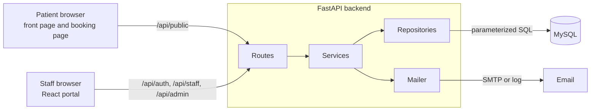

In development, the Vite dev server on port 5173 forwards every `/api` request to the backend on port 8000, so the browser never deals with CORS.

### 7.2 Backend layers

| Layer | Role | Location |
|---|---|---|
| Routes | Thin endpoints. Declare the feature with `require_feature(...)`, call one service method. | `backend/routes/` |
| Schemas | Pydantic request bodies. Every input is validated before it reaches a service. | `backend/schemas/` |
| Services | Business rules: conflicts, workflow, doctor scoping, transactions, audit, emails. | `backend/services/` |
| Repositories | The only place with SQL. Each extends `BaseRepository` (or works on any `Executor`). | `backend/repositories/` |
| Models | `User` and role subclasses, `AppointmentWorkflow`. | `backend/models/domain.py` |
| Core | Settings, database pool and transactions, exceptions, security, mailer, utilities. | `backend/core/` |

| Service | Responsibility |
|---|---|
| `AuthService` | Login, profile, avatar, password change |
| `BookingService` | Public catalog, open slots, booking calendar, booking requests |
| `SchedulingService` | Turns schedule blocks into open slots, honoring days off |
| `AppointmentService` | Approval and dismissal, walk-ins, check-in, exam start and finish, cancel, reschedule, rooms, days off, agenda calendar |
| `BillingService` | Invoices, payment, history, prescriptions |
| `PatientService` | Patient search, create, update, delete |
| `DashboardService` | Staff and admin dashboards and reports |
| `AdminService` | Users, schedules, rooms, settings, audit |
| `SiteService` | Website texts, logo, and hero picture |
| `DepartmentService`, `StaffDirectoryService` | Public lists. `DepartmentService` also manages departments and icons. |
| `DatabaseService`, `backup_parser` | Admin Database page: tables, SQL console, backup, import |
| `WaitingQueue` | The check-in priority queue (a data structure rather than a service) |

### 7.3 Frontend structure

| Folder | Contents |
|---|---|
| `api/` | `client.ts` (the only `fetch`, adds the token, `ApiError`, file download), `endpoints.ts`, `databaseApi.ts`, `departmentApi.ts`, `staffDirectoryApi.ts`, `siteApi` |
| `components/` | `Avatar`, `BrandingSettings`, `Badge`, `Modal`, `Alert`, `ExamPanel`, `EncounterCard`, `ScheduleEditor`, `WalkInModal`, `AgendaCalendar`, `BookingCalendar`, `DepartmentsModal`, `PasswordRequirements`, `StatCard`, `ProtectedRoute` |
| `config/` | `Navigation.ts`, `branding` |
| `context/AuthContext.tsx` | The signed-in user. The token is kept in `sessionStorage`. |
| `hooks/` | `usePolling`, `useSite`, `useStaffArt` |
| `layouts/DashboardLayout.tsx` | Side panel and page frame |
| `pages/` | `LandingPage`, `BookingPage`, `StaffLoginPage`, plus `staff/`, `admin/`, `shared/` |
| `types/` | Types matching the backend JSON |
| `utils/` | `format`, `csv`, `image`, `input` (character filters), `password` (strength rules), `preferences`, `staffArt` |

`ProtectedRoute` and hidden menu items are conveniences only. The backend enforces every role rule.

## 8. Roles and Permissions

Each role class lists the features it may open. Routes declare the feature they need, and the check is `User.can_access(feature)`.

| Feature | Doctor | Nurse | Admin |
|---|:---:|:---:|:---:|
| `dashboard`, `appointments`, `notifications`, `patients`, `history`, `invoice` | Yes | Yes | |
| `prescriptions` | Yes | | |
| `exam` (start, release, finish an examination) | Yes | | |
| `schedule` (mark and clear days off) | Yes | | |
| `admin_dashboard`, `users`, `rooms`, `settings`, `reports`, `audit`, `database` | | | Yes |

**Doctor scope.** Clinical data belongs to a doctor. A doctor works with their own data. A nurse works with the data of their assigned doctor. Administrators do not work with clinical records. `scope_doctor_id` returns the doctor or raises `PermissionDeniedError`, and services answer "not found" for anything outside it.

## 9. Appointment Workflow

### 9.1 From request to payment

1. A patient submits a request. It is stored in `notifications` as **Pending** and routed to the doctor and to the assigned nurse with the fewest pending requests.
2. Staff **approve** it (patient record created or reused, appointment created, patient emailed) or **disapprove** it with a reason (emailed).
3. On arrival, staff choose an exam room and **check the patient in**. Only today's appointments can be checked in. This sets `checked_in_at`, which orders the queue.
4. The doctor **starts the examination**. Only one exam per doctor can be in progress (a row lock closes the race). The invoice is created with the default fee.
5. The doctor **finishes the examination**: diagnosis, notes, prescription, and fee are saved, the invoice is totalled, the room is freed, and an optional follow-up is booked.
6. The doctor or nurse **marks the invoice paid**. The appointment becomes **Completed** and appears in History.

A doctor may also mark a date as a **day off** at any time, as long as no open appointment or pending request still wants that day.

### 9.2 Appointment status state machine

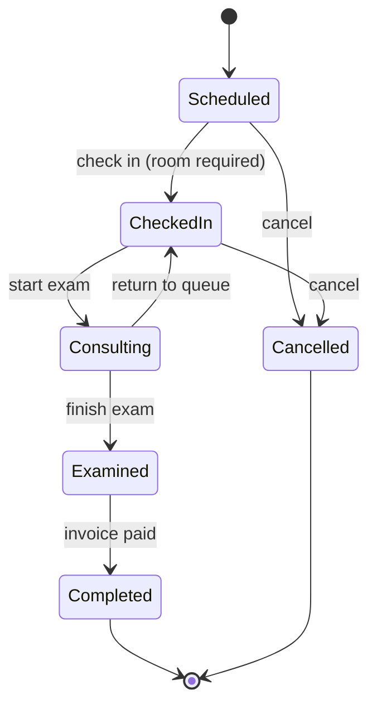

`CheckedIn` is `Checked-in` in the database. `AppointmentWorkflow.ensure(current, target)` raises `InvalidStatusError` for any other change.

### 9.3 Other status values

| Item | Values |
|---|---|
| Booking request | Pending, Converted (shown as "Approved"), Dismissed (shown as "Disapproved") |
| Invoice | Unpaid, Paid, Cancelled |
| Room | Available, Occupied, Maintenance |
| Appointment source | Notification, Walk-in, Follow-up |

## 10. Database Design

`schema.sql` creates all 15 tables. Sample data is in `seed.sql`. Details are in `DATABASE.md`.

### 10.1 Entity relationship diagram

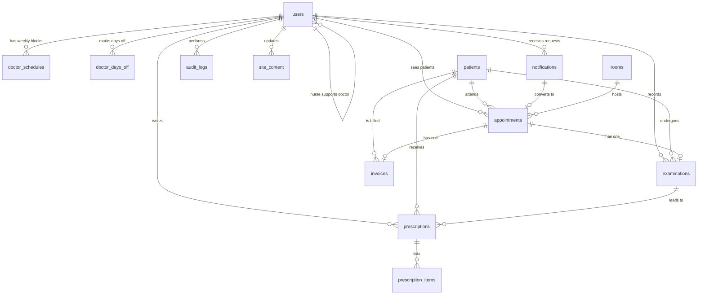

`clinic_settings`, `departments`, and `site_content` are standalone tables.

### 10.2 Tables

| Table | Purpose | Notable columns and rules |
|---|---|---|
| `users` | Clinic staff only | `role` enum, `password_hash` (bcrypt), `assigned_doctor_id` (nurses), `avatar`, public profile columns `bio`, `education`, `years_experience`, `languages`, `is_active` |
| `doctor_schedules` | Weekly working hours | ISO `weekday`, `start_time`, `end_time`, `slot_minutes`. `CHECK` end > start. Two rows on a day make a lunch break. |
| `doctor_days_off` | Single unavailable dates | `UNIQUE (doctor_id, off_date)`, optional private `reason` |
| `rooms` | Exam room board | Unique name, `status` enum |
| `notifications` | Booking requests | Requester details, `preferred_datetime`, `origin`, `status`, `decision_note` |
| `patients` | Clinical records | Indexed by name, `condition_summary`, `doctor_id` |
| `appointments` | Every booked visit | `status` enum, `checked_in_at`, `source`, generated `active_slot` with a unique index |
| `examinations` | The doctor's record | One per appointment, `outcome`, `follow_up_appointment_id` |
| `prescriptions`, `prescription_items` | Medicines | `quantity > 0`, `unit_price >= 0`, `ON DELETE CASCADE` |
| `invoices` | One per appointment | `amount = consultation_fee + medicines_total` (checked by `CHECK`), `status`, `paid_at`, `paid_by` |
| `clinic_settings` | Admin key/value settings | Six keys (name, address, fee, slot minutes, booking switch, booking window) |
| `audit_logs` | Append-only activity log | `user_id` (null for system actions), `action`, `entity`, `details` |
| `departments` | Front-page departments | `name`, `description`, `icon`, `is_featured`, `is_active`, `sort_order` |
| `site_content` | Website texts and pictures (key/value) | `content_key` PK, `content_value` MEDIUMTEXT; also holds department icons |

### 10.3 Double-booking guard

```sql
active_slot DATETIME GENERATED ALWAYS AS
    (CASE WHEN status = 'Cancelled' THEN NULL ELSE scheduled_time END) VIRTUAL,
UNIQUE KEY uq_doctor_active_slot (doctor_id, active_slot)
```

A doctor cannot have two non-cancelled appointments at the same time. A cancelled row has a `NULL` `active_slot`, and MySQL allows many `NULL` values in a unique index, so the slot can be booked again. Services check first for a friendly message, but the index stops two simultaneous requests from both succeeding. A duplicate-entry error becomes `AppointmentConflictError`.

### 10.4 Database access

The web app connects as `appointmed_user` with only `SELECT`, `INSERT`, `UPDATE`, and `DELETE`. It cannot change the table structure. Only `root` loads `schema.sql` and restores a backup.

## 11. API Reference

All endpoints are under `/api`. Errors look like `{"detail": "..."}`. Interactive docs: `http://127.0.0.1:8000/docs`.

### 11.1 Health

| Method | Path | Purpose |
|---|---|---|
| GET | `/api/health` | Backend is running |
| GET | `/api/health/db` | Backend can reach MySQL |

### 11.2 Authentication and profile (`/api/auth`)

| Method | Path | Purpose |
|---|---|---|
| POST | `/login` | Sign in and receive a token |
| GET, PUT | `/me` | Read or change own name, email, bio, education, years of experience, and languages |
| PUT, DELETE | `/me/avatar` | Upload or remove a profile picture |
| POST | `/change-password` | Change own password (strength rules apply) |

### 11.3 Public (`/api/public`, no login)

| Method | Path | Purpose |
|---|---|---|
| GET | `/catalog` | Clinic info, booking switch, booking window, bookable doctors |
| GET | `/departments` | Active departments with doctor counts |
| GET | `/staff` | Active staff: names, roles, specialization, weekdays |
| GET | `/staff/{id}` | One active staff profile |
| GET | `/staff/{id}/photo` | Staff photo |
| GET | `/site` | Website texts and image URLs |
| GET | `/site-image/{logo|hero}` | Uploaded site logo or hero image |
| GET | `/department-icon/{id}` | Department icon |
| GET | `/slots?doctor_id=&day=` | Open times for a doctor on a day |
| GET | `/calendar?doctor_id=&date_from=&date_to=` | Working weekdays, fully booked days, and days off (dates only) |
| POST | `/bookings` | Submit a request (rate-limited per visitor) |

### 11.4 Doctor and nurse (`/api/staff`)

| Method | Path | Feature | Purpose |
|---|---|---|---|
| GET | `/dashboard` | `dashboard` | Numbers, queue, exam room, upcoming |
| GET | `/notifications` | `notifications` | Booking requests by status |
| POST | `/notifications/{id}/approve`, `/dismiss` | `notifications` | Approve (time, room) or disapprove (reason) |
| GET, POST | `/appointments` | `appointments` | List by day and search, or create a walk-in |
| GET | `/calendar` | `appointments` | Working weekdays, busy days, and days off for the agenda calendar |
| POST | `/days-off` | `schedule` | Mark a day unavailable |
| DELETE | `/days-off/{day}` | `schedule` | Make a day available again |
| POST | `/appointments/{id}/check-in` | `appointments` | Add to the queue (room required) |
| POST | `/appointments/{id}/start`, `/release`, `/finish` | `exam` | Start, return to queue, finish |
| POST | `/appointments/{id}/cancel`, `/reschedule` | `appointments` | Cancel or move |
| PUT | `/appointments/{id}/room` | `appointments` | Choose or clear the room |
| POST | `/appointments/{id}/bill` | `invoice` | Invoice an examined, unbilled session |
| GET | `/rooms` | `appointments` | Rooms with the patient inside |
| PUT | `/rooms/{id}/status` | `appointments` | Change room status |
| GET, POST | `/patients` | `patients` | Search or add |
| PUT, DELETE | `/patients/{id}` | `patients` | Edit or delete |
| GET | `/patients/{id}/history` | `patients` | A patient's completed visits |
| GET | `/history` | `history` | Completed visits, search and dates |
| GET | `/invoices`, `/invoices/unbilled` | `invoice` | Invoices and unbilled sessions |
| POST | `/invoices/{id}/pay` | `invoice` | Mark paid and complete the visit |
| GET | `/prescriptions` | `prescriptions` | The doctor's prescriptions |

### 11.5 Administrator (`/api/admin`)

| Method | Path | Feature | Purpose |
|---|---|---|---|
| GET | `/dashboard` | `admin_dashboard` | Clinic totals and recent activity |
| GET, POST | `/users` | `users` | List or create users |
| PUT | `/users/{id}` | `users` | Edit a user |
| POST | `/users/{id}/active`, `/password` | `users` | Activate or deactivate, reset password |
| GET, PUT | `/users/{id}/schedule` | `users` | Read or replace a doctor's weekly schedule |
| GET | `/doctors` | `users` | Active doctors |
| GET, POST | `/rooms` | `rooms` | List or add rooms |
| PUT, DELETE | `/rooms/{id}` | `rooms` | Edit or delete a room |
| GET, PUT | `/settings` | `settings` | Read or save clinic settings |
| PUT | `/site` | `settings` | Save front-page texts and links |
| PUT, DELETE | `/site/image/{logo|hero}` | `settings` | Upload or reset the logo or hero |
| GET, POST | `/departments` | `settings` | List (including hidden) or add departments |
| PUT, DELETE | `/departments/{id}` | `settings` | Edit or delete (refused while doctors use it) |
| PUT, DELETE | `/departments/{id}/icon` | `settings` | Upload or remove a department icon |
| GET | `/reports` | `reports` | Summaries for a date range (up to one year) |
| GET | `/audit` | `audit` | A page of audit entries |
| GET | `/database/tables`, `/database/tables/{table}` | `database` | Table list and a page of rows |
| POST | `/database/tables/{table}/rows` | `database` | Insert a row |
| PUT, DELETE | `/database/tables/{table}/rows/{key}` | `database` | Edit or delete a row |
| POST | `/database/query` | `database` | Run one SQL statement |
| GET | `/database/backup` | `database` | Download a `.sql` backup |
| POST | `/database/import` | `database` | Replace data with a backup file |

### 11.6 Status codes

| Code | Meaning |
|---|---|
| 200, 201 | OK, created |
| 400, 422 | Invalid input or a broken business rule |
| 401 | Not signed in, or the session ended |
| 403 | Signed in but not allowed |
| 404 | Not found (or outside the doctor scope) |
| 409 | Conflict (double booking, invalid status change) |
| 429 | Too many attempts |
| 503 | Database unavailable |

## 12. Object-Oriented Design

| Concept | Where it lives |
|---|---|
| **Classes and objects** | `User`, `Doctor`, `Nurse`, `Admin`, `AppointmentWorkflow`, `Settings`, `Database`, `Transaction`, `AdminSession`, `Mailer`, `RateLimiter`, `WaitingQueue`, every repository and service |
| **Constructors** | `User.__init__` rejects a missing username or name. Repositories receive an `Executor`. Services receive a `Database` and `Mailer`. |
| **Factory methods** | `User.from_row`, `Settings.from_env` |
| **Encapsulation** | `Settings` (frozen dataclass), `Database` (hides pool, lock, error translation), `User` (private fields behind properties), `RateLimiter` (private store and lock) |
| **Abstraction** | `Executor` (abstract way to run SQL), `BaseRepository` (abstract `table` and `columns`), `User.scope_doctor_id` |
| **Inheritance** | Roles extend `User`. Repositories extend `BaseRepository`. Errors extend `AppError`. `DuplicateEntryError`, `AppointmentConflictError`, `InvalidStatusError` extend `ConflictError`. |
| **Polymorphism** | Each role answers `scope_doctor_id` differently. `Database`, `Transaction`, and `AdminSession` are interchangeable `Executor`s. |
| **Custom exceptions** | The `AppError` family (Section 18) |
| **Method overloading** | Python has none. `AppointmentRepository.list_for_doctor` accepts a `str` or a `date` for the day filter, and optional arguments give the same effect. |
| **Interfaces and abstract classes** | `Executor`, `BaseRepository`, `User` (all `ABC`) |

## 13. UML Class Diagrams

The diagrams are written in Mermaid. Export them to images in `source/documentation/diagrams/` if the course requires picture files.

### 13.1 Users and the appointment workflow

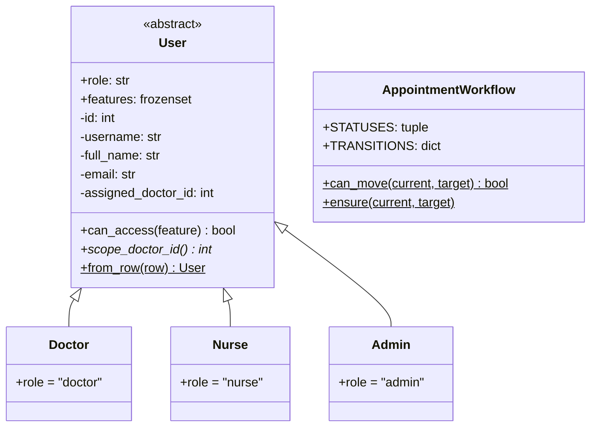

### 13.2 Data access

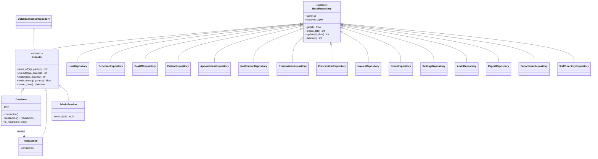

### 13.3 Exceptions

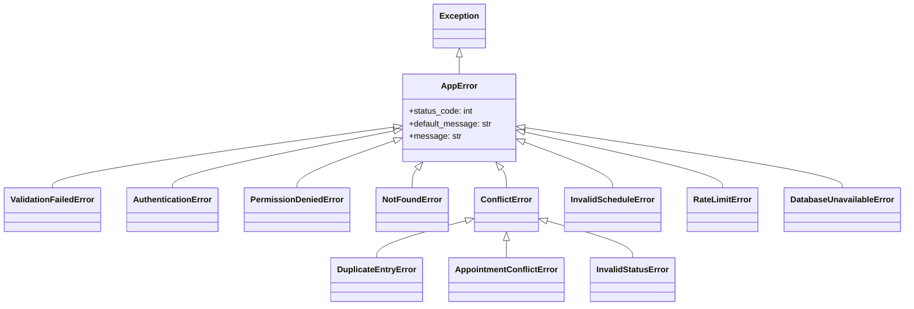

### 13.4 Services and helpers

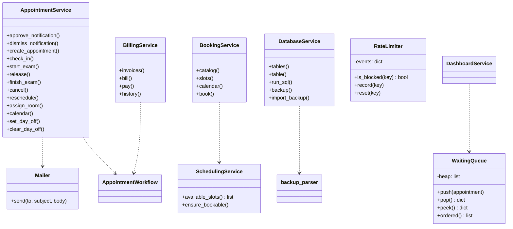

## 14. Flowcharts

### 14.1 A patient books an appointment online

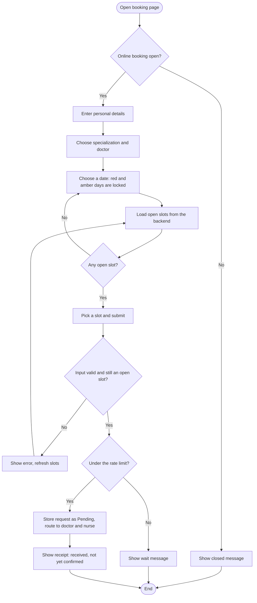

### 14.2 Staff review a request and check the patient in

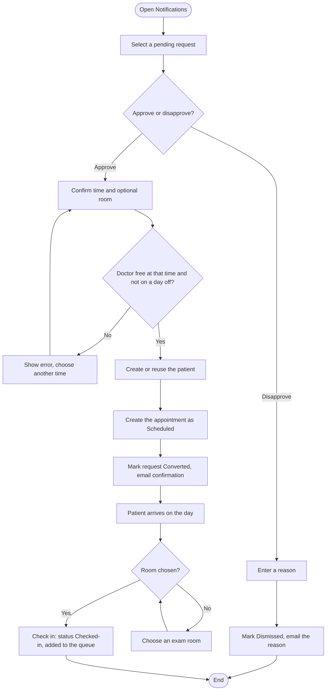

### 14.3 Doctor examines the patient and the invoice is paid

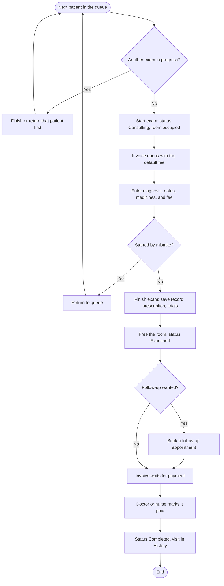

### 14.4 A doctor marks a day off

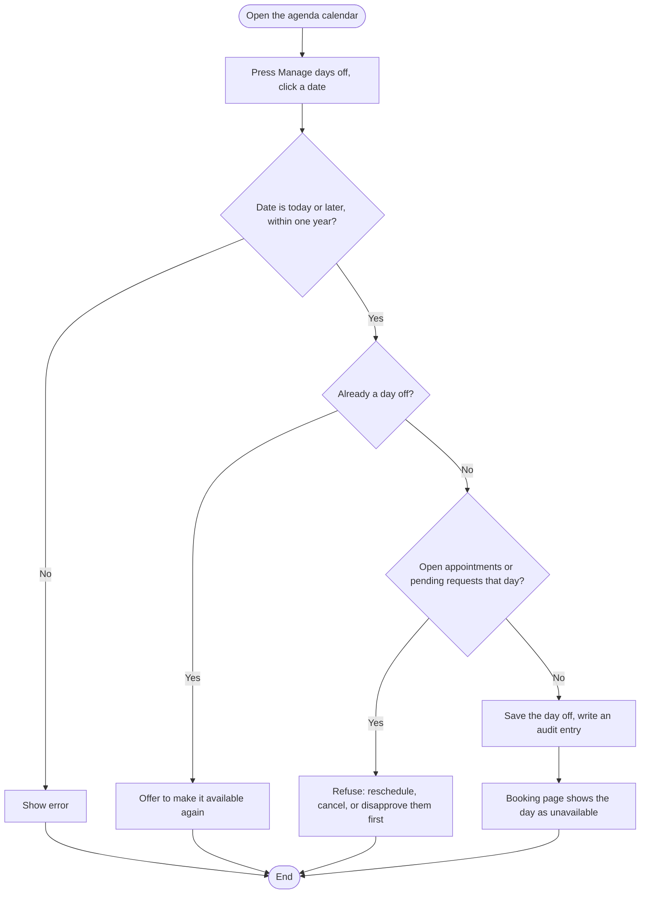

## 15. Data Structures and Algorithms

Full explanations with code and complexity are in [NOTES.md](NOTES.md).

| Item | Where | Notes |
|---|---|---|
| **Min-heap priority queue** | `services/waiting_queue.py` | `WaitingQueue` orders checked-in patients by `(checked_in_at, id)`. Insert and remove are O(log n). Patients with no check-in time sort last. |
| **Sliding-window rate limiter** | `core/security.py` | A `deque` of event times per key. Old events leave from the left. Logins: 5 per username per 5 minutes. Bookings: 6 per IP per 10 minutes. |
| **State machine** | `models/domain.py` | `TRANSITIONS` maps each status to a set of allowed next statuses. The check is a constant-time lookup. |
| **Slot generation** | `services/scheduling_service.py` | Step through each schedule block by `slot_minutes`. Keep a slot if it is in the future and not in the `taken` set (O(1) lookups). Days off return no slots. |
| **Hash-based grouping** | `clinical_repository.py`, `user_repository.py`, `staff_directory_repository.py` | `defaultdict(list)` groups medicine lines by appointment and weekdays by doctor, avoiding one query per row. |
| **Set operations** | `AppointmentRepository.booked_times`, `booked_days`, `pending_days` | `UNION` results and day lists become Python sets. The agenda calendar merges busy days with a set union. |
| **Schedule validation** | `AdminService.replace_schedule` | Sort blocks by `(weekday, start_time)`, then compare neighbors to find overlaps in one pass. |
| **Parsing** | `services/backup_parser.py` | A regular-expression tokenizer splits a backup into statements, then values, in a single pass. Nothing is executed as SQL. |
| **Searching and paging** | Repositories | `LIKE` searches, `ORDER BY` on indexed columns, `LIMIT` and `OFFSET` in the audit log and the Database page |

## 16. Information Management

| Concept | Where it shows up |
|---|---|
| **Normalization** | Each fact is stored once: staff in `users`, medicine lines in `prescription_items`, settings as key/value rows |
| **Keys** | Primary keys on every table. Foreign keys between users, patients, appointments, examinations, prescriptions, invoices, rooms, and logs. Unique keys on `username`, `room_name`, one examination per appointment, one invoice per appointment, one day off per doctor and date. |
| **Constraints** | `CHECK` for weekday range, schedule times, quantity, price, and invoice amounts (`amount = fee + medicines`). `ENUM` for roles and statuses. `NOT NULL` where required. |
| **Indexes** | Role, assigned doctor, patient name, appointment time, doctor and status, notification status, invoice status, audit time and user |
| **Integrity beyond SQL** | Role rules on foreign-key targets are enforced in the services |
| **Double-booking guard** | Generated `active_slot` plus a unique index (Section 10.3) |
| **Transactions and locks** | `Database.transaction()` makes multi-step changes all-or-nothing. `SELECT ... FOR UPDATE` on the doctor row serializes exam starts, days off, and bookings. |
| **Parameterized queries** | Every value is a parameter. Identifiers for generic queries come from a whitelist or are checked against `information_schema`. |
| **Aggregates** | `ReportRepository`: `GROUP BY`, `SUM`, `COUNT`, `COALESCE`, joins |
| **Audit trail** | `audit_logs`: rows are only ever added by the app |
| **Backup and restore** | `DatabaseAdminRepository.dump()` writes structure and data. Import parses the file and reloads the rows in one transaction. |
| **Key/value content** | `site_content` and `clinic_settings` allow new editable fields without a schema change. |
| **Referential safety** | Users are deactivated, not deleted. Patients and rooms with history cannot be deleted. |
| **Money** | `Decimal` in Python, `DECIMAL(10,2)` in MySQL |
| **Server clock** | `Executor.server_now()` reads `NOW()` from MySQL |

## 17. Security

The full policy and known gaps are in `SECURITY.md`. Summary:

- **Passwords:** salted bcrypt. New passwords: 8 to 72 bytes, with upper and lower case, a number, and a special character. Changing a password needs the current one. A dummy hash is checked for unknown usernames so timing does not reveal which usernames exist.
- **Tokens:** signed JWT (HS256), expiring after `JWT_EXPIRE_MINUTES`. The key comes from `JWT_SECRET`, and the backend refuses to start without it.
- **Fresh user on every request:** the role comes from the database, so deactivation and role changes apply at once.
- **Server-side role checks and doctor scope:** every protected route uses `require_feature(...)`.
- **Server-side input validation:** Pydantic allowlists, length limits, control-character rejection, and business rules in services.
- **Rate limiting:** logins and public bookings.
- **Public endpoints:** include bio, education, years of experience, languages, profile photos, and department icons, as well as clinic info, doctor and staff names, roles, specializations, weekdays, open times, and unavailable dates. They never return clinical data.
- **Database:** parameterized SQL, a least-privilege account, and generic error messages. Admin-only Database page: `password_hash` and `avatar` columns are never sent to the browser, the audit log is append-only, and every change is audited without the values.
- **Uploads:** PNG, JPEG, or WebP (checked by file signature): profile 300 KB, logo 300 KB, hero 1.5 MB, department icon 150 KB.
- **Data:** only fictional sample data. Sample passwords are public.

## 18. Exception Handling and Validation

### 18.1 Validation

Every request body is validated by Pydantic before it reaches a service: lengths, formats, character allowlists (letters only in names), ranges (quantity, price, slot minutes, weekdays), no time zones in times, and rules such as "birthdate cannot be in the future". The frontend filters characters while typing and repeats the checks, but the backend is the authority.

### 18.2 Custom exceptions

| Exception | Status | Raised when |
|---|---|---|
| `AppError` | 400 | Base class for every expected error |
| `ValidationFailedError` | 400 | Input is well-formed but breaks a business rule |
| `AuthenticationError` | 401 | Not signed in, wrong credentials, or deactivated account |
| `PermissionDeniedError` | 403 | The role may not do this (or has no assigned doctor) |
| `NotFoundError` | 404 | A record does not exist or is outside the user's scope |
| `ConflictError` | 409 | The change clashes with current data |
| `DuplicateEntryError` | 409 | A unique value already exists |
| `AppointmentConflictError` | 409 | The doctor already has an appointment at that time |
| `InvalidStatusError` | 409 | The status change is not allowed |
| `InvalidScheduleError` | 400 | The time is outside the schedule, on a day off, past, or outside the window |
| `RateLimitError` | 429 | Too many attempts |
| `DatabaseUnavailableError` | 503 | MySQL could not be reached or failed |

### 18.3 How errors reach the user

`register_exception_handlers` turns every `AppError` into `{"detail": "<plain message>"}` with the right status. Pydantic errors become one readable sentence with status 422. Unexpected errors are logged and return a plain "Something went wrong" message. The frontend's `ApiError` carries the message into an alert. Driver errors are translated so SQL text is never leaked (only the admin Database page shows MySQL's own message to an administrator).

## 19. Screenshots of the Application

*To be added.* Save screenshots in `source/documentation/screenshots/` using fictional data only. Suggested list:

1. Landing page (hero, staff cards, departments, departments popup).
2. Public booking page with the calendar (red and amber days) and open times.
3. Staff login.
4. Nurse dashboard.
5. Notifications (pending request, approve form, conflict warning).
6. Appointments page (queue, exam room, agenda calendar, rooms, day-off banner).
7. Doctor examination form with the live invoice.
8. Invoice page.
9. Patient record with visit history.
10. History and Prescriptions.
11. Admin users and the schedule editor.
12. Admin rooms and clinic settings.
13. Admin reports and audit log.
14. Admin Database page (tables, SQL console, backup and import).
15. Profile and settings (password checklist).

## 20. Testing Results

There are no automated tests yet. Test by hand using the sample logins in `CONTRIBUTING.md`, and fill in **Actual result** and **Status** as you run each case.

| ID | Feature | Test case | Expected result | Actual result | Status |
|---|---|---|---|---|---|
| T-01 | Health check | Open `http://127.0.0.1:8000` with backend and MySQL running | API: Online and Database: Connected | | |
| T-02 | Health check | Stop MySQL and reload the status page | Database: Not connected, no error details | | |
| T-03 | Login | Sign in as `nurse.dora` with the right password | Lands on the nurse dashboard | | |
| T-04 | Login | Sign in with a wrong password | "Incorrect username or password." | | |
| T-05 | Login | Fail five times for one username within 5 minutes | "Too many failed attempts." | | |
| T-06 | Login | Sign in as a deactivated user | "This account is deactivated." | | |
| T-07 | Access control | As a nurse, open `/doctor/dashboard` by URL | Redirected to `/nurse` | | |
| T-08 | Access control | As a nurse, call `POST /api/staff/appointments/{id}/start` in `/docs` | 403 | | |
| T-09 | Doctor scope | As `dr.cheeks`, request an appointment of `dr.tentacles` | 404 "Appointment not found." | | |
| T-10 | Booking | Submit a valid request on an open slot | Receipt shown, request appears as Pending | | |
| T-11 | Booking | Submit with empty name, bad email, bad phone | Field errors, nothing sent | | |
| T-12 | Booking | Pick a date when the doctor does not work | Date is red and cannot be chosen | | |
| T-13 | Booking | Switch online booking off, then open `/book` | "Online booking is currently closed." | | |
| T-14 | Booking | Send 7 requests from one address within 10 minutes | The seventh is refused | | |
| T-15 | Approval | Approve a pending request | Appointment created, request Approved, email logged or sent | | |
| T-16 | Approval | Approve a request whose time was just booked | Warning shown, then 409 if confirmed | | |
| T-17 | Approval | Disapprove with a 2-character reason | Blocked: at least 3 characters | | |
| T-18 | Double booking | Create two walk-ins for one doctor at the same minute | Second fails: "That time is already booked for this doctor." | | |
| T-19 | Double booking | Cancel an appointment, then book its time again | Booking succeeds | | |
| T-20 | Check-in | Check in an appointment dated tomorrow | Button disabled, server also refuses | | |
| T-21 | Check-in | Check in an appointment with no room | "Choose an exam room before checking the patient in." | | |
| T-22 | Queue | Check in three patients in order | Positions 1, 2, 3 match the check-in order | | |
| T-23 | Exam | Start a second exam while one is in progress | "Finish the examination that is already in progress first." | | |
| T-24 | Exam | Start an exam in an Occupied room | Refused with the room's status | | |
| T-25 | Exam | Finish with medicines and a follow-up | Totals correct, room freed, Examined, follow-up created | | |
| T-26 | Exam | Finish with a follow-up in the past | "The follow-up must be in the future." | | |
| T-27 | Invoice | Pay an invoice before the exam is finished | Refused | | |
| T-28 | Invoice | Mark an Examined invoice as paid | Paid, appointment Completed, visit in History | | |
| T-29 | Invoice | Create an invoice for an Examined session with none | Invoice created from the default fee plus medicines | | |
| T-30 | Cancel | Cancel a Checked-in appointment with an unpaid invoice | Appointment and invoice Cancelled | | |
| T-31 | Reschedule | Reschedule to a past time | "Choose a time in the future." | | |
| T-32 | Patients | Add a patient with an existing name and birthdate | "A patient with this name and birthdate already exists." | | |
| T-33 | Patients | Delete a patient who has appointments | Refused | | |
| T-34 | Users | Create a nurse with no assigned doctor | "Choose the doctor this nurse supports." | | |
| T-35 | Users | Create a user with a taken username | "That username is already taken." | | |
| T-36 | Users | As admin, deactivate your own account | Refused | | |
| T-37 | Schedule | Save two overlapping blocks on one day | "Schedule blocks on the same day cannot overlap." | | |
| T-38 | Rooms | Delete a room used in an appointment | Refused, advice to set it to Maintenance | | |
| T-39 | Settings | Save a slot length of 3 | Validation message (5 to 120) | | |
| T-40 | Reports | Request a range longer than one year | "Choose a range of one year or less." | | |
| T-41 | Audit | Perform an action, then open Audit Logs | A matching entry with the acting user | | |
| T-42 | Profile | Upload a PNG, then a `.txt` renamed to `.png` | PNG works, the fake image is rejected | | |
| T-43 | Password | Set a new password `password1` | "The password needs an uppercase letter, a special character." | | |
| T-44 | Password | Change password to the same value as the current one | "Choose a password that is different..." | | |
| T-45 | Error handling | Turn the backend off and use any page | "Cannot reach the server. Check that the backend is running." | | |
| T-46 | Build | `npm run build` in `source/frontend` | No TypeScript errors | | |
| T-47 | Database | Reset, then load `schema.sql`, `seed.sql` | 15 tables, 10 users, 9 departments | | |
| T-48 | Day off | As a doctor, mark a free future date unavailable | Saved. The date turns red on `/book`. | | |
| T-49 | Day off | Mark a day that has an open appointment | Refused with the counts of open appointments and requests | | |
| T-50 | Day off | Approve a request, or reschedule, onto a day off | "The doctor is not available on that day." | | |
| T-51 | Day off | As a nurse, call `POST /api/staff/days-off` | 403 | | |
| T-52 | Input | Send a name with digits through `/docs` | 422 "A name cannot contain the character '1'." | | |
| T-53 | Database page | Download a backup, open it | Header line, `DROP TABLE`, `CREATE TABLE`, and `INSERT` statements. Password hashes present. | | |
| T-54 | Database page | Import a file that is not a backup | "This is not an AppointMed backup." | | |
| T-55 | Database page | In the SQL console, run `DELETE FROM rooms` | "UPDATE and DELETE need a WHERE clause" | | |
| T-56 | Database page | Run a statement that mentions `audit_logs` to change it | "The audit log is append-only and cannot be changed." | | |
| T-57 | Database page | As a nurse, call `GET /api/admin/database/tables` | 403 | | |
| T-58 | Landing page | Deactivate a doctor, reload `/` | That person disappears from Meet Our Staff | | |
| T-59 | Branding | As admin, upload a logo and a text change | Landing page, side panel, and footer update | | |
| T-60 | Branding | As a nurse, call `PUT /api/admin/site` | 403 | | |
| T-61 | Branding | Upload a 3 MB hero picture | "The image is too large." | | |
| T-62 | Departments | Delete a department that has doctors | 409 with the doctor count | | |
| T-63 | Departments | Rename a department with doctors | Doctors' specialization follows the new name | | |
| T-64 | Users | Create a doctor with a specialization not in departments | "The specialization must be one of the departments..." | | |
| T-65 | Staff profile | Open `/staff/{id}` for a deactivated user | 404 "Staff member not found." | | |
| T-66 | Profile | Save years of experience as 99 | 422 (at most 70) | | |
| T-67 | Settings | Choose Dark theme and reload | Theme persists | | |

## 21. Conclusion

*To be written by the team after testing and the final demonstration.* Suggested points:

1. What the system achieved against each objective in Section 3.
2. Which object-oriented, data-structure, and information-management ideas proved most useful, and where.
3. Challenges met (preventing double booking under simultaneous requests, keeping role rules and validation on the server, safe backup and restore).
4. Lessons learned from working as a team.
5. Future work: automated tests, appointment reminders, a patient portal, a pharmacy module, tighter limits on the SQL console, and the hardening steps in `SECURITY.md`.

## 22. References

- FastAPI documentation. https://fastapi.tiangolo.com
- React documentation. https://react.dev
- Vite documentation. https://vite.dev
- Tailwind CSS documentation. https://tailwindcss.com/docs
- React Router documentation. https://reactrouter.com
- Pydantic documentation. https://docs.pydantic.dev
- MySQL Reference Manual. https://dev.mysql.com/doc/
- Python `heapq` module. https://docs.python.org/3/library/heapq.html
- PyJWT documentation. https://pyjwt.readthedocs.io
- bcrypt for Python. https://pypi.org/project/bcrypt/
- Republic Act 10173, Data Privacy Act of 2012 (Philippines). https://www.privacy.gov.ph/data-privacy-act/
- Contributor Covenant, version 2.1. https://www.contributor-covenant.org

*Add the related studies and systems from Section 5 here.*

---

*Last Updated: November 2026*