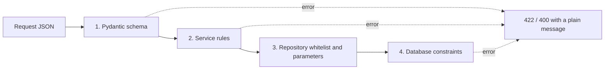

# NOTES | AppointMed

Study notes for the final presentation. Each section is short, shows the real code from the project, and explains it in plain words. Where a file is named, you can open it and point to the line.

**Contents**

1. [Three Data Structures Used](#1-three-data-structures-used)
2. [Time and Space Complexity](#2-time-and-space-complexity)
3. [Sample OOP Concepts](#3-sample-oop-concepts)
4. [Validate Input on the Server](#4-validate-input-on-the-server)
5. [Hashing Passwords](#5-hashing-passwords)
6. [Protect Credentials](#6-protect-credentials)
7. [Respect Data Privacy](#7-respect-data-privacy)

---

## 1. Three Data Structures Used

| # | Structure | Where | Problem it solves |
|---|---|---|---|
| 1 | **Min-heap (priority queue)** | `services/waiting_queue.py` | Serve checked-in patients in the order they arrived |
| 2 | **Deque (double-ended queue) as a sliding window** | `core/security.py` (`RateLimiter`) | Count recent login or booking attempts per user or IP |
| 3 | **Hash set and hash map (set, dict)** | `scheduling_service.py`, `appointment_repository.py`, `models/domain.py`, `clinical_repository.py` | Fast "is this time taken?", grouping rows, and allowed status changes |

### 1.1 Min-heap: the waiting queue

A **min-heap** keeps the smallest item at the top. Here the "smallest" is the patient who checked in earliest, so the next patient to be examined is always at the top.

```python6
class WaitingQueue:
    def __init__(self) -> None:
        self._heap: list[tuple[datetime, int, dict[str, Any]]] = []

    def push(self, appointment):
        heapq.heappush(self._heap, (appointment.get("checked_in_at") or datetime.max, appointment["id"], appointment))

    def pop(self):
        return heapq.heappop(self._heap)[2]
```

How it works:

- Each entry is a tuple `(checked_in_at, id, appointment)`. Python compares tuples left to right, so the earliest time wins, and the `id` breaks a tie.
- An appointment with no check-in time gets `datetime.max`, so it sorts last.
- `ordered()` pops everyone one by one and writes a `queue_position` (1, 2, 3, ...). The dashboard uses this to show the numbered queue.

Why a heap and not a sorted list: inserting into a sorted list means re-sorting or shifting items. A heap inserts and removes in O(log n) and always knows who is next.

### 1.2 Deque: the sliding-window rate limiter

A **deque** adds and removes from both ends in O(1). The limiter keeps one deque of timestamps per key (a username for logins, an IP address for bookings).

```python
def _prune(self, key, now):
    events = self._events[key]
    while events and now - events[0] > self._window:
        events.popleft()          # forget attempts older than the window
    return events

def is_blocked(self, key):
    with self._lock:
        return len(self._prune(key, time.monotonic())) >= self._max
```

How it works:

- `record(key)` appends the current time on the right.
- Before every check, old attempts are removed from the left. What remains is "attempts inside the last N seconds".
- Logins: 5 failures per username per 300 seconds. Bookings: 6 successes per IP per 600 seconds.
- `time.monotonic()` is used so a clock change cannot reset the window, and a `threading.Lock` keeps it safe when requests arrive together.

### 1.3 Hash set and hash map: slots, grouping, and the status table

A **set** answers "is this item in here?" in O(1) on average. A **dict** (hash map) finds a value by key in O(1).

```python
taken = self._appointments.booked_times(doctor_id, day)        # a set of datetimes
...
if cursor > now and cursor not in taken:                         # O(1) lookup
    slots.append(cursor)
```

```python
TRANSITIONS = {
    "Scheduled":  frozenset({"Checked-in", "Cancelled"}),
    "Checked-in": frozenset({"Consulting", "Cancelled"}),
    "Consulting": frozenset({"Examined", "Checked-in"}),
    "Examined":   frozenset({"Completed"}),
    "Completed":  frozenset(),
    "Cancelled":  frozenset(),
}
def can_move(cls, current, target):
    return target in cls.TRANSITIONS.get(current, frozenset())
```

```python
grouped: dict[int, list[Row]] = defaultdict(list)               # group medicine lines by appointment
for row in rows:
    grouped[row["appointment_id"]].append(row)
```

How it works:

- **Open slots:** the times already taken (appointments plus pending requests) go into a set once, so each candidate slot is checked in constant time.
- **Status workflow:** the dictionary maps each status to a set of statuses it may become. Checking a change is one lookup. This is a small **state machine**.
- **Grouping:** `defaultdict(list)` collects all medicine lines for each appointment in a single query instead of one query per appointment.

**Also used (smaller):** sorted lists (schedule blocks sorted by weekday and start time so overlaps are found by comparing neighbors), and a regular-expression tokenizer that reads a backup file in one pass.

---

## 2. Time and Space Complexity

Symbols: **n** = number of items in the structure, **k** = number of different keys, **m** = events kept per key, **s** = slots in one day, **t** = taken times, **b** = schedule blocks, **L** = length of a file.

### 2.1 Summary

| Operation | Time | Space | Explanation |
|---|---|---|---|
| `WaitingQueue.push` | O(log n) | O(1) extra | The new item moves up the heap at most log n levels |
| `WaitingQueue.pop` | O(log n) | O(1) | The last item moves down at most log n levels |
| `WaitingQueue.peek` | O(1) | O(1) | The smallest item is always at index 0 |
| `WaitingQueue.ordered` | O(n log n) | O(n) | n pops of O(log n) each (this is heap sort) |
| Build the dashboard queue | O(n log n) | O(n) | n pushes, then `ordered()` |
| `RateLimiter.is_blocked`, `record` | O(1) amortized | O(k × m) total | Each timestamp is added once and removed once, so pruning costs O(1) on average |
| `RateLimiter.reset` | O(1) | frees one key | A dict removal |
| Generate open slots for a day | O(t + s) | O(s + t) | Build the taken set in O(t), then walk s slots with O(1) lookups. Blocks come sorted from SQL, so the final sort is near O(s). |
| `ensure_bookable` | O(s) | O(s) | It generates the slots, then checks membership in a **list** |
| Status change check (`can_move`) | O(1) | O(1) | One dict lookup and one set lookup |
| Schedule overlap check | O(b log b) | O(b) | Sort the blocks, then one pass over neighbors (b is at most 70) |
| Group medicine lines | O(n) | O(n) | One pass with a `defaultdict` |
| Staff weekdays per doctor | O(r) | O(r) | r = schedule rows, one pass (a list of at most 7 days per doctor) |
| Patient or user search (`LIKE '%term%'`) | O(n) | O(result) | A leading wildcard cannot use an index, so MySQL scans the table |
| Lookup by primary key or unique key | O(log n) | O(1) | MySQL B-tree index |
| Double-booking check (unique index) | O(log n) | O(1) | One index probe per insert |
| Paged list (`LIMIT` and `OFFSET`) | O(offset + limit) | O(limit) | MySQL skips the offset rows first |
| Backup export (`dump`) | O(N) | O(N) | N = total rows, all rows are read and written as text |
| Backup import | O(L + N) | O(L) | The tokenizer reads the text once, rows go in 100 at a time |
| bcrypt hash or verify | O(2^cost) | O(1) | Slow **on purpose** (cost 12 is about 4096 rounds) |
| JWT sign or verify | O(size of token) | O(1) | One HMAC |

### 2.2 Why these numbers matter

- **Queue:** a clinic queue is small, but the heap shows the right idea. Doing n inserts into a sorted list would cost O(n²) in the worst case. A heap costs O(n log n).
- **Rate limiter:** the space is bounded. A login key never holds more than 5 events and a booking key never more than 6 (a blocked key records nothing new). The one weakness is that a key with no recent events stays in the dictionary until restart, so distinct usernames or IPs slowly use memory.
- **Slots:** looking up `cursor not in taken` in a **list** would cost O(t) each time and O(s × t) for the day. Using a set makes it O(s + t).
- **Public calendar:** the booking calendar asks for slots day by day (up to 62 days), so it costs about 62 × O(s + queries). It works for one clinic, but batching the queries would be faster.
- **Search:** `LIKE '%term%'` is O(n). That is fine for a clinic's patient list. At millions of rows, use a full-text index.
- **Date filters:** `DATE(scheduled_time) = %s` cannot use the time index. Writing it as a range (`>= day AND < day + 1`) would allow an index scan.
- **bcrypt:** being slow is the feature. If one guess costs about a quarter of a second, an attacker with a stolen database can test only a few guesses per second per core.

---

## 3. Sample OOP Concepts

The backend is Python, and the classes below are the ones to show in the presentation.

### 3.1 Encapsulation

Hide the inside of an object and give controlled access.

```python
class User(ABC):
    def __init__(self, user_id, username, full_name, ...):
        if not username or not full_name:
            raise ValidationFailedError("A user needs a username and a full name.")
        self._id = user_id                # private by convention: underscore
        self._username = username

    @property
    def id(self) -> int:                  # read-only: there is no setter
        return self._id
```

- Fields start with `_`, and outside code reads them through read-only `@property` methods. Nobody can change a user's id by accident.
- `Settings` is a **frozen dataclass**: once the environment is read, no field can change.
- `Database` hides the pool, the lock, the retry, and the error translation. Callers only see `fetch_all`, `execute`, `update`, and `transaction()`.

### 3.2 Abstraction

Show what something does, not how.

```python
class Executor(ABC):
    @abstractmethod
    def fetch_all(self, sql, params=()) -> list[Row]: ...
    @abstractmethod
    def execute(self, sql, params=()) -> int: ...
    @abstractmethod
    def update(self, sql, params=()) -> int: ...
```

- A repository only knows "something that can run SQL". It does not know about connection pools or transactions.
- `BaseRepository` is also abstract: each child must define `table` and `columns`.
- `User.scope_doctor_id` is an **abstract property**: every role must answer it.

### 3.3 Inheritance

A child class reuses and extends a parent.

```python
class Doctor(User):
    role = "doctor"
    features = frozenset(_CLINICAL | {"prescriptions", "exam", "schedule"})

class Nurse(User):
    role = "nurse"
    features = frozenset(_CLINICAL)
```

- `Doctor`, `Nurse`, and `Admin` extend `User`. Every repository extends `BaseRepository`.
- All business errors extend `AppError`, and `DuplicateEntryError`, `AppointmentConflictError`, and `InvalidStatusError` extend `ConflictError`, so one `except ConflictError` can catch them all.

### 3.4 Polymorphism

The same call behaves differently for different objects.

```python
class Doctor(User):
    @property
    def scope_doctor_id(self): return self.id                       # their own data

class Nurse(User):
    @property
    def scope_doctor_id(self):
        if self.assigned_doctor_id is None:
            raise PermissionDeniedError("No doctor is assigned to your account.")
        return self.assigned_doctor_id                              # their doctor's data

class Admin(User):
    @property
    def scope_doctor_id(self):
        raise PermissionDeniedError("Administrators do not work with clinical records.")
```

- A service writes `user.scope_doctor_id` once and never checks the role with `if`.
- `Database`, `Transaction`, and `AdminSession` are all `Executor`s. A repository works the same in each, whether it runs one statement or several inside a transaction.

### 3.5 Constructors and factory methods

```python
@classmethod
def from_row(cls, row):
    role_class = _ROLE_CLASSES.get(row["role"])       # {"doctor": Doctor, "nurse": Nurse, "admin": Admin}
    if role_class is None:
        raise ValidationFailedError("Unknown user role.")
    return role_class(row["id"], row["username"], row["full_name"], ...)
```

- The constructor checks that required values exist. The **factory** `User.from_row` chooses the right subclass from a database row. `Settings.from_env` is another factory.

### 3.6 Custom exceptions

```python
class AppError(Exception):
    status_code = 400
    default_message = "The request could not be completed."

class AppointmentConflictError(ConflictError):
    default_message = "That time is already booked for this doctor."
```

- Each error carries its own HTTP status and a safe message. One handler turns any `AppError` into `{"detail": "..."}`, so routes stay short.

### 3.7 Composition and dependency injection

```python
class AppointmentService:
    def __init__(self, db: Database = database, mail: Mailer = mailer) -> None:
        self._db = db
        self._mail = mail
```

- A service receives its tools through the constructor. A test can pass a fake `Database` or `Mailer` without changing the service.

### 3.7a Method overloading note

Python does not have method overloading. We get the same effect with flexible parameters. `AppointmentRepository.list_for_doctor(when)` accepts the strings `"today"`, `"upcoming"`, `"all"` or a `date`, and `consulting(doctor_id, exclude_id=None)` has an optional argument. Say this in the presentation.

---

## 4. Validate Input on the Server

**Rule: never trust the browser.** The React forms filter characters and show friendly messages, but anyone can call the API directly. So every rule is enforced again on the server, in layers.



### 4.1 Layer 1: Pydantic schemas (`schemas/api.py`)

A request body that breaks a rule never reaches a service.

```python
class BookingRequest(Schema):
    full_name: str = Field(min_length=2, max_length=100)
    birthdate: date
    sex: BookingSex                                   # only "Male" or "Female"
    contact_number: str = Field(max_length=20)
    email: str = Field(max_length=100, pattern=EMAIL_PATTERN)
    ...

    @field_validator("full_name")
    @classmethod
    def name_ok(cls, value): return _person_name(value)    # letters only, 2+ letters
```

| Rule | Example |
|---|---|
| Types | `date`, `datetime`, `int`, `Decimal`, `Literal["Male", "Female"]` |
| Length | Name 2 to 100, reason 3 to 255, password 8 to 72 |
| Character allowlist | `_person_name`: letters, marks, and `' ’ . , ( ) -` only. `_restrict` rejects any other character. |
| No control characters | `_no_control` rejects newlines and invisible characters in one-line fields |
| Phone | `_phone`: 7 to 15 digits, with `+ - ( )` and spaces |
| Dates | `_birthdate`: not in the future, not before 1900. `_naive`: no time zone, year 2000 to 2100 |
| Money | `Decimal` with `ge=0`, `le=1,000,000`, `max_digits=10`, `decimal_places=2` |
| Quantity | `ge=1`, `le=9999` |
| Lists | At most 30 medicine lines, 70 schedule blocks, 10 settings |
| Passwords | `_check_password_strength`: 8+ characters, upper, lower, number, special, at most 72 bytes |
| Unknown fields | Ignored (`extra="ignore"`), so nobody can slip in `role` or `is_active` |
| Text | Trimmed (`str_strip_whitespace`) |

Pydantic errors become one readable sentence with status **422**, for example `contact_number: Enter a valid contact number (7 to 15 digits; ...)`.

### 4.2 Layer 2: business rules in services

Some rules need the database, so a schema cannot check them. Services raise a custom error instead:

- The chosen time must be an **open slot** (`ensure_bookable`), not a day off, and inside the booking window.
- The status change must be allowed (`AppointmentWorkflow.ensure`).
- A room must exist and not be in maintenance. A nurse must be assigned to an **active doctor**.
- A patient with appointments cannot be deleted. Settings are validated key by key (`_validate_setting`, using `isascii()` so characters like "²" cannot crash `int()`).
- Everything is checked inside the **doctor scope**, so a record of another doctor answers "not found".

### 4.3 Layer 3: repositories

```python
def _allowed(self, data):
    unknown = [key for key in data if key not in self.columns]
    if unknown:
        raise ValueError(f"Columns not allowed for {self.table}: {unknown}")
```

- Column names come from a fixed tuple, and values are always `%s` parameters (this blocks SQL injection).
- On the Database page, table names are checked against `information_schema` and column names against the real column list before use.

### 4.4 Layer 4: database constraints

`CHECK`, `ENUM`, `NOT NULL`, `UNIQUE`, and foreign keys are the last line of defense. For example, `chk_invoices_total` makes it impossible to store an invoice whose amount is not fee plus medicines, and `uq_doctor_active_slot` stops a double booking even in a race.

### 4.4a Client-side checks (convenience only)

`utils/input.ts` removes forbidden characters while typing (letters only in names, digits only in numbers), and `utils/password.ts` shows the password checklist. They give fast feedback, but **the server repeats every rule**.

---

## 5. Hashing Passwords

A **hash** is a one-way fingerprint. You can check a password against it but you cannot turn it back into the password. AppointMed uses **bcrypt**.

```python
def hash_password(plain: str) -> str:
    return bcrypt.hashpw(plain.encode("utf-8"), bcrypt.gensalt()).decode("utf-8")

def verify_password(plain: str, hashed: str) -> bool:
    try:
        return bcrypt.checkpw(plain.encode("utf-8"), hashed.encode("utf-8"))
    except ValueError:
        return False
```

Why bcrypt:

| Feature | Meaning |
|---|---|
| **Salt** | `gensalt()` adds a random value to every password, so two users with the same password get different hashes, and precomputed "rainbow tables" are useless |
| **Slow on purpose** | A cost factor (default 12) makes each hash take a fraction of a second, so guessing millions of passwords is very expensive |
| **One-way** | There is no function that returns the original password. Even administrators cannot read it. |
| **Self-contained** | The salt and cost are stored inside the hash string, so `checkpw` needs only the hash |

How it is used:

1. **Create or reset:** `AdminService.create_user` and `reset_password` call `hash_password` before saving. The plain password is never written to the database or the audit log.
2. **Login:** `verify_password(password, row["password_hash"])`. A wrong or malformed hash returns `False`.
3. **Equal timing:** if the username does not exist, the server still verifies against `_DUMMY_HASH`, so the response time does not reveal which usernames are real.
4. **Change password:** needs the **current** password, a different new one, and the strength rules (8 to 72 bytes, upper, lower, number, special).
5. **72-byte limit:** bcrypt only uses the first 72 bytes, so longer passwords are refused instead of silently cut.
6. **Never returned:** `UserRepository` selects an explicit list of safe columns. The hash comes back only from `get_by_username` (login) and `get_password_hash` (change password). The Database page hides the column.

Things to be honest about:

- Backups contain password hashes. Anyone with a backup can try to crack them offline, so strong passwords and private backups both matter.
- The sample users (`admin123`, `doctor123`, `nurse123`) are public and weak. Remove them before real use.
- Login does not check password strength (only new passwords do), so old weak passwords keep working until changed.

---

## 6. Protect Credentials

"Credentials" means anything that proves identity or gives access: database passwords, the JWT signing key, SMTP passwords, user passwords, and tokens.

| Credential | How it is protected |
|---|---|
| Database password and SMTP password | Only in `source/.env`. The file is **gitignored**. The repository holds only `.env.example` with placeholders. |
| `JWT_SECRET` | Required: the backend refuses to start without it and warns about the placeholder. `dev.py` generates a random one with `secrets.token_hex(32)`. |
| App database account | `appointmed_user` has only `SELECT`, `INSERT`, `UPDATE`, `DELETE`. The app never connects as `root`. |
| MySQL root password | Used only by `dev.py` to create the database. It is typed hidden (`getpass`), passed to MySQL through the `MYSQL_PWD` environment variable (not on the command line), and **never saved**. |
| Settings object | `Settings` is a frozen dataclass that reads the environment once. Code never hard-codes secrets. |
| User passwords | bcrypt hashes only. Hashes are never sent to the browser. |
| Login token | Short-lived (default 8 hours), signed, kept in `sessionStorage` (it disappears when the tab closes), sent as a `Bearer` header, and cleared on logout or a `401`. The user is reloaded from the database on every request. |
| "Remember me" | Stores only the **username**, never a password or token |
| Errors and logs | Errors never include SQL, stack traces, or hashes. Logs never contain passwords, tokens, or medical details. |
| Admin Database page | Hides `password_hash` and `avatar` columns, and audits every action without values |
| Backups | Contain hashes and records, so they are returned only to an administrator and must be kept private and never committed |
| Frontend | No secrets anywhere. The API address is the same-origin `/api`. |

Rules for the team:

1. Never commit `.env`, a backup, or a dump. Stage specific files and read `git status`.
2. If a secret is ever committed, **rotate it** (new database password, new `JWT_SECRET`). Deleting the file later is not enough because Git history keeps it.
3. Each developer generates their own `JWT_SECRET` and database password.
4. Never paste credentials into issues, pull requests, chats, or screenshots.
5. Use the sample logins only on your own computer.

Gaps to be honest about: the `.env` file is plain text on disk, the token is readable by scripts if XSS ever happens (no Content-Security-Policy yet), tokens cannot be revoked one by one, and SMTP passwords are stored in plain text in `.env`.

---

## 7. Respect Data Privacy

Patient data is sensitive personal information. In the Philippines it is covered by the **Data Privacy Act of 2012 (Republic Act 10173)**, whose main principles are **transparency**, **legitimate purpose**, and **proportionality** (collect only what is needed). AppointMed is a coursework project and is **not** certified for real patient data, but it is built to follow these principles.

| Principle | What AppointMed does |
|---|---|
| **Collect only what is needed (proportionality)** | A booking asks only for name, birthdate, sex, contact number, email, address, and reason. Staff lists show names and roles only. Public endpoints never return contact details, usernames, or emails. |
| **Limit who can see it (access control)** | Role-based features checked on the server. A doctor sees their own patients. A nurse sees only the assigned doctor's data. Administrators do not work with clinical records through the normal API. |
| **Keep a record of access (accountability)** | The append-only audit log records who did what and when. Entries never hold passwords or medical details. Database page actions log counts, not values. |
| **Protect it (security)** | Hashed passwords, parameterized SQL, least-privilege database account, scoped access, validation, rate limits, generic error messages, and a confirmation before destructive actions |
| **Keep records accurate** | Staff can edit patient details. The latest condition is kept in step with the newest diagnosis. |
| **Do not destroy history** | Users are deactivated, not deleted. Patients and rooms with appointments cannot be deleted. |
| **Be careful with messages** | Emails contain only the name, doctor, and time. Staff are told not to put medical details in a disapproval reason. A doctor's reason for a day off is visible to staff only, never to the public. |
| **Keep sample data fake** | `seed.sql` is entirely fictional (cartoon characters, `example.com`). Contributors must never add real data to the repository, screenshots, or demos. |
| **Keep logs clean** | No passwords, tokens, or medical details in logs. Without SMTP, emails are printed to the log, so those logs are treated as sensitive. |

### What is missing (be honest in the presentation)

- **No consent or privacy notice** on the booking page, and no way for a patient to ask for access, correction, or deletion of their data.
- **No retention policy:** nothing deletes old records or old audit entries.
- **No encryption at rest** in MySQL, and no HTTPS in development.
- **Backups and the SQL console** can expose all data to an administrator, so they need trust and policy.
- **The staff directory is public** and lists all active accounts (names, roles, specializations, supported doctor).
- **No breach procedure** and no registered data protection officer.
- **No review** by a privacy adviser. Real use would require one.

### Checklist before real patient data

1. Add a privacy notice and consent text to the booking page, and a way to handle access and deletion requests.
2. Decide how long each kind of record is kept, and add a safe deletion or archive process.
3. Turn on HTTPS and database encryption, and keep encrypted backups in a safe place.
4. Remove sample accounts and demo data.
5. Limit or disable the Database page and SQL console in production.
6. Review the public staff list and remove roles that should not be public.
7. Have a privacy adviser review the system against RA 10173 before it is used for real patients.

---

*Last Updated: November 2026*