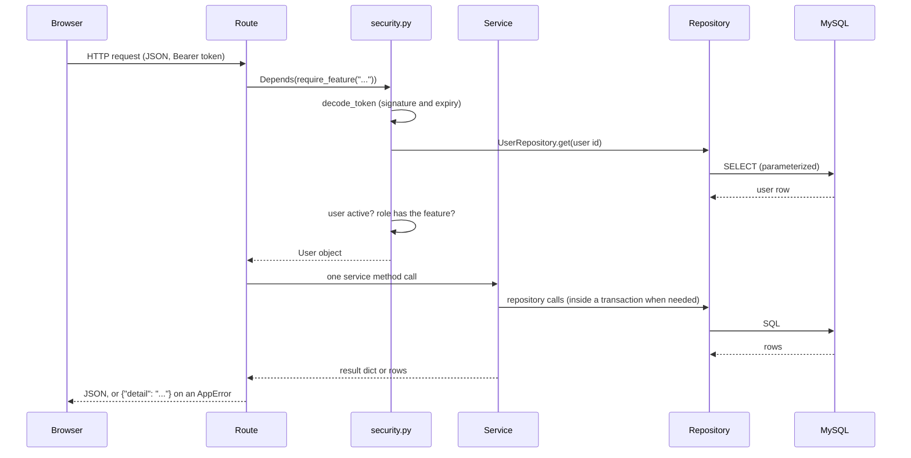

# BACKEND | AppointMed

This document explains everything the AppointMed backend does: how a request travels through the code, what each file is responsible for, the business rules the services enforce, and how the code meets the CMSC 203 final-project requirements (and the related ITEC 104 and ITEC 105 ideas).

For setup see `CONTRIBUTING.md`. For the whole system, diagrams, and test cases see `source/documentation/DOCUMENTATION.md`. For the data layer see `DATABASE.md`, for the web app `FRONTEND.md`, and for short study notes [NOTES.md](../../NOTES.md).

**Contents**

1. [Overview](#1-overview)
2. [Folder layout](#2-folder-layout)
3. [How a request travels](#3-how-a-request-travels)
4. [Entry point: `main.py`](#4-entry-point-mainpy)
5. [Core package](#5-core-package)
6. [Domain models](#6-domain-models)
7. [Schemas (input validation)](#7-schemas-input-validation)
8. [Repositories (all SQL)](#8-repositories-all-sql)
9. [Services (business rules)](#9-services-business-rules)
10. [Routes](#10-routes)
11. [Key flows step by step](#11-key-flows-step-by-step)
12. [Transactions and concurrency](#12-transactions-and-concurrency)
13. [Configuration](#13-configuration)
14. [Emails and logging](#14-emails-and-logging)
15. [Admin database tools](#15-admin-database-tools)
16. [Known issues and improvement ideas](#16-known-issues-and-improvement-ideas)
17. [Compliance with the project instructions](#17-compliance-with-the-project-instructions)
18. [How to extend the backend](#18-how-to-extend-the-backend)

---

## 1. Overview

The backend is a REST API written in Python with **FastAPI**. It is the only thing that talks to MySQL. The React web app and the public pages call it over HTTP and exchange JSON.

| Concern | Choice |
|---|---|
| Web framework | FastAPI (served by Uvicorn) |
| Validation | Pydantic 2 |
| Database driver | `mysql-connector-python` with a connection pool |
| Passwords | `bcrypt` |
| Login tokens | `PyJWT` (HS256) |
| Settings | `python-dotenv`, read once into a frozen dataclass |
| Email | Standard library `smtplib` |

The design rule is a strict layering: **routes call services, services call repositories, repositories run SQL.** Each layer only knows the one below it.

## 2. Folder layout

```
source/
├── main.py                       # app creation, CORS, routers, health checks, status page
├── requirements.txt
├── .env / .env.example           # configuration (the real .env is gitignored)
├── database/
│   ├── schema.sql                # all 16 tables and constraints
│   └── seed.sql                  # fictional sample data
├── backend/
    ├── core/
    │   ├── config.py             # Settings (frozen dataclass)
    │   ├── database.py           # Executor, Transaction, Database
    │   ├── exceptions.py         # AppError family and handlers
    │   ├── security.py           # hashing, tokens, current user, feature check, RateLimiter
    │   ├── email_templates.py    # escaped responsive HTML and plain-text email layout
    │   ├── mailer.py             # outgoing email
    │   └── utils.py              # to_money, blank_to_none, floor_minute, trim
    ├── models/domain.py          # User / Doctor / Nurse / Admin, AppointmentWorkflow
    ├── schemas/                  # api.py, database.py, site.py
    ├── repositories/             # base, user (+schedule, days off), patient, appointment
    │                             # (+notification), clinical, system, department, site
    │                             # (+email preferences, site_content), staff_directory, database
    ├── services/                 # auth, notifier, booking, scheduling, appointment, billing, patient,
    │                             #   dashboard, admin, department, site_service, staff_directory,
    │                             #   database, backup_parser, waiting_queue
    └── routes/                   # auth, public, staff, admin, database
```

## 3. How a request travels



- The user is **reloaded from the database on every request**, and the role comes from that row, not from the token. Deactivating an account or changing a role takes effect immediately.
- Every `AppError` becomes `{"detail": "<plain message>"}` with the right status code, so the frontend can show it as it is.

## 4. Entry point: `main.py`

Started with `uvicorn main:app --reload` from the `source` folder. It configures logging, creates the `FastAPI` app (`AppointMed API`, version `1.0.0`), adds **CORS** middleware (only the origins in `CORS_ORIGINS`), registers the exception handlers, and includes the routers: auth, public, staff, and admin (the admin router includes the database router).

| Route | Purpose |
|---|---|
| `GET /api/health` | Status, app name, version, environment, and UTC time |
| `GET /api/health/db` | Whether MySQL is reachable, never error details |
| `GET /` | A small HTML status page (follows light or dark mode) |

## 5. Core package

### 5.1 `config.py`: `Settings`

A **frozen dataclass**, built once by `Settings.from_env()` after `load_dotenv` reads `source/.env`.

| Field | Environment variable | Default |
|---|---|---|
| `app_env` | `APP_ENV` | `development` |
| `app_url` | `APP_URL` | `http://localhost:5173` |
| `db_host`, `db_port` | `DB_HOST`, `DB_PORT` | `localhost`, `3306` |
| `db_name`, `db_user`, `db_password` | `DB_NAME`, `DB_USER`, `DB_PASSWORD` | `appointmed`, `appointmed_user`, empty |
| `jwt_secret` | `JWT_SECRET` | **none, required** |
| `jwt_expire_minutes` | `JWT_EXPIRE_MINUTES` | `480` |
| `cors_origins` | `CORS_ORIGINS` | the two Vite addresses |
| `smtp_*` | `SMTP_HOST`, `SMTP_PORT`, `SMTP_USER`, `SMTP_PASSWORD`, `SMTP_FROM`, `SMTP_TLS` | empty host, `587`, empty, empty, `no-reply@appointmed.example`, `true` |

A missing `JWT_SECRET` raises `RuntimeError` and the app refuses to start. A secret still equal to `change_this_secret` logs a warning. `smtp_enabled` is true when `SMTP_HOST` is set. The module exposes one shared object, `settings`.

### 5.2 `database.py`: `Executor`, `Transaction`, `Database`

Repositories depend on the small abstract interface **`Executor`**, not on a concrete connection.

| Class | Role |
|---|---|
| `Executor` (abstract) | `fetch_all`, `execute` (returns the new id), `update` (returns rows changed), plus `fetch_one` and `server_now()` |
| `Transaction` | Several statements on **one** connection. Commit and rollback are done by `Database.transaction()`. |
| `Database` | A pool wrapper. Each call borrows a connection and commits at once (`autocommit=True`). `transaction()` commits when the `with` block ends normally and rolls back on any exception. |

- The pool is created on **first use**, so the app starts even if MySQL is down. It has 8 connections, `utf8mb4`, `pool_reset_session=True`, and a 5-second connection timeout.
- If a single autocommit call fails with `DatabaseUnavailableError`, `Database._retry` rebuilds the pool once and tries again (useful after the database was recreated).
- Driver errors go through `_translate`: a duplicate-entry error becomes `DuplicateEntryError`, other integrity errors become `ConflictError`, and everything else is logged and becomes `DatabaseUnavailableError`. SQL text never reaches the user.
- `server_now()` reads `NOW()` from MySQL so Python's "now" agrees with `CURDATE()` and `NOW()` in queries.

Because `Database`, `Transaction`, and the admin `AdminSession` are all `Executor`s, **any repository works inside or outside a transaction without changing**. That is the polymorphism the design is built around.

### 5.3 `exceptions.py`

```
AppError (400)
├── ValidationFailedError (400)
├── AuthenticationError (401)
├── PermissionDeniedError (403)
├── NotFoundError (404)
├── ConflictError (409)
│   ├── DuplicateEntryError
│   ├── AppointmentConflictError
│   └── InvalidStatusError
├── InvalidScheduleError (400)
├── RateLimitError (429)
└── DatabaseUnavailableError (503)
```

| Handler | Result |
|---|---|
| `AppError` | `{"detail": message}` with the error's status code |
| `RequestValidationError` (Pydantic) | Status 422 with the messages joined into one sentence, such as `contact_number: Enter a valid contact number...` |
| `Exception` (unexpected) | Logs the stack trace, returns 500 "Something went wrong on the server. Please try again." |

### 5.4 `security.py`

| Item | What it does |
|---|---|
| `hash_password`, `verify_password` | bcrypt hash with a random salt, and a safe comparison that returns `False` on a malformed hash |
| `create_token`, `decode_token` | A signed JWT (`sub`, `role`, `iat`, `exp`). Failure raises `AuthenticationError("Your session has expired...")`. |
| `get_current_user` | Dependency: reads the Bearer token, loads the user fresh, checks `is_active`, returns a `User` |
| `require_feature(feature)` | Builds a dependency that returns the user only if `user.can_access(feature)`, otherwise `PermissionDeniedError` |
| `RateLimiter` | In-memory sliding window over a `deque` per key, thread-safe, using `time.monotonic()` |
| `login_limiter` | 5 events per 300 seconds, keyed by lowercase username |
| `booking_limiter` | 6 events per 600 seconds, keyed by client IP |

### 5.5 `mailer.py`

`Mailer.send(to, subject, body, html=None)` starts a **daemon thread** so the request is never delayed. It sends a plain-text alternative and optional HTML content. With no address it does nothing. When SMTP is not configured, the plain-text email is written to the log. When it is configured, it connects (implicit SSL on port 465, otherwise optional STARTTLS), logs in if a username is set, and sends. Failures are logged with a clear reason and never break the request. `send_blocking` sends immediately and raises on failure, for checking SMTP settings.

### 5.6 `utils.py`

| Function | Purpose |
|---|---|
| `to_money(value)` | Two-decimal `Decimal` (round half up). Money is never a float. |
| `blank_to_none(value)` | Trims text and turns an empty result into `None` |
| `floor_minute(value)` | Drops seconds so times line up with slots |
| `trim(text, limit)` | Shortens text with an ellipsis so it fits a `VARCHAR` |

## 6. Domain models

### 6.1 `User` and the role subclasses

`User` is an **abstract class**. Its private fields are exposed through read-only properties, and the constructor rejects a missing username or full name.

| Member | Meaning |
|---|---|
| `role`, `features` | Class-level: the role name and the set of features the role may open |
| `can_access(feature)` | Polymorphic permission check |
| `scope_doctor_id` | **Abstract** property: the doctor whose clinical data this user works with |
| `from_row(row)` | **Factory** that picks the subclass from the row's `role` |

| Subclass | Features | `scope_doctor_id` |
|---|---|---|
| `Doctor` | dashboard, appointments, notifications, patients, history, invoice, prescriptions, exam, schedule | Their own id |
| `Nurse` | dashboard, appointments, notifications, patients, history, invoice | The assigned doctor, or `PermissionDeniedError` if none |
| `Admin` | admin_dashboard, users, rooms, settings, reports, audit, database | Always raises `PermissionDeniedError` |

### 6.2 `AppointmentWorkflow`

A small state machine. `TRANSITIONS` maps each status to the set it may become. `can_move(current, target)` answers yes or no, and `ensure(...)` raises `InvalidStatusError("This appointment is X, so it cannot become Y.")`.

| From | May become |
|---|---|
| Scheduled | Checked-in, Cancelled |
| Checked-in | Consulting, Cancelled |
| Consulting | Examined, Checked-in (return to queue) |
| Examined | Completed |
| Completed, Cancelled | nothing |

## 7. Schemas (input validation)

`schemas/api.py` holds every request body as a Pydantic model. All inherit from `Schema`, which trims whitespace and ignores unknown fields. A body that breaks a rule never reaches a service.

**Shared checks**

| Check | Rule |
|---|---|
| `_person_name` | Letters, combining marks, and ` ' ’ . , ( ) -` only. At least two letters. No digits. |
| `_specialization`, `_room_name`, `_medicine_text`, `_address` | Character allowlists for each field kind |
| `_no_control` | Rejects control characters (newlines allowed only in long text) |
| `_phone` | 7 to 15 digits; spaces, `+`, `-`, `( )` allowed |
| `_naive` | Times are clinic-local: a time zone is refused, and the year must be 2000 to 2100 |
| `_birthdate` | Not in the future and not before 1900 |
| `_check_optional_email` | Empty or a plausible address |
| `_check_password_strength` | At most 72 bytes, at least 8 characters, uppercase, lowercase, number, and special character |

| Schema | Used by | Notable rules |
|---|---|---|
| `LoginRequest` | login | username 1 to 50, password 1 to 200 (strength is not checked at login) |
| `ProfileUpdate` | own profile | name, optional email, `bio` (1000, multiline), `education` (255), `years_experience` 0 to 70, `languages` (letters, `, . & / -`) |
| `AvatarUpload`, `PasswordChange` | profile | image text at most 2,500,000 characters, new password strong |
| `DepartmentIn` | admin departments | name 2 to 100 (letters, digits, `& , . ' ’ ( ) / -`), description 3 to 255, `sort_order` 0 to 9999 |
| `SiteContentUpdate` | admin site texts | At most 20 keys `[a-z_]`, values up to 1100 characters |
| `SiteImageUpload` | logo, hero, department icon | Data URL up to 2,500,000 characters |
| `BookingRequest` | public booking | all details required, sex Male or Female, email pattern (lowercased), phone and address checks |
| `ApproveRequest`, `DismissRequest` | notifications | optional room and time, dismissal note 3 to 255 |
| `AppointmentCreate` | walk-ins | existing `patient_id` or a name, optional details, `check_in_now` |
| `RescheduleRequest`, `CancelRequest`, `RoomAssign` | appointments | new time, optional reason, optional room |
| `DayOffIn` | days off | a date and an optional reason |
| `PrescriptionItemIn`, `ExamFinish` | exam | quantity 1 to 9999, price 0 to 1,000,000 with two decimals, diagnosis 2 to 2000, up to 30 medicine lines, optional follow-up time |
| `PatientIn` | patients | name, optional birthdate, sex, phone, email, address, condition |
| `RoomStatusUpdate`, `RoomIn` | rooms | status is Available, Occupied, or Maintenance |
| `UserCreate`, `UserUpdate`, `PasswordReset`, `ActiveToggle` | admin users | username pattern `[A-Za-z0-9._-]{3,50}`, strong password |
| `ScheduleBlock`, `ScheduleUpdate` | admin schedule | weekday 1 to 7, slot 5 to 120 minutes, at most 70 blocks |
| `SettingsUpdate` | admin settings | at most 10 keys of `[a-z_]` and values up to 255 characters, then validated key by key in the service |

`schemas/database.py` holds `RowValues` (at most 60 columns, valid column names, values up to 70,000 characters), `SqlRequest` (1 to 5,000 characters), and `BackupImport` (up to 30,000,000 characters).

## 8. Repositories (all SQL)

**Only repositories contain SQL**, and every value is passed as a parameter, never joined into the query text.

### 8.1 `BaseRepository`

An abstract class with generic `get`, `create`, `update`, and `delete`. Subclasses define `table` and `columns`. `columns` is a **whitelist**: `_allowed` raises `ValueError` if data contains a column that is not in it, so a column name can never come from user input. `placeholders(n)` builds `%s, %s, ...` for `IN (...)`.

### 8.2 The repositories

| Repository | Table | Notable methods |
|---|---|---|
| `UserRepository` | `users` | As before, plus public profile columns in `_PUBLIC` and `_LISTING` |
| `ScheduleRepository` | `doctor_schedules` | `blocks_for_day`, `blocks_for_doctor` (`HH:MM`), `replace` (delete then insert, inside a transaction) |
| `DayOffRepository` | `doctor_days_off` | `in_range`, `is_off`, `remove` |
| `PatientRepository` | `patients` | `search`, `get_scoped`, `find_match` (NULL-safe `<=>`), `has_history` |
| `AppointmentRepository` | `appointments` | `get_item`, `list_for_doctor`, `queue`, `consulting`, `unbilled`, `conflict_exists`, `booked_times`, `booked_days`, `active_count_on`, `status_counts_today` |
| `NotificationRepository` | `notifications` | `list_for_doctor` (with `slot_taken`), `resolve` (only if still Pending), `count_pending`, `pending_days`, `pending_count_on` |
| `ExaminationRepository`, `PrescriptionRepository`, `InvoiceRepository` | clinical tables | `encounters`, `add_items`, `items_for_appointments`, `get_by_appointment`, `set_amounts` and `mark_paid` (Unpaid only), `count_awaiting_payment` |
| `RoomRepository`, `SettingsRepository`, `AuditRepository`, `ReportRepository`, `EmailPreferenceRepository` | system tables | `list_with_occupant`, `in_use`, `upsert`, `record`, `search`, `overview`, `report`, preference and staff-recipient lookups |
| `DepartmentRepository` | `departments` | `list_active`, `list_all`, `find_by_name`, `doctors_in`, `rename_specialization` |
| `SiteContentRepository` | `site_content` | `texts`, `image_keys`, `get_value`, `version`, `upsert`, `remove` |
| `StaffDirectoryRepository` | `users` | `list_active`, `get_active` (bio fields and a doctor's nurses), `photo` |
| `DatabaseAdminRepository` | any table | metadata from `information_schema`, `page`, `insert`, `update_row`, `delete_row`, `insert_many`, `dump` (see Section 15) |

Several guards are done in SQL on purpose so they hold under simultaneous requests: `resolve` only updates a row that is still `Pending`, and `set_amounts` and `mark_paid` only touch an `Unpaid` invoice.

## 9. Services (business rules)

Each service receives its `Database` and (where needed) `Notifier` through the constructor, so it can be created with test doubles.

### 9.1 `AuthService`

| Method | Rules |
|---|---|
| `login` | Blocks after 5 failures per username in 5 minutes. For an unknown username it still checks a dummy bcrypt hash so the response time does not reveal real usernames. A wrong login records a failure, writes `LOGIN_FAILED`, and returns one generic message. A deactivated account is refused. Success resets the limiter, updates `last_login_at`, writes `LOGIN` (in a transaction), and returns the token and a small user object. |
| `profile` | Returns user detail with the avatar as a `data:` URL (type detected from the first bytes) |
| `update_profile`, `remove_avatar` | Change own name, email, bio, education, years of experience and languages, or clear the picture |
| `set_avatar` | PNG, JPEG, or WebP data URL, valid base64, at most 300,000 bytes, real image signature |
| `change_password` | Requires the current password, and a new one that is different |
| `email_preferences`, `save_email_preferences` | Read or save the five per-user email categories; users without a row get all categories enabled |
| `send_test_email` | Requires a profile email and is limited to 3 test messages per user per 10 minutes |

### 9.2 `SchedulingService` and `BookingService`

`SchedulingService.available_slots(doctor_id, day)`:

1. Confirms the doctor exists, is a doctor, and is active.
2. Returns nothing if the doctor marked that date as a day off.
3. Reads "now" from the database and the set of **taken** times (non-cancelled appointments plus pending requests).
4. For each schedule block on that weekday, steps from `start_time` by `slot_minutes` while a whole slot fits.
5. Keeps a slot only if it is in the future and not taken.

`ensure_bookable(doctor_id, when)` raises `InvalidScheduleError` unless `when` is an open slot.

| `BookingService` method | Rules |
|---|---|
| `catalog` | Clinic name and address, whether booking is open, the window, and bookable doctors |
| `slots` | Refuses if booking is off, or the day is before today or beyond the window |
| `calendar` | For the booking calendar: working weekdays, days off (dates only), and working days with no open slot left. Range at most 62 days. |
| `book` | Rounds to the minute, re-checks the day, and in one transaction: confirms the doctor, **locks the doctor row**, re-confirms the slot is open, picks the least-busy nurse, stores a `Pending` request (origin `Website`), and writes an audit entry with no user |

### 9.3 `AppointmentService`

Every method works on `user.scope_doctor_id`, loads the appointment with `_load`, and answers `NotFoundError` if it belongs to another doctor. Times are also checked against days off with `_ensure_working`.

| Method | What it does |
|---|---|
| `list_notifications` | Requests for the doctor, optionally by status |
| `approve_notification` | One transaction: still pending, chosen or requested time, not in the past, doctor working that day, room valid (not in maintenance), no time conflict, find or create the patient (updating contact details of an existing one), create the appointment as `Scheduled`, mark the request `Converted`, audit. The confirmation email is queued after the transaction. |
| `dismiss_notification` | Marks a pending request `Dismissed` with the reason, audits it, emails the reason |
| `list_appointments`, `calendar` | Agenda lists, and the working weekdays, busy days, and days off for the agenda calendar (range at most 62 days) |
| `set_day_off`, `clear_day_off` | Doctor only. Today or later and within a year. Locks the doctor row. Refused while the day still has open appointments or pending requests. Audited. |
| `create_appointment` | Walk-in for an existing patient (scoped) or a new one (reused if name and birthdate match). Rejects past dates and days off, rejects check-in for another day, checks conflicts. |
| `check_in` | Legal transition, **room required**, not a future date, patient record ensured, sets `Checked-in` and `checked_in_at` |
| `start_exam` | **Locks the doctor row**, legal transition, refuses if another exam is in progress, optional room must be `Available` and becomes `Occupied`, sets `Consulting`, creates the invoice with the default fee if none exists |
| `release` | Consulting back to Checked-in. Frees the room. |
| `finish_exam` | Legal transition. Optional follow-up (future, doctor working, conflict-free, assigned to the least-busy nurse, source `Follow-up`). Saves the examination, the prescription and lines, totals the invoice (fee plus medicines), frees the room, sets `Examined`. |
| `cancel` | Legal transition, sets `Cancelled`, and cancels an unpaid invoice |
| `reschedule` | `Scheduled` only. The new time must be future, a working day, and conflict-free. |
| `assign_room` | Only before the exam starts. Room must exist and not be in maintenance. |
| `list_rooms`, `set_room_status` | Room board for doctors and nurses |

Almost every state change also calls `AuditRepository.record(...)`.

### 9.4 `BillingService`

| Method | Rules |
|---|---|
| `invoices`, `unbilled` | The doctor's invoices with medicine lines, and examined sessions with no invoice |
| `bill` | Only for an `Examined` session with a patient and no invoice. Fee from settings plus prescribed medicines. |
| `pay` | The invoice belongs to the doctor, is `Unpaid`, and its appointment is `Examined`. One transaction: conditional update to paid, and the appointment becomes `Completed`. |
| `history`, `prescriptions` | Completed encounters with medicine lines (start date not after end date), and the doctor's prescriptions |

### 9.5 `PatientService`, `DashboardService`, `AdminService`

| Service | Rules |
|---|---|
| `PatientService` | Patients are scoped to the doctor. `create` refuses a duplicate name and birthdate. `delete` refuses if the patient has any appointment. |
| `DashboardService` | `staff`: today's counts, pending requests, unbilled sessions, sessions awaiting payment, the queue (via `WaitingQueue`), the patient being examined, and the next five scheduled appointments. `admin`: totals and the eight latest audit entries. `report`: last 30 days by default, range at most 366 days. |
| `AdminService` users | A nurse **must** be assigned to an active doctor. A doctor's specialization must match an existing department (`_specialization` normalizes to the stored name). A duplicate username is a clear conflict. Users are deactivated, not deleted. An admin cannot deactivate their own account. Passwords are hashed before storing. All changes and audits run in transactions. |
| `AdminService` schedules | Each block ends after it starts and is at least one slot long. Blocks are sorted and neighbors checked, so none overlap. The schedule is replaced in one transaction. |
| `AdminService` rooms and settings | Unique room names. A room in any appointment cannot be deleted. Each setting is validated key by key (name and address required, fee 0 to 1,000,000, slot 5 to 120, window 1 to 365, booking `true` or `false`, unknown keys refused) and then saved together. |

### 9.6 `DepartmentService`

`list_public` and `icon` serve public departments and icons. Admin methods create and update departments, rename doctors' specialization when a department is renamed, refuse deletion while doctors use a department, and set or remove icons. Icons must be PNG, JPEG, or WebP, at most 150 KB, and are checked by signature; they are stored in `site_content` as `dept_icon_<id>`.

### 9.6a `SiteService`

`TEXT_FIELDS` allowlists hero, about, footer, contact and social-link content and validates each field by kind (line, multi, URL, email, or phone). Saving an empty text deletes its row so the frontend default returns. `set_image` and `remove_image` manage the logo (up to 300 KB) and hero (up to 1.5 MB). `public()` returns a `version` used as a cache buster.

### 9.6b `StaffDirectoryService`

`list_public`, `get_public`, and `photo` provide the public staff list, profile details, and photos.

### 9.7 `WaitingQueue`

A **min-heap** of checked-in appointments ordered by `(checked_in_at, id)`. `push` adds, `pop` removes the patient who has waited longest, `peek` looks without removing, and `ordered()` drains the heap into a list tagged with a 1-based `queue_position`. Appointments with no check-in time sort last.

## 10. Routes

Routes are thin: read the validated body, call one service method, return the result.

| Router | Prefix | Login | Features used |
|---|---|---|---|
| `auth_routes` | `/api/auth` | login is open, the rest need any signed-in user | none (uses `get_current_user`) |
| `public_routes` | `/api/public` | none | `GET /site`, `GET /site-image/{logo|hero}`, `GET /staff/{id}`, `GET /staff/{id}/photo`, `GET /department-icon/{id}`, and rate-limited `GET /staff`, `GET /departments`, `POST /bookings` |
| `staff_routes` | `/api/staff` | doctor or nurse | `dashboard`, `notifications`, `appointments`, `exam`, `invoice`, `patients`, `history`, `prescriptions`, `schedule` (days off) |
| `admin_routes` | `/api/admin` | admin | `admin_dashboard`, `users`, `rooms`, `settings`, `PUT /site`, `PUT or DELETE /site/image/{kind}`, `GET or POST /departments`, `PUT or DELETE /departments/{id}`, `PUT or DELETE /departments/{id}/icon`, `reports`, `audit` |
| `database_routes` | `/api/admin/database` | admin | `database` |

The complete endpoint list is in `DOCUMENTATION.md`, Section 11. The public booking route checks `booking_limiter.is_blocked` first and **records the hit only after a successful booking**, so a mistyped form does not use up a visitor's allowance.

## 11. Key flows step by step

### 11.1 Login

1. `POST /api/auth/login`.
2. The limiter is checked (5 failures per username per 5 minutes).
3. `get_by_username` loads the user and hash. `verify_password` compares (a dummy hash if the user is unknown).
4. Wrong: record the failure, audit it, generic message. Deactivated: refuse. Right: reset the limiter, touch `last_login_at`, audit, return `{access_token, user}`.

### 11.2 A patient books

1. `GET /api/public/catalog` lists doctors and whether booking is open.
2. `GET /api/public/calendar` colors the calendar, and `GET /api/public/slots` returns open times.
3. `POST /api/public/bookings` validates the body, checks the limiter, locks the doctor, re-checks the slot, stores a `Pending` request, and returns a receipt.

### 11.3 Staff approve the request

1. `POST /api/staff/notifications/{id}/approve`.
2. In a transaction: pending check, time, day off, room, and conflict checks, find or create the patient, create the appointment, mark the request `Converted`, audit.
3. After the commit, the confirmation email is queued.

### 11.4 Check-in, examination, and payment

1. `check-in`: a room must be set. `Scheduled` to `Checked-in`, stamped with the time.
2. `start`: `Checked-in` to `Consulting`, one at a time per doctor, room occupied, invoice opened with the default fee.
3. `finish`: examination, prescription, and totals saved, room freed, optional follow-up, status `Examined`.
4. `pay`: invoice `Paid`, appointment `Completed`. The visit appears in History.

## 12. Transactions and concurrency

- Multi-step changes use `with self._db.transaction() as tx:` and build repositories from `tx`, so they commit or roll back together.
- **Double booking** is stopped twice: services check `conflict_exists` for a friendly message, and the unique `active_slot` index is the final guard. A duplicate-entry error becomes `AppointmentConflictError`.
- **Row locks.** `_lock_doctor` and the booking lock run `SELECT id FROM users WHERE id = %s FOR UPDATE`. Two starts of an exam for one doctor, two days-off requests, or two bookings for the same doctor now run one after the other.
- Conditional updates (`WHERE status = 'Pending'`, `WHERE status = 'Unpaid'`) prevent a request being handled twice or an invoice paid twice.
- The email is sent **after** the transaction ends, so a mail problem never rolls back saved work.

## 13. Configuration

Everything comes from `source/.env` (see `CONTRIBUTING.md`, Step 6). The file is read once at startup, so restart the backend after changing it. Never commit it.

## 14. Emails and logging

- `Notifier` sends request, appointment, billing, account, clinic, and database-event messages through the shared `Mailer`.
- Staff email categories default to enabled and can be changed in Settings. Password-change and password-reset security messages are not preference-filtered.
- `APP_URL` is used to build links in email content and defaults to `http://localhost:5173`.
- Re-run `source/database/schema.sql` against an existing database to create `email_preferences`; backups made before this table existed are rejected as incomplete.
- With no `SMTP_HOST`, each email is printed to the backend console (including the recipient). Treat those logs as sensitive.
- Logging uses the `appointmed` logger. Unexpected errors are logged with a stack trace. Passwords, tokens, and medical details must never be logged.

## 15. Admin database tools

Files: `repositories/database_repository.py`, `services/database_service.py`, `services/backup_parser.py`, `routes/database_routes.py`, `schemas/database.py`. Only the `database` feature (Admin) reaches them.

**`AdminSession`.** One connection (an `Executor`) whose driver errors keep MySQL's own message (for example "Cannot delete a parent row") so an administrator can read it. `admin_session()` commits everything in its `with` block together, or rolls back.

**Browsing and editing**

| Rule | Detail |
|---|---|
| Table names | Always checked against `information_schema` before use. Identifiers are backtick-quoted. |
| Column names | Checked against the real column list. Generated and hidden columns cannot be set. |
| Hidden columns | `password_hash` and `avatar` are never sent to the browser |
| Read-only tables | `audit_logs` (append-only), and any table without a single-column primary key |
| No manual insert | `users` (accounts must be created on the Users page so the password is hashed) |
| Self-protection | An admin cannot change their own role or active status, or delete their own account |
| Values | Blank means "use the default" on insert and `NULL` (or empty text) on edit. All values are parameters. |
| Audit | `DB_INSERT_ROW`, `DB_UPDATE_ROW`, `DB_DELETE_ROW`, with the table name only (no values) |

**SQL console** (`run_sql`): one statement at a time; only `SELECT`, `SHOW`, `DESCRIBE`, `EXPLAIN`, `INSERT`, `UPDATE`, `DELETE`; a semicolon in the middle is refused; anything mentioning `audit_logs` for a write is refused; `UPDATE` and `DELETE` need a `WHERE`. Reads run with a 5-second `MAX_EXECUTION_TIME`, show at most 500 rows, and mask result columns named `password_hash` or `avatar`. Writes are committed with an audit entry (`DB_RUN_SQL`, kind and row count).

**Backup** (`dump`): every table's `SHOW CREATE TABLE` and rows as batched `INSERT` statements (100 rows each), parents first, generated columns left out. It starts with the header `-- AppointMed database backup`. It contains password hashes. Restoring with the `mysql` client needs the `root` user. Download is audited as `BACKUP_DATABASE`.

`site_content` holds base64 pictures, so its rows can be very long and backups can be large. `_TABLE_ORDER` does not list `departments`, `site_content`, or `doctor_days_off`, so they are dumped last; this is safe because foreign-key checks are off while loading.

**Import** (`import_backup`): the file is **parsed, never executed**.

1. `parse_backup` accepts only `SET`, `DROP TABLE IF EXISTS`, `CREATE TABLE` (ignored: structure is not changed), and `INSERT`. Values are tokenized into Python objects.
2. The backup must name every table of this database and no others, and every column must exist.
3. In one transaction, foreign key checks are turned off, every table except `audit_logs` is emptied, and the rows are inserted with parameters (100 per statement).
4. The import is refused (and rolled back) unless the backup keeps the importing administrator's own active admin account.
5. Foreign key checks are switched back on, and `RESTORE_DATABASE` is audited.

## 16. Known issues and improvement ideas

Honest notes for the team. None stop the system from working.

| Area | Note |
|---|---|
| Missing import | `BookingService.calendar` raises `ValidationFailedError` but `booking_service.py` does not import it. An invalid range (start after end, or over 62 days) would give a 500 instead of a clear 400. Add the import. |
| Walk-in check-in | `check_in` needs a room, but a walk-in created with "check in now" skips that rule. Decide on one rule. |
| Masking by name | The SQL console hides `password_hash` and `avatar` by result-column name, so `SELECT password_hash AS x` would show it. Block those columns in the statement or remove read access to `users`. |
| Console power | An admin can run `UPDATE` or `DELETE` on any table except the audit log (including `users`). It is audited, but consider limiting it. |
| Public calendar cost | `BookingService.calendar` calls `available_slots` for each day (up to 62 days, several queries each). Batch the queries or cache the result. |
| Non-indexed date filter | Queries such as `DATE(scheduled_time) = %s` cannot use the time index. Use a `>= day AND < day + 1` range. |
| Metadata queries | `DatabaseService.tables()` calls `table_names()` once per table. Fetch the list once. |
| Setting not used | `default_slot_minutes` is stored and editable but slot length comes from schedule blocks. |
| Rate limits | In memory only, so they reset on restart and are not shared across processes. Keys are never evicted. |
| Audit outside transactions | `PatientService` and the failed-login entry write their audit row on a separate connection from the change. |
| Department counting | A doctor is counted in a department only when `specialization` equals the department name exactly. |
| Public profile | `/api/public/staff/{id}` exposes bio, education, years, and languages. Staff should be told these are public. |
| Cache | Public photos and icons send `max-age=3600`, so a changed picture can take an hour to refresh unless the `?v=` version changes (it does for photos and site images). |
| Backup size | Large pictures live in `site_content`, which can make backups large. Consider storing files on disk. |
| Dump order | `_TABLE_ORDER` omits `departments`, `site_content`, and `doctor_days_off`; they are dumped last. Add them for a tidier backup. |
| SQL setup (fixed) | `dev.py` previously listed a missing `site_content.sql`; `SQL_FILES` now contains `("schema.sql", "seed.sql")`. |
| Import and audit rows | After an import, old `audit_logs.user_id` values may point to ids that no longer match the restored users. |
| No automated tests | Test by hand for now (`DOCUMENTATION.md`, Section 20). Services accept their `Database` and `Mailer`, so tests with fakes are straightforward to add. |

**Resolved since the last update:** `departments` moved into `schema.sql`; `dev.py` now loads only `schema.sql` and `seed.sql`; the one-exam-at-a-time race (now a row lock), the dead expression in `PatientService.create`, the `CREATE DATABASE` line in `schema.sql`, and the unused legacy files (`deps.py`, `permissions.py`, `visit_service.py`, and others), which were removed.

## 17. Compliance with the project instructions

The CMSC 203 final project is graded on seven criteria. This section shows where the backend answers each one.

> **Course-requirement note.** The instructions ask for a Python GUI application (Tkinter preferred, or another instructor-approved framework). AppointMed's backend is Python and its interface is a web app. Confirm with the instructors that the web frontend counts as an approved framework, and keep that approval on record.

### 17.1 Object-Oriented Programming (30 points)

| Required concept | Where it appears |
|---|---|
| Classes and objects | `User`, `Doctor`, `Nurse`, `Admin`, `AppointmentWorkflow`, `Settings`, `Database`, `Transaction`, `AdminSession`, `Mailer`, `RateLimiter`, `WaitingQueue`, every repository and service |
| Constructors | `User.__init__` validates its arguments. Repositories take an `Executor`. Services take a `Database` and a `Mailer`. |
| Encapsulation | `Settings` (frozen), `Database`, `User` (private fields behind properties), `RateLimiter` |
| Inheritance | Roles extend `User`. Repositories extend `BaseRepository`. Errors extend `AppError`. |
| Polymorphism | Each role implements `scope_doctor_id` differently. `Database`, `Transaction`, and `AdminSession` are interchangeable `Executor`s. |
| Abstraction | `Executor`, `BaseRepository`, `User.scope_doctor_id` |
| Interfaces or abstract classes | `Executor`, `BaseRepository`, `User` use `ABC` and `@abstractmethod` |
| Method overloading | Python has no overloading. `list_for_doctor(when)` accepts a keyword string or a `date`, and `consulting(doctor_id, exclude_id=None)` has an optional argument. Say this in the presentation. |
| Factory methods | `User.from_row`, `Settings.from_env` |

### 17.2 Functional features (20 points)

| Required feature | Where it appears |
|---|---|
| User login | `AuthService.login` with bcrypt, JWT, rate limiting, audit |
| Add records | Users, patients, rooms, days off, walk-ins, booking requests, examinations, prescriptions, invoices, database rows |
| Edit records | Users, patients, rooms, profile, appointments, schedules, settings, database rows |
| Delete records | Patients (no history), rooms (unused), days off, database rows. Users and appointments are deactivated or cancelled to keep history. |
| Search records | Users, patients, appointments, history, prescriptions, audit log, database tables |
| Display records | Dashboards, lists, history, invoices, reports, front page |
| Save data | MySQL, with transactions |
| Load data | Schema and seed SQL files, every `GET` endpoint, and backup import |

### 17.3 Exception handling and robustness (10 points)

| Required error type | How it is handled |
|---|---|
| Invalid input | Pydantic schemas reject it with 422 and a readable sentence |
| Empty fields | `min_length`, required fields, and `blank_to_none` |
| Invalid data types | Pydantic validation, `Decimal` for money, `Literal` types |
| File errors | Avatar format, base64, size, and signature checks. Backup files are parsed and checked before anything changes. A missing `JWT_SECRET` stops startup. SMTP and OS errors are caught and logged. |
| Custom exceptions | The 12-class `AppError` family |
| Database failures | Driver errors are translated and never expose SQL (admin Database page excepted) |

### 17.4 Code quality (10 points)

| Expectation | Where it appears |
|---|---|
| Naming conventions | `snake_case` functions, `PascalCase` classes, `UPPER_CASE` constants |
| Modular programming | Routes, schemas, services, repositories, models, and core are separate packages |
| Reusable methods | `BaseRepository` CRUD, `to_money`, `blank_to_none`, `_load`, `_check_room`, `_free_room`, `_ensure_patient`, `_lock_doctor`, shared schema checks |
| Comments | A docstring on every module, class, and public method |
| Readability | Type hints, short route functions, one responsibility per class |

### 17.5 Documentation, presentation, and related courses

Documentation: `DOCUMENTATION.md` covers the required sections, and this file, `DATABASE.md`, `FRONTEND.md`, and `NOTES.md` add detail. Remaining for the team: related studies, screenshots, the conclusion, and the test results column.

Suggested demo order: book as a patient, approve as a nurse (show the email in the console), choose a room and check in, examine as a doctor, pay, mark a day off and show it on the booking calendar, then show the audit log and the Database page as admin. Be ready to explain any file.

| Course | Backend evidence |
|---|---|
| ITEC 104 Data Structures and Algorithms | `WaitingQueue` (min-heap), `RateLimiter` (deque window), `AppointmentWorkflow` (transition table), slot generation with a set lookup, overlap detection after sorting, the backup tokenizer |
| ITEC 105 Information Management | 16 tables, keys, `CHECK` constraints, the generated `active_slot` unique index, row locks, transactions, parameterized queries, aggregate reports, audit log, backup and restore |

## 18. How to extend the backend

**Add an endpoint**

1. Add a request body to `schemas/api.py` (reuse the shared checks).
2. Add the query to the right repository.
3. Add the rule to a service (scope check, transaction, audit entry).
4. Add the route with `Depends(require_feature("..."))`.
5. Try it at `http://127.0.0.1:8000/docs` with valid, invalid, and empty input, and as a role that should be refused.

**Give a role a new feature:** add the name to that role's `features` set in `models/domain.py`, then use it in `require_feature(...)`.

**Add a status or transition:** update the database enum in `schema.sql`, then `STATUSES` and `TRANSITIONS`, then the frontend type and badge colors.

**Change the database:** edit `schema.sql` (and `seed.sql`), update the repository queries and frontend types, and tell the team to reset their databases. Check that backup and import still list the table.

---

*Last Updated: November 2026*