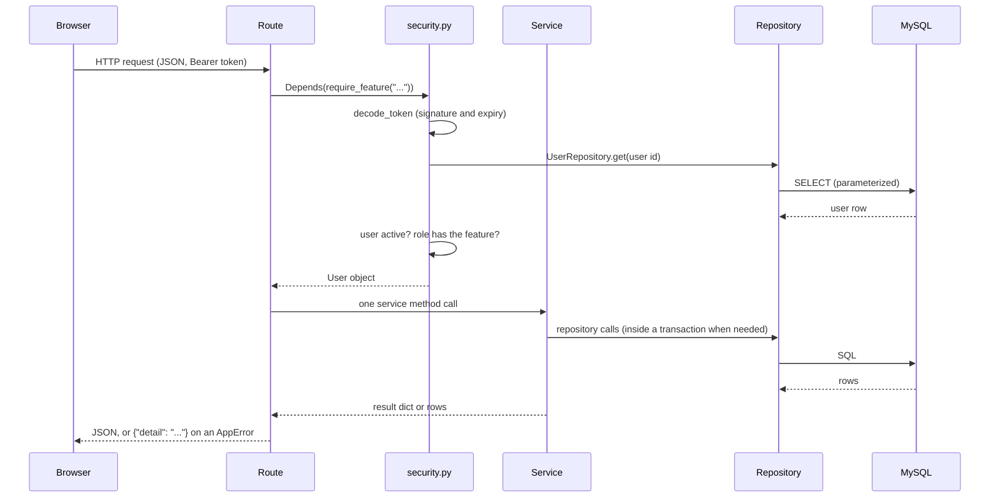

# BACKEND | AppointMed

This document explains everything the AppointMed backend does: how a request travels through the code, what each file is responsible for, the business rules the services enforce, and how the code meets the CMSC 203 final-project requirements (and the related ITEC 104 and ITEC 105 ideas).

For setup steps see `CONTRIBUTING.md`. For the overall system description, diagrams, and test cases see `source/documentation/DOCUMENTATION.md`. For the web app see `FRONTEND.md`.

**Contents**

1. [Overview](#1-overview)
2. [Folder layout](#2-folder-layout)
3. [How a request travels](#3-how-a-request-travels)
4. [Entry point: `main.py`](#4-entry-point-mainpy)
5. [Core package](#5-core-package)
6. [Domain models](#6-domain-models)
7. [Schemas (input validation)](#7-schemas-input-validation)
8. [Repositories (all SQL)](#8-repositories-all-sql)
9. [Services (business rules)](#9-services-business-rules)
10. [Routes](#10-routes)
11. [Key flows step by step](#11-key-flows-step-by-step)
12. [Transactions and concurrency](#12-transactions-and-concurrency)
13. [Configuration](#13-configuration)
14. [Emails and logging](#14-emails-and-logging)
15. [Legacy files](#15-legacy-files)
16. [Known issues and improvement ideas](#16-known-issues-and-improvement-ideas)
17. [Compliance with the project instructions](#17-compliance-with-the-project-instructions)
18. [How to extend the backend](#18-how-to-extend-the-backend)

---

## 1. Overview

The backend is a REST API written in Python with **FastAPI**. It is the only thing that talks to MySQL. The React web app and the public booking page both call it over HTTP and exchange JSON.

| Concern | Choice |
|---|---|
| Web framework | FastAPI (served by Uvicorn) |
| Validation | Pydantic 2 |
| Database driver | `mysql-connector-python` with a connection pool |
| Passwords | `bcrypt` |
| Login tokens | `PyJWT` (HS256) |
| Settings | `python-dotenv`, read once into a frozen dataclass |
| Email | Standard library `smtplib` |

The design rule is a strict layering: **routes call services, services call repositories, repositories run SQL.** Each layer only knows the one below it.

## 2. Folder layout

```
source/
├── main.py                       # app creation, CORS, routers, health checks, status page
├── requirements.txt
├── .env / .env.example           # configuration (the real .env is gitignored)
├── database/
│   ├── schema.sql                # 12 tables and constraints
│   └── seed.sql                  # fictional sample data
└── backend/
    ├── core/
    │   ├── config.py             # Settings (frozen dataclass)
    │   ├── database.py           # Executor, Transaction, Database
    │   ├── exceptions.py         # AppError family and handlers
    │   ├── security.py           # hashing, tokens, current user, feature check, RateLimiter
    │   ├── mailer.py             # outgoing email
    │   └── utils.py              # to_money, blank_to_none, floor_minute, trim
    ├── models/domain.py          # User / Doctor / Nurse / Admin, AppointmentWorkflow
    ├── schemas/api.py            # Pydantic request bodies
    ├── repositories/             # base, user, patient, appointment, clinical, system
    ├── services/                 # auth, booking, scheduling, appointment, billing,
    │                             #   patient, dashboard, admin, waiting_queue
    └── routes/                   # auth_routes, public_routes, staff_routes, admin_routes
```

## 3. How a request travels



Two details matter:

- The user is **reloaded from the database on every request**, and the role comes from that row, not from the token. Deactivating an account or changing a role takes effect immediately.
- Every error that is an `AppError` becomes `{"detail": "<plain message>"}` with the right status code, so the frontend can show it as it is.

## 4. Entry point: `main.py`

`main.py` is started with `uvicorn main:app --reload` from the `source` folder. It:

1. Configures logging.
2. Creates the `FastAPI` app (`AppointMed API`, version `1.0.0`).
3. Adds **CORS** middleware, allowing only the origins in `CORS_ORIGINS`.
4. Registers the exception handlers (`register_exception_handlers`).
5. Includes the four routers: auth, public, staff, admin.
6. Defines three extra routes:

| Route | Purpose |
|---|---|
| `GET /api/health` | Returns status, app name, version, environment, and UTC time |
| `GET /api/health/db` | Returns whether MySQL is reachable (`database.is_reachable()`), never error details |
| `GET /` | A small HTML status page that calls the two health routes and shows API and Database state |

The status page follows the user's light or dark mode through a `prefers-color-scheme` media query.

## 5. Core package

### 5.1 `config.py`: `Settings`

`Settings` is a **frozen dataclass**, so once built it cannot change. `Settings.from_env()` reads the environment (after `load_dotenv` loads `source/.env`) and applies safe defaults.

| Field | Environment variable | Default |
|---|---|---|
| `app_env` | `APP_ENV` | `development` |
| `db_host`, `db_port` | `DB_HOST`, `DB_PORT` | `localhost`, `3306` |
| `db_name`, `db_user`, `db_password` | `DB_NAME`, `DB_USER`, `DB_PASSWORD` | `appointmed`, `appointmed_user`, empty |
| `jwt_secret` | `JWT_SECRET` | **none, required** |
| `jwt_expire_minutes` | `JWT_EXPIRE_MINUTES` | `480` |
| `cors_origins` | `CORS_ORIGINS` | the two Vite addresses |
| `smtp_host`, `smtp_port`, `smtp_user`, `smtp_password`, `smtp_from`, `smtp_tls` | `SMTP_*` | empty host, `587`, empty, empty, `no-reply@appointmed.example`, `true` |

- A missing `JWT_SECRET` raises `RuntimeError` and the app refuses to start.
- A secret still equal to `change_this_secret` logs a warning.
- `smtp_enabled` is a property that is true when `SMTP_HOST` is set.
- `_split` turns `"a, b, c"` into `["a", "b", "c"]` for the CORS list.
- The module exposes one shared object, `settings`.

### 5.2 `database.py`: `Executor`, `Transaction`, `Database`

The repositories depend on a small abstract interface, **`Executor`**, not on a concrete connection.

| Class | Role |
|---|---|
| `Executor` (abstract) | Declares `fetch_all`, `execute` (returns the new row id), and `update` (returns rows changed). Provides `fetch_one` and `server_now()` on top of them. |
| `Transaction` | Several statements on **one** connection. Does not commit by itself. |
| `Database` | A pool wrapper. Each call borrows a connection, commits at once (`autocommit=True`), and returns it. `transaction()` gives a `Transaction` that commits when the `with` block ends normally and rolls back on any exception. |

Behavior worth knowing:

- The pool is created on **first use**, guarded by a lock, so the app can start even if MySQL is down. It has 8 connections, `utf8mb4`, and a 5-second connection timeout.
- Driver errors go through `_translate`: a duplicate-entry error becomes `DuplicateEntryError`, any other integrity error becomes `ConflictError`, and everything else is logged and becomes `DatabaseUnavailableError`. SQL text and driver details never reach the user.
- `server_now()` reads `NOW()` from MySQL so the app's "now" agrees with `CURDATE()` and `NOW()` used inside queries.
- `is_reachable()` runs `SELECT 1` and powers the health check.
- The module exposes one shared object, `database`.

Because `Database` and `Transaction` are both `Executor`s, **any repository works inside or outside a transaction without changing**. That is the polymorphism the design is built around.

### 5.3 `exceptions.py`

```
AppError (400)
├── ValidationFailedError (400)
├── AuthenticationError (401)
├── PermissionDeniedError (403)
├── NotFoundError (404)
├── ConflictError (409)
│   ├── DuplicateEntryError
│   ├── AppointmentConflictError
│   └── InvalidStatusError
├── InvalidScheduleError (400)
├── RateLimitError (429)
└── DatabaseUnavailableError (503)
```

Each class carries a `status_code` and a `default_message`, and any message can be overridden when it is raised. `register_exception_handlers(app)` attaches three handlers:

| Handler | Result |
|---|---|
| `AppError` | `{"detail": message}` with the error's status code |
| `RequestValidationError` (Pydantic) | Status 422 with the messages joined into one sentence, such as `contact_number: String should match pattern ...` |
| `Exception` (anything unexpected) | Logs the stack trace and returns 500 with "Something went wrong on the server. Please try again." |

### 5.4 `security.py`

| Item | What it does |
|---|---|
| `hash_password`, `verify_password` | bcrypt hash with a random salt, and a safe comparison that returns `False` on a malformed hash |
| `create_token` | A signed JWT with `sub` (user id), `role`, `iat`, and `exp` |
| `decode_token` | Verifies signature and expiry. Failure raises `AuthenticationError("Your session has expired...")`. |
| `get_current_user` | FastAPI dependency. Reads the `Bearer` token, loads the user fresh, checks `is_active`, and returns a `User` object (built by `User.from_row`). |
| `require_feature(feature)` | Builds a dependency that returns the user only if `user.can_access(feature)`, otherwise raises `PermissionDeniedError`. |
| `RateLimiter` | An in-memory sliding window. See below. |
| `login_limiter` | 5 events per 300 seconds, keyed by lowercase username |
| `booking_limiter` | 6 events per 600 seconds, keyed by client IP |

`RateLimiter` keeps a `deque` of timestamps per key, uses `time.monotonic()`, and is thread-safe with a lock. `is_blocked(key)` prunes old events then checks the count, `record(key)` adds an event, and `reset(key)` forgets the key (used after a successful login).

### 5.5 `mailer.py`

`Mailer.send(to, subject, body)` starts a **daemon thread** so the request is never held up by email. If `to` is empty it does nothing. In the thread:

- When SMTP is **not** configured, the whole email is written to the log (so developers can read it in the console).
- When it is configured, it connects, optionally uses STARTTLS, logs in if a username is set, and sends. Failures are logged and never break the request.

### 5.6 `utils.py`

| Function | Purpose |
|---|---|
| `to_money(value)` | Converts to a two-decimal `Decimal` (round half up). Money is never a float. |
| `blank_to_none(value)` | Trims text and turns an empty result into `None` so it is stored as `NULL`. |
| `floor_minute(value)` | Drops seconds so times line up with slots. |
| `trim(text, limit)` | Shortens text with an ellipsis so it fits a `VARCHAR`. |

## 6. Domain models

`models/domain.py` holds the two domain ideas that are not just database rows.

### 6.1 `User` and the role subclasses

`User` is an **abstract class**. Its private fields (`_id`, `_username`, `_full_name`, `_email`, `_specialization`, `_assigned_doctor_id`) are exposed through read-only properties. The constructor rejects a missing username or full name with `ValidationFailedError`.

| Member | Meaning |
|---|---|
| `role`, `features` | Class-level: the role name and the set of features that role may open |
| `can_access(feature)` | Polymorphic permission check |
| `scope_doctor_id` | **Abstract** property: the doctor whose clinical data this user works with |
| `from_row(row)` | **Factory** that picks the right subclass from the row's `role` |

| Subclass | Features | `scope_doctor_id` |
|---|---|---|
| `Doctor` | dashboard, appointments, notifications, patients, history, invoice, prescriptions, exam | Their own id |
| `Nurse` | the same set without `prescriptions` and `exam` | The assigned doctor, or `PermissionDeniedError` if none |
| `Admin` | admin_dashboard, users, rooms, settings, reports, audit | Always raises `PermissionDeniedError` (admins do not touch clinical records) |

### 6.2 `AppointmentWorkflow`

A small state machine. `STATUSES` lists the six statuses, `TRANSITIONS` maps each status to the set it may become, `can_move(current, target)` answers yes or no, and `ensure(current, target)` raises `InvalidStatusError("This appointment is X, so it cannot become Y.")`.

| From | May become |
|---|---|
| Scheduled | Checked-in, Cancelled |
| Checked-in | Consulting, Cancelled |
| Consulting | Examined, Checked-in (return to queue) |
| Examined | Completed |
| Completed, Cancelled | nothing |

## 7. Schemas (input validation)

`schemas/api.py` holds every request body as a Pydantic model. All inherit from `Schema`, which trims whitespace and ignores unknown fields. A body that breaks a rule never reaches a service.

| Schema | Used by | Notable rules |
|---|---|---|
| `LoginRequest` | login | username 1 to 50, password 1 to 200 |
| `ProfileUpdate`, `AvatarUpload`, `PasswordChange` | profile | name 2 to 100, optional valid email, image at most 500,000 characters, new password 8 to 72 |
| `BookingRequest` | public booking | name 2 to 100, birthdate not in the future, sex is Male/Female/Other, phone and email patterns, address 3 to 255, reason 3 to 255 |
| `ApproveRequest`, `DismissRequest` | notifications | optional room and time, dismissal note 3 to 255 |
| `AppointmentCreate` | walk-ins | existing `patient_id` or a name, optional birthdate, sex, contact, time, reason, `check_in_now` |
| `RescheduleRequest`, `CancelRequest`, `RoomAssign` | appointments | new time, optional reason, optional room |
| `PrescriptionItemIn` | exam | medicine name, quantity 1 to 9999, unit price at least 0 with two decimals |
| `ExamFinish` | exam | diagnosis 2 to 2000, notes, fee at least 0, up to 30 medicine lines, optional follow-up time |
| `PatientIn` | patients | name, optional birthdate (not future), sex, contact, valid email, address, condition |
| `RoomStatusUpdate`, `RoomIn` | rooms | status is Available, Occupied, or Maintenance |
| `UserCreate`, `UserUpdate`, `PasswordReset`, `ActiveToggle` | admin users | username pattern `[A-Za-z0-9._-]{3,50}`, password 8 to 72 |
| `ScheduleBlock`, `ScheduleUpdate` | admin schedule | weekday 1 to 7, slot 5 to 120 minutes, at most 70 blocks |
| `SettingsUpdate` | admin settings | a dictionary of key to text, checked key by key in the service |

## 8. Repositories (all SQL)

**Only repositories contain SQL**, and every value is passed as a parameter, never joined into the query text.

### 8.1 `BaseRepository`

An abstract class with generic `get`, `create`, `update`, and `delete`. Subclasses must define `table` and `columns`. `columns` is a **whitelist**: `_allowed` raises `ValueError` if the data contains a column that is not in it, so a column name can never come from user input. `placeholders(n)` builds `%s, %s, ...` lists for `IN (...)` queries.

### 8.2 The repositories

| Repository | Table | Notable methods |
|---|---|---|
| `UserRepository` | `users` | `get` (never returns the hash), `get_detail` (with the assigned doctor's name), `get_by_username` (login only, includes the hash), `list_users`, `touch_login`, `set_password`, avatar get and set, `public_doctors` (active doctors with a schedule and their weekdays), `nurses_for_doctor` (fewest pending requests first), `active_doctors` |
| `ScheduleRepository` | `doctor_schedules` | `blocks_for_day`, `blocks_for_doctor` (times as `HH:MM`), `replace` (delete then insert, used inside a transaction). Converts MySQL `TIME` (a `timedelta`) to `datetime.time`. |
| `PatientRepository` | `patients` | `search` (name, contact, or email, scoped to the doctor, with visit counts), `get_scoped`, `find_match` (same name ignoring case and same birthdate, NULL-safe with `<=>`), `has_history` |
| `AppointmentRepository` | `appointments` | `get_item` (with patient, room, and invoice details), `list_for_doctor` (today, upcoming, all, or one date, with search and status filter), `queue`, `consulting`, `unbilled`, `conflict_exists`, `booked_times`, `status_counts_today` |
| `NotificationRepository` | `notifications` | `list_for_doctor` (pending first, with a `slot_taken` warning flag), `resolve` (only if still Pending, returns rows changed), `count_pending` |
| `ExaminationRepository` | `examinations` | `encounters`: completed visits with diagnosis and bill, filterable by patient, text, and dates |
| `PrescriptionRepository` | `prescriptions` | `add_items`, `items_for_appointments` (grouped with a `defaultdict`), `list_for_doctor` |
| `InvoiceRepository` | `invoices` | `get_by_appointment`, `get_item`, `list_for_doctor`, `set_amounts` (Unpaid only), `mark_paid` (Unpaid only, returns 0 otherwise), `count_awaiting_payment` |
| `RoomRepository` | `rooms` | `list_with_occupant`, `in_use` |
| `SettingsRepository` | `clinic_settings` | `all_rows`, `as_dict`, `upsert` (`ON DUPLICATE KEY UPDATE`) |
| `AuditRepository` | `audit_logs` | `record` (details cut to 255 characters), `search` (page, total, and the list of known actions) |
| `ReportRepository` | read-only | `overview` for the admin dashboard, `report(date_from, date_to)` with status counts, per-doctor totals, daily totals, and new patients |

Several guards are done in SQL on purpose so they hold even under simultaneous requests: `resolve` only updates a row that is still `Pending`, and `set_amounts` and `mark_paid` only touch an `Unpaid` invoice.

## 9. Services (business rules)

Services hold the rules. Each receives its `Database` (and a `Mailer` where needed) through the constructor, so they can be created with test doubles.

### 9.1 `AuthService`

| Method | Rules |
|---|---|
| `login` | Blocks after 5 failures per username in 5 minutes. A wrong username or password records a failure, writes a `LOGIN_FAILED` audit entry, and returns one generic message. A deactivated account is refused. On success it resets the limiter, updates `last_login_at`, writes a `LOGIN` audit entry, and returns the token and a small user object. |
| `profile` | Returns the user detail with the avatar as a `data:` URL. The image type is detected from the first bytes, not trusted from the upload. |
| `update_profile` | Changes the user's own name and email. |
| `set_avatar` | Accepts only a PNG, JPEG, or WebP data URL, valid base64, at most 300,000 bytes, with a real image signature. |
| `remove_avatar` | Clears the picture. |
| `change_password` | Requires the current password and a new one that is different. |

### 9.2 `BookingService` and `SchedulingService`

`SchedulingService.available_slots(doctor_id, day)`:

1. Confirms the doctor exists, is a doctor, and is active.
2. Reads "now" from the database and the set of **taken** times for the day (non-cancelled appointments plus pending requests).
3. For each schedule block on that weekday, steps from `start_time` by `slot_minutes` while a whole slot still fits before `end_time`.
4. Keeps a slot only if it is in the future and not taken, then returns them sorted.

`ensure_bookable(doctor_id, when)` raises `InvalidScheduleError` unless `when` is one of those open slots.

`BookingService`:

| Method | Rules |
|---|---|
| `catalog` | Clinic name and address, whether booking is open, the booking window, and bookable doctors |
| `slots` | Refuses if online booking is off, or if the day is before today or beyond the window |
| `book` | Rounds to the minute, re-checks the day, and in one transaction: confirms the doctor, re-confirms the slot is open (the server never trusts the browser), picks the nurse with the fewest pending requests, requires an email, stores the request as `Pending` with origin `Website`, and writes an audit entry with no user |

### 9.3 `AppointmentService`

This is the largest service. Every method works on `user.scope_doctor_id`, loads the appointment with `_load`, and answers `NotFoundError` if it belongs to another doctor.

| Method | What it does |
|---|---|
| `list_notifications` | Requests for the doctor, optionally by status |
| `approve_notification` | In one transaction: checks the request is still pending, takes the chosen or requested time, validates the room (must exist, not in maintenance), checks for a time conflict, finds or creates the patient (updating contact details of an existing one), creates the appointment as `Scheduled`, marks the request `Converted`, and writes an audit entry. After the transaction it emails the confirmation. |
| `dismiss_notification` | Marks a pending request `Dismissed` with the reason, audits it, and emails the reason |
| `list_appointments` | Today, upcoming, all, or a date, plus search |
| `create_appointment` | A walk-in or phone appointment for an existing patient (scoped) or a new one (reused if the name and birthdate match). Rejects past dates, rejects check-in for another day, and checks for a time conflict. |
| `check_in` | Needs a legal transition. Refuses future dates. Makes sure a patient record exists. Sets `Checked-in` and `checked_in_at` from the database clock. |
| `start_exam` | Needs a legal transition. Refuses if another exam is in progress. Makes sure a patient record exists. If a room is chosen it must be `Available`, and it becomes `Occupied`. Sets `Consulting`. Creates the invoice with the default consultation fee if none exists. |
| `release` | Consulting back to Checked-in (started by mistake). Frees the room. |
| `finish_exam` | Needs a legal transition. Optionally books a **follow-up** (must be in the future and conflict-free, assigned to the nurse with the fewest pending requests, source `Follow-up`). Saves the examination, creates the prescription and its lines (if any), totals the invoice (fee plus medicines), frees the room, and sets `Examined`. |
| `cancel` | Needs a legal transition. Sets `Cancelled`. Also cancels an unpaid invoice. |
| `reschedule` | Only `Scheduled` appointments. The new time must be in the future and conflict-free. |
| `assign_room` | Only before the exam starts. The room must exist and not be in maintenance. |
| `list_rooms`, `set_room_status` | Room board for doctors and nurses |

Almost every state change also calls `AuditRepository.record(...)`.

### 9.4 `BillingService`

| Method | Rules |
|---|---|
| `invoices` | The doctor's invoices (by status), each with its medicine lines |
| `unbilled` | Examined sessions that have no invoice |
| `bill` | Only for an `Examined` session with a patient and no invoice. Totals the fee from settings plus the prescribed medicines. |
| `pay` | The invoice must belong to the doctor, be `Unpaid`, and its appointment must be `Examined`. In one transaction it marks the invoice paid (conditional update) and sets the appointment to `Completed`. |
| `history` | Completed encounters with their medicine lines. Rejects a start date after the end date. |
| `prescriptions` | The doctor's prescriptions, searchable by patient or diagnosis |

### 9.5 `PatientService`

Patients are scoped to the doctor. `create` refuses a duplicate name and birthdate. `update` and `delete` first load the patient through the scope check. `delete` refuses if the patient has **any** appointment on record, to protect clinical history. `ensure_access` is used by the patient history route.

### 9.6 `DashboardService`

| Method | Returns |
|---|---|
| `staff` | Today's count per status, pending requests, unbilled sessions, sessions awaiting payment, the queue (built with `WaitingQueue`), the patient being examined, and the next five upcoming scheduled appointments |
| `admin` | Clinic-wide totals plus the eight latest audit entries |
| `report` | Defaults to the last 30 days. The start must not be after the end, and the range must be at most 366 days. |

### 9.7 `AdminService`

| Area | Rules |
|---|---|
| Users | A nurse **must** be assigned to an active doctor, and other roles never have one. A duplicate username becomes a clear conflict. Users are deactivated, not deleted. An admin cannot deactivate their own account. Passwords are hashed before storing. |
| Schedules | Each block must end after it starts and be at least one slot long. Blocks are sorted and adjacent ones checked, so blocks on the same day cannot overlap. The whole schedule is replaced in one transaction. |
| Rooms | Names must be unique. A room that appears in any appointment cannot be deleted (set it to Maintenance instead). |
| Settings | Each key is validated first (`clinic_name` and `clinic_address` required and short, `consultation_fee` 0 to 1,000,000, `default_slot_minutes` 5 to 120, `booking_window_days` 1 to 365, `online_booking_enabled` true or false, unknown keys rejected), then all values are saved together in a transaction with one audit entry each. |
| Audit | Paged search by text and action |

### 9.8 `WaitingQueue`

A **min-heap** of checked-in appointments ordered by `(checked_in_at, id)`. `push` adds, `pop` removes the patient who has waited longest, `peek` looks without removing, and `ordered()` drains the heap into a list tagged with a 1-based `queue_position`. Appointments with no check-in time sort last.

## 10. Routes

Routes are deliberately thin: read the validated body, call one service method, return the result. Each declares who may call it with `Depends(require_feature("..."))`.

| Router | Prefix | Login | Features used |
|---|---|---|---|
| `auth_routes` | `/api/auth` | login is open, the rest need any signed-in user | none (uses `get_current_user`) |
| `public_routes` | `/api/public` | none | none, but `/bookings` is rate-limited |
| `staff_routes` | `/api/staff` | doctor or nurse | `dashboard`, `notifications`, `appointments`, `exam`, `invoice`, `patients`, `history`, `prescriptions` |
| `admin_routes` | `/api/admin` | admin | `admin_dashboard`, `users`, `rooms`, `settings`, `reports`, `audit` |

The complete endpoint list is in `DOCUMENTATION.md`, Section 11. The public booking route checks `booking_limiter.is_blocked` first, calls the service, and **records the hit only after a successful booking**, so a mistyped form does not use up a visitor's allowance.

## 11. Key flows step by step

### 11.1 Login

1. `POST /api/auth/login` with username and password.
2. The limiter is checked (5 failures per username per 5 minutes).
3. `get_by_username` loads the user and the hash. `verify_password` compares.
4. Wrong: record the failure, audit it, answer with the generic message. Deactivated: refuse. Right: reset the limiter, touch `last_login_at`, audit, return `{access_token, user}`.

### 11.2 A patient books

1. `GET /api/public/catalog` lists doctors and whether booking is open.
2. `GET /api/public/slots` returns open times, computed by `SchedulingService`.
3. `POST /api/public/bookings` validates the body (Pydantic), checks the limiter, re-checks the slot, stores a `Pending` request routed to the doctor and the least-busy nurse, and returns a receipt.

### 11.3 Staff approve the request

1. `POST /api/staff/notifications/{id}/approve`.
2. Inside a transaction: pending check, time and room checks, conflict check, find or create the patient, create the appointment, mark the request `Converted`, audit.
3. After the commit, the confirmation email is queued.

### 11.4 Check-in, examination, and payment

1. `check-in`: `Scheduled` to `Checked-in`, stamped with the time.
2. `start`: `Checked-in` to `Consulting`, one at a time per doctor, room occupied, invoice opened with the default fee.
3. `finish`: examination, prescription, and invoice totals saved, room freed, optional follow-up booked, status `Examined`.
4. `pay`: invoice `Paid`, appointment `Completed`. The visit now appears in History and the patient's record.

## 12. Transactions and concurrency

- Multi-step changes use `with self._db.transaction() as tx:` and build repositories from `tx`, so they commit together or roll back together.
- **Double booking** is stopped twice: services check `conflict_exists` for a friendly message, and the unique index on `active_slot` in MySQL is the final guard. A duplicate-entry error is translated into `AppointmentConflictError`.
- Conditional updates (`WHERE status = 'Pending'`, `WHERE status = 'Unpaid'`) prevent a request being handled twice or an invoice being paid twice.
- The email is sent **after** the transaction ends, so a mail problem can never roll back saved work.

## 13. Configuration

Everything comes from `source/.env` (see `CONTRIBUTING.md`, Step 6). The file is read once at startup, so restart the backend after changing it. Never commit it.

## 14. Emails and logging

- Emails are sent for **approved** and **disapproved** booking requests only.
- With no `SMTP_HOST`, each email is printed to the backend console (including the recipient), which is enough for development. Treat those logs as sensitive.
- Logging uses the `appointmed` logger. Unexpected errors are logged with a stack trace. Passwords, tokens, and medical details must never be logged.

## 15. Legacy files

These files come from an earlier design. They are **not imported by the app** and would fail on import because they use names that no longer exist (`database.session`, `Session`, `ForbiddenError`). Delete them rather than fixing them.

| File | Replaced by |
|---|---|
| `core/deps.py` | `core/security.py` (`get_current_user`, `require_feature`, `RateLimiter`) |
| `core/permissions.py` | `User.scope_doctor_id` in `models/domain.py` |
| `repositories/booking_repository.py` | `appointment_repository.py` and `patient_repository.py` |
| `repositories/visit_repository.py` | `appointment_repository.py` and `clinical_repository.py` |
| `schemas/clinic.py` | `schemas/api.py` |
| `services/visit_service.py` | `appointment_service.py` and `billing_service.py` |

## 16. Known issues and improvement ideas

These are honest notes for the team. None stop the system from working.

| Area | Note |
|---|---|
| One exam at a time | `start_exam` checks for another exam in progress but does not lock the row, so two simultaneous starts for one doctor could both pass. A row lock (`SELECT ... FOR UPDATE`) inside the transaction would close the gap. |
| Dead expression | In `PatientService.create`, the return line contains `... if False else self._load(...)`. It always runs `_load`, so it works, but the first half can be deleted. |
| Schema file | `schema.sql` begins with `CREATE DATABASE appointmed;` although `CONTRIBUTING.md` already creates it in Step 4. Loading the schema after Step 4 would report that the database exists. Remove that line or use `CREATE DATABASE IF NOT EXISTS`. |
| Setting not used | `default_slot_minutes` is stored and editable but slot length comes from the schedule blocks. |
| Rate limits | In memory only, so they reset on restart and are not shared across processes. |
| Audit outside transactions | Some single-step operations (such as `set_active`) write their audit entry on a separate connection, so a failure between the two could leave one without the other. |
| No automated tests | Test by hand for now (see `DOCUMENTATION.md`, Section 20). Services accept their `Database` and `Mailer`, so unit tests with fakes are straightforward to add. |

## 17. Compliance with the project instructions

The CMSC 203 final project is graded on seven criteria. This section shows where the backend answers each one.

> **Course-requirement note.** The instructions ask for a Python GUI application (Tkinter preferred, or another instructor-approved framework). AppointMed's backend is Python, and its interface is a web app. Confirm with the instructors that the web frontend counts as an approved framework, and keep that approval on record.

### 17.1 Object-Oriented Programming (30 points)

| Required concept | Where it appears |
|---|---|
| Classes and objects | `User`, `Doctor`, `Nurse`, `Admin`, `AppointmentWorkflow`, `Settings`, `Database`, `Transaction`, `Mailer`, `RateLimiter`, `WaitingQueue`, every repository and service |
| Constructors | `User.__init__` validates its arguments. Repositories take an `Executor`. Services take a `Database` and a `Mailer`. |
| Encapsulation | `Settings` (frozen), `Database` (hides the pool, lock, and error translation), `User` (private fields behind properties), `RateLimiter` (private store and lock) |
| Inheritance | `Doctor`/`Nurse`/`Admin` extend `User`. All repositories extend `BaseRepository`. All errors extend `AppError`. |
| Polymorphism | Each role implements `scope_doctor_id` differently. `Database` and `Transaction` are interchangeable as `Executor`. |
| Abstraction | `Executor`, `BaseRepository` (abstract `table` and `columns`), and `User.scope_doctor_id` |
| Interfaces or abstract classes | `Executor`, `BaseRepository`, and `User` all use `ABC` and `@abstractmethod` |
| Method overloading | Python has no overloading. The same effect is achieved with flexible parameters, for example `list_for_doctor(when)` accepts a keyword string or a `date`, and `consulting(doctor_id, exclude_id=None)` has an optional argument. Say this explicitly in the presentation. |
| Factory methods | `User.from_row`, `Settings.from_env` |

### 17.2 Functional features (20 points)

| Required feature | Where it appears |
|---|---|
| User login | `AuthService.login` with bcrypt, JWT, rate limiting, and audit |
| Add records | Users, patients, rooms, walk-in appointments, booking requests (public), examinations, prescriptions, invoices |
| Edit records | Users, patients, rooms, profile, appointments (reschedule and room), schedules, settings |
| Delete records | Patients (only if no history), rooms (only if unused). Users and appointments are deactivated or cancelled instead, to keep history. |
| Search records | Users, patients, appointments, history, prescriptions, audit log |
| Display records | Dashboards, lists, history, invoices, reports |
| Save data | Everything is stored in MySQL. Transactions keep related saves together. |
| Load data | Schema and seed SQL files, and every `GET` endpoint |

Reports and the audit log can also be exported as CSV from the frontend.

### 17.3 Exception handling and robustness (10 points)

| Required error type | How it is handled |
|---|---|
| Invalid input | Pydantic schemas reject it with status 422 and a readable sentence |
| Empty fields | `min_length` and required fields in the schemas, plus `blank_to_none` for optional text |
| Invalid data types | Pydantic type coercion and validation. `Decimal` for money. Enum-like `Literal` types. |
| File errors | The avatar is checked for format, base64 validity, size, and image signature. A missing `JWT_SECRET` stops startup with a clear message. SMTP and OS errors when emailing are caught and logged. |
| Custom exceptions (at least one) | The 12-class `AppError` family, with handlers that return `{"detail": "..."}` |
| Database failures | Driver errors are translated and never expose SQL |

### 17.4 Code quality (10 points)

| Expectation | Where it appears |
|---|---|
| Naming conventions | `snake_case` functions, `PascalCase` classes, `UPPER_CASE` constants |
| Modular programming | Routes, schemas, services, repositories, models, and core are separate packages |
| Reusable methods | `BaseRepository` CRUD, `to_money`, `blank_to_none`, `AppointmentService._load`, `_check_room`, `_free_room`, `_ensure_patient` |
| Comments | A docstring on every module, class, and public method, and comments that explain why |
| Readability | Type hints throughout, short route functions, one responsibility per class |
| Organization by packages | See [Section 2](#2-folder-layout) |

### 17.5 Documentation (10 points)

The technical documentation in `source/documentation/DOCUMENTATION.md` covers the required sections (introduction, problem, objectives, scope and limitations, features, UML class diagram, flowcharts, screenshots, testing results, conclusion, references). This file and `FRONTEND.md` add the implementation detail. Remaining items for the team: related studies, screenshots, the conclusion, and the test results column.

### 17.6 Presentation and demonstration (10 points)

Suggested demo order that touches every layer: book as a patient, approve as a nurse (show the email in the console), check in, examine as a doctor, pay, then show the audit log as admin. Be ready to explain any file, because the instructors may ask any member to walk through any part.

### 17.7 Related course ideas

| Course | Backend evidence |
|---|---|
| ITEC 104 Data Structures and Algorithms | `WaitingQueue` (min-heap), `RateLimiter` (sliding window over a `deque`), `AppointmentWorkflow` (transition table), slot generation with a set lookup, overlap detection after sorting |
| ITEC 105 Information Management | 12 normalized tables, keys, `CHECK` constraints, the generated `active_slot` unique index, transactions, parameterized queries, aggregate reports, audit log |

## 18. How to extend the backend

**Add an endpoint**

1. Add a request body to `schemas/api.py` if it receives data.
2. Add the query to the right repository.
3. Add the rule to a service (scope check, transaction, audit entry).
4. Add the route with `Depends(require_feature("..."))`.
5. Try it at `http://127.0.0.1:8000/docs` with valid, invalid, and empty input, and as a role that should be refused.

**Give a role a new feature:** add the feature name to that role's `features` set in `models/domain.py`, then use the same name in `require_feature(...)`.

**Add a status or transition:** update the database enum in `schema.sql`, then `STATUSES` and `TRANSITIONS` in `AppointmentWorkflow`, then the frontend type and badge colors.

**Change the database:** edit `schema.sql` (and `seed.sql` if needed), update the matching repository queries and the frontend types, and tell the team to reset their databases.

---

*Last Updated: October 2026*