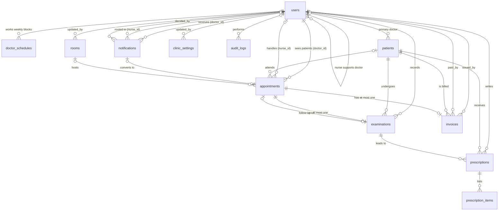

# DATABASE | AppointMed

This document explains the AppointMed database: why it is shaped the way it is, what every table and column means, how the backend reads and writes it, and how it meets the course requirements. It complements `DOCUMENTATION.md` (whole system) and `FRONTEND.md` (the web app).

**Course Affiliation**

Laguna State Polytechnic University | College of Computer Studies  
CMSC 203 – Object-Oriented Programming, ITEC 104 – Data Structures and Algorithm, ITEC 105 – Information Management  
Instructors: Ms. Roxanne Garbo, Sir Rolan C. Sotomayor, Sir Jencel P. Sofer  
Academic Year: 2026 – 2027  
System Project Assigned: Clinic Appointment System

**Contents**

1. [Overview](#1-overview)
2. [Files and Setup](#2-files-and-setup)
3. [Design Approach](#3-design-approach)
4. [Entity Relationship Diagram](#4-entity-relationship-diagram)
5. [Data Dictionary](#5-data-dictionary)
6. [Relationships and Foreign Keys](#6-relationships-and-foreign-keys)
7. [Constraints and Indexes](#7-constraints-and-indexes)
8. [Normalization](#8-normalization)
9. [The Double-Booking Guard](#9-the-double-booking-guard)
10. [How the Backend Accesses the Database](#10-how-the-backend-accesses-the-database)
11. [Transactions and Concurrency](#11-transactions-and-concurrency)
12. [Workflow and the Tables It Touches](#12-workflow-and-the-tables-it-touches)
13. [Key Queries Explained](#13-key-queries-explained)
14. [Reports and Aggregates](#14-reports-and-aggregates)
15. [Sample Data](#15-sample-data)
16. [Security and Integrity](#16-security-and-integrity)
17. [Maintenance](#17-maintenance)
18. [Verification Queries](#18-verification-queries)
19. [Compliance with the Project Instructions](#19-compliance-with-the-project-instructions)
20. [Known Issues and Recommended Improvements](#20-known-issues-and-recommended-improvements)

---

## 1. Overview

AppointMed stores everything in **one MySQL 8 database named `appointmed`** with **12 tables**. Nobody connects to it directly. The React app and the public booking page talk to the FastAPI backend, and only the backend runs SQL.

| Fact | Value |
|---|---|
| DBMS | MySQL 8.0 or newer |
| Storage engine | InnoDB (transactions and foreign keys) |
| Character set | `utf8mb4` (any character, including accents) |
| Tables | 12 |
| Driver | `mysql-connector-python` with a connection pool of 8 |
| Application account | `appointmed_user`, with `SELECT`, `INSERT`, `UPDATE`, `DELETE` only |
| Structure owner | `root` (loads `schema.sql`) |

The 12 tables, grouped by purpose:

| Group | Tables |
|---|---|
| Staff and scheduling | `users`, `doctor_schedules`, `rooms` |
| Requests and visits | `notifications`, `patients`, `appointments` |
| Clinical | `examinations`, `prescriptions`, `prescription_items` |
| Billing | `invoices` |
| Administration | `clinic_settings`, `audit_logs` |

## 2. Files and Setup

| File | Purpose |
|---|---|
| `source/database/schema.sql` | Structure only: tables, keys, constraints, indexes |
| `source/database/seed.sql` | Fictional sample data for development and testing |
| `source/.env` | Connection settings (`DB_HOST`, `DB_PORT`, `DB_NAME`, `DB_USER`, `DB_PASSWORD`). Never committed |
| `backend/core/config.py` | Reads `.env` once into the frozen `Settings` object |
| `backend/core/database.py` | Connection pool, transactions, and error translation |

Setup order (full steps are in `CONTRIBUTING.md`, Steps 4 to 6):

1. As `root`, create the database and the limited `appointmed_user`, and grant it `SELECT, INSERT, UPDATE, DELETE` on `appointmed.*`.
2. As `root`, load `schema.sql`, then `seed.sql` (once).
3. Put the same password in `source/.env` as `DB_PASSWORD`.

The pool is **created on the first query**, not at startup, so the backend starts even when MySQL is down. In that case `/api/health/db` reports `connected: false` and API calls return a clean 503.

## 3. Design Approach

The schema follows the real clinic workflow rather than a generic template.

1. A **patient requests** an appointment on the website. They have no account, so the request carries their personal details itself (`notifications`).
2. Staff **approve** the request. That creates (or reuses) a `patients` record and creates an `appointments` row. A rejected request just stays as `Dismissed` with a reason.
3. The patient **checks in** (`checked_in_at` sets queue order), the doctor **examines** them (`examinations`), writes a **prescription** (`prescriptions` and `prescription_items`), and an **invoice** (`invoices`) is totalled.
4. Payment **completes** the appointment.
5. The administrator manages `users`, `doctor_schedules`, `rooms`, and `clinic_settings`, and reviews `audit_logs`.

Design decisions and the reasons for them:

| Decision | Reason |
|---|---|
| Patients are **not** users | Patients never log in. Only staff have accounts, so `users` stays small and every row has a role |
| Requests (`notifications`) are separate from appointments | A request may be rejected or may never become an appointment. Keeping them apart avoids half-valid appointment rows |
| `appointments.full_name` is stored even though `patient_id` exists | An appointment can exist before a patient record does (`patient_id` is `NULL` until check-in or exam). The name is the only identity at that stage |
| One invoice per appointment, one examination per appointment | Enforced with `UNIQUE` on `appointment_id`, so double billing or double examining is impossible |
| Users are deactivated, never deleted | Foreign keys from history would otherwise break, and the audit trail would lose its actors |
| Weekly schedule stored as rows (`doctor_schedules`) | Open slots can be computed for any date. Two rows on a day give a lunch break |
| Settings as key/value rows | New settings need no schema change |
| Money as `DECIMAL(10,2)` | Exact arithmetic, never floating point |
| Status values as `ENUM` | The database itself rejects an unknown status |

## 4. Entity Relationship Diagram



Reading the symbols: `||` exactly one, `|o` zero or one, `o{` zero or many, `|{` one or many. `clinic_settings` has no incoming relationships. It is a standalone key/value table.

## 5. Data Dictionary

Legend: **PK** primary key, **FK** foreign key, **UQ** unique, **AI** auto increment, **NN** not null.

### 5.1 `users`

Clinic staff only (doctors, nurses, admins).

| Column | Type | Rules | Meaning |
|---|---|---|---|
| `id` | INT | PK, AI | Staff id |
| `username` | VARCHAR(50) | NN, UQ | Login name |
| `password_hash` | VARCHAR(255) | NN | bcrypt hash, never plain text |
| `full_name` | VARCHAR(100) | NN | Display name |
| `role` | ENUM('doctor','nurse','admin') | NN | Decides which features the user may open |
| `email` | VARCHAR(100) | NULL | Contact email |
| `specialization` | VARCHAR(100) | NULL | Doctors only |
| `assigned_doctor_id` | INT | FK to `users(id)`, NULL | Nurses only: the doctor they support |
| `avatar` | MEDIUMBLOB | NULL | Small profile picture (up to 300 KB, checked by the backend) |
| `is_active` | BOOLEAN | NN, default TRUE | False means the account is blocked, but history is kept |
| `last_login_at` | TIMESTAMP | NULL | Updated on each successful login |
| `created_at` | TIMESTAMP | default now | Account creation time |

### 5.2 `doctor_schedules`

| Column | Type | Rules | Meaning |
|---|---|---|---|
| `id` | INT | PK, AI | |
| `doctor_id` | INT | NN, FK to `users` | |
| `weekday` | TINYINT | NN, CHECK 1 to 7 | ISO weekday: 1 Monday to 7 Sunday |
| `start_time`, `end_time` | TIME | NN, CHECK end > start | One working block |
| `slot_minutes` | SMALLINT | NN, default 30 | Length of one bookable slot |

`UNIQUE (doctor_id, weekday, start_time)` prevents two blocks starting at the same time.

### 5.3 `rooms`

| Column | Type | Rules | Meaning |
|---|---|---|---|
| `id` | INT | PK, AI | |
| `room_name` | VARCHAR(50) | NN, UQ | |
| `status` | ENUM('Available','Occupied','Maintenance') | NN, default Available | |
| `updated_by` | INT | FK to `users`, NULL | Who last changed it |
| `updated_at` | TIMESTAMP | default now, `ON UPDATE` now | Maintained by MySQL |

### 5.4 `notifications` (booking requests)

| Column | Type | Rules | Meaning |
|---|---|---|---|
| `id` | INT | PK, AI | |
| `doctor_id` | INT | NN, FK | The doctor the requester chose |
| `nurse_id` | INT | FK, NULL | Nurse the request is routed to (the one with the fewest pending requests) |
| `requester_name` | VARCHAR(100) | NN | |
| `contact_number` | VARCHAR(20) | | |
| `email` | VARCHAR(100) | | Where the confirmation or reason is emailed |
| `birthdate` | DATE | NULL | |
| `sex` | ENUM('Male','Female','Other') | NULL | |
| `address` | VARCHAR(255) | NULL | |
| `preferred_datetime` | DATETIME | NULL | The slot picked on the website |
| `reason` | VARCHAR(255) | | |
| `origin` | ENUM('Website','Phone','Other') | NN, default Website | |
| `status` | ENUM('Pending','Converted','Dismissed') | NN, default Pending | Staff see Converted as "Approved" and Dismissed as "Disapproved" |
| `decision_note` | VARCHAR(255) | NULL | Reason given when dismissed (emailed) |
| `decided_by` | INT | FK, NULL | Staff member who decided |
| `created_at` | TIMESTAMP | default now | |
| `resolved_at` | TIMESTAMP | NULL | When it was approved or dismissed |

### 5.5 `patients`

| Column | Type | Rules | Meaning |
|---|---|---|---|
| `id` | INT | PK, AI | |
| `full_name` | VARCHAR(100) | NN, indexed | |
| `birthdate` | DATE | | |
| `sex` | ENUM('Male','Female','Other') | NULL | |
| `contact_number`, `email`, `address` | VARCHAR | | Latest known contact details |
| `condition_summary` | VARCHAR(255) | | Short note on the latest condition |
| `doctor_id` | INT | FK, NULL | Current or primary doctor |
| `created_at` | TIMESTAMP | default now | Used by "new patients" in reports |

### 5.6 `appointments`

| Column | Type | Rules | Meaning |
|---|---|---|---|
| `id` | INT | PK, AI | |
| `notification_id` | INT | FK, NULL | Set only when converted from a request |
| `patient_id` | INT | FK, NULL | Filled in when the patient record exists |
| `full_name` | VARCHAR(100) | NN | Appointee's name (before they are a patient) |
| `doctor_id` | INT | NN, FK | |
| `nurse_id` | INT | FK, NULL | NULL when the doctor booked it themselves |
| `room_id` | INT | FK, NULL | Chosen exam room |
| `source` | ENUM('Notification','Walk-in','Follow-up') | NN, default Walk-in | How it was created |
| `scheduled_time` | DATETIME | NN | |
| `reason` | VARCHAR(255) | | |
| `status` | ENUM('Scheduled','Checked-in','Consulting','Examined','Completed','Cancelled') | NN, default Scheduled | Workflow state |
| `checked_in_at` | DATETIME | NULL | Orders the waiting queue |
| `created_at` | TIMESTAMP | default now | |
| `active_slot` | DATETIME | **VIRTUAL generated** | See [Section 9](#9-the-double-booking-guard) |

### 5.7 `examinations`

| Column | Type | Rules | Meaning |
|---|---|---|---|
| `id` | INT | PK, AI | |
| `appointment_id` | INT | NN, **UQ**, FK | One examination per appointment |
| `patient_id`, `doctor_id` | INT | NN, FK | |
| `diagnosis`, `notes` | TEXT | | The doctor's findings |
| `outcome` | ENUM('Follow-up Scheduled','Sent to History') | NN | |
| `follow_up_appointment_id` | INT | FK, NULL | Set when `outcome` is Follow-up Scheduled |
| `examined_at` | TIMESTAMP | default now | |

### 5.8 `prescriptions` and `prescription_items`

`prescriptions`

| Column | Type | Rules | Meaning |
|---|---|---|---|
| `id` | INT | PK, AI | |
| `examination_id`, `patient_id`, `doctor_id` | INT | NN, FK | |
| `notes` | VARCHAR(255) | | General instructions |
| `issued_at` | TIMESTAMP | default now | |

`prescription_items`

| Column | Type | Rules | Meaning |
|---|---|---|---|
| `id` | INT | PK, AI | |
| `prescription_id` | INT | NN, FK, `ON DELETE CASCADE` | Deleting a prescription removes its lines |
| `medicine_name` | VARCHAR(150) | NN | |
| `dosage` | VARCHAR(100) | | |
| `quantity` | INT | NN, default 1, CHECK > 0 | |
| `unit_price` | DECIMAL(10,2) | NN, default 0, CHECK >= 0 | Billed on the invoice |
| `instructions` | VARCHAR(255) | | For example "Take twice daily after meals" |

### 5.9 `invoices`

| Column | Type | Rules | Meaning |
|---|---|---|---|
| `id` | INT | PK, AI | |
| `patient_id` | INT | NN, FK | |
| `appointment_id` | INT | NN, **UQ**, FK | One invoice per appointment |
| `issued_by` | INT | NN, FK | Staff member who started the exam or billed it |
| `consultation_fee` | DECIMAL(10,2) | NN, default 0 | |
| `medicines_total` | DECIMAL(10,2) | NN, default 0 | |
| `amount` | DECIMAL(10,2) | NN, CHECK >= 0 | Equals fee plus medicines |
| `status` | ENUM('Unpaid','Paid','Cancelled') | NN, default Unpaid | |
| `issued_at` | TIMESTAMP | default now | |
| `paid_at` | TIMESTAMP | NULL | |
| `paid_by` | INT | FK, NULL | Staff member who received payment |

### 5.10 `clinic_settings`

| Column | Type | Rules | Meaning |
|---|---|---|---|
| `setting_key` | VARCHAR(50) | **PK** | Natural key |
| `setting_value` | VARCHAR(255) | NN | Stored as text, validated by the backend |
| `description` | VARCHAR(255) | | |
| `updated_by` | INT | FK, NULL | |
| `updated_at` | TIMESTAMP | default now, `ON UPDATE` now | |

Keys in use:

| Key | Meaning | Validation (backend) |
|---|---|---|
| `clinic_name` | Name shown on the website and invoices | Required, up to 100 characters |
| `clinic_address` | Clinic address | Required, up to 255 characters |
| `consultation_fee` | Default fee when an exam starts | 0 to 1,000,000, two decimals |
| `default_slot_minutes` | Default slot length | Whole number, 5 to 120 |
| `online_booking_enabled` | Public booking switch | `true` or `false` |
| `booking_window_days` | How far ahead patients may book | Whole number, 1 to 365 |

### 5.11 `audit_logs`

| Column | Type | Rules | Meaning |
|---|---|---|---|
| `id` | INT | PK, AI | |
| `user_id` | INT | FK, NULL | NULL for system or unauthenticated actions (failed login, public booking) |
| `action` | VARCHAR(50) | NN | For example LOGIN, CREATE_USER, CANCEL_APPOINTMENT |
| `entity` | VARCHAR(50) | NULL | Table or concept affected |
| `entity_id` | INT | NULL | Row id in that entity (not a foreign key, because it may point to any table) |
| `details` | VARCHAR(255) | NULL | Short text. Never passwords or medical details |
| `created_at` | TIMESTAMP | default now | |

Actions the backend writes: `LOGIN`, `LOGIN_FAILED`, `UPDATE_PROFILE`, `CHANGE_PASSWORD`, `BOOKING_REQUEST`, `APPROVE_REQUEST`, `DISMISS_REQUEST`, `CREATE_APPOINTMENT`, `CHECK_IN`, `START_EXAM`, `RETURN_TO_QUEUE`, `FINISH_EXAM`, `CANCEL_APPOINTMENT`, `RESCHEDULE_APPOINTMENT`, `CREATE_INVOICE`, `PAY_INVOICE`, `CREATE_PATIENT`, `UPDATE_PATIENT`, `DELETE_PATIENT`, `UPDATE_ROOM_STATUS`, `CREATE_USER`, `UPDATE_USER`, `ACTIVATE_USER`, `DEACTIVATE_USER`, `RESET_PASSWORD`, `UPDATE_SCHEDULE`, `CREATE_ROOM`, `UPDATE_ROOM`, `DELETE_ROOM`, `UPDATE_SETTING`.

## 6. Relationships and Foreign Keys

All foreign keys use MySQL's default `RESTRICT` behavior (a parent row cannot be deleted while children point to it). The only cascade is `prescription_items` to `prescriptions`.

| Child column | Parent | Meaning |
|---|---|---|
| `users.assigned_doctor_id` | `users.id` | Nurse supports a doctor (self-reference) |
| `doctor_schedules.doctor_id` | `users.id` | Whose weekly hours |
| `rooms.updated_by` | `users.id` | Who last changed the room |
| `notifications.doctor_id` | `users.id` | Requested doctor |
| `notifications.nurse_id` | `users.id` | Nurse the request is routed to |
| `notifications.decided_by` | `users.id` | Who approved or dismissed |
| `patients.doctor_id` | `users.id` | Primary doctor |
| `appointments.notification_id` | `notifications.id` | Request it came from |
| `appointments.patient_id` | `patients.id` | The patient |
| `appointments.doctor_id` | `users.id` | The doctor |
| `appointments.nurse_id` | `users.id` | The nurse |
| `appointments.room_id` | `rooms.id` | Exam room |
| `examinations.appointment_id` | `appointments.id` | The visit |
| `examinations.patient_id` | `patients.id` | |
| `examinations.doctor_id` | `users.id` | |
| `examinations.follow_up_appointment_id` | `appointments.id` | Follow-up visit booked at the end |
| `prescriptions.examination_id` | `examinations.id` | |
| `prescriptions.patient_id` | `patients.id` | |
| `prescriptions.doctor_id` | `users.id` | |
| `prescription_items.prescription_id` | `prescriptions.id` | Cascade delete |
| `invoices.patient_id` | `patients.id` | |
| `invoices.appointment_id` | `appointments.id` | |
| `invoices.issued_by`, `invoices.paid_by` | `users.id` | |
| `clinic_settings.updated_by` | `users.id` | |
| `audit_logs.user_id` | `users.id` | |

**Rules SQL cannot express** (a foreign key only checks that the parent row exists, not what kind of row it is). The services enforce these:

- `users.assigned_doctor_id` must point to an **active user whose role is `doctor`**, and only for nurses.
- `appointments.doctor_id`, `notifications.doctor_id`, and `doctor_schedules.doctor_id` must be doctors.
- A nurse only works with the data of their assigned doctor (doctor scope).

## 7. Constraints and Indexes

### 7.1 Constraints

| Type | Where | Purpose |
|---|---|---|
| `PRIMARY KEY` | Every table | Row identity (`clinic_settings` uses `setting_key`) |
| `FOREIGN KEY` | See Section 6 | Referential integrity |
| `UNIQUE` | `users.username`, `rooms.room_name`, `examinations.appointment_id`, `invoices.appointment_id`, `doctor_schedules (doctor_id, weekday, start_time)`, `appointments (doctor_id, active_slot)` | No duplicates where the business forbids them |
| `CHECK` | `chk_schedules_weekday` (1 to 7), `chk_schedules_times` (end > start), `chk_rx_items_qty` (> 0), `chk_rx_items_price` (>= 0), `chk_invoices_amount` (>= 0) | Reject impossible values at the database |
| `ENUM` | Roles and every status column | Reject unknown values |
| `NOT NULL` | Required columns | A value must exist |
| `DEFAULT` | Statuses, timestamps, quantities, fees | Sensible starting values |
| `ON UPDATE CURRENT_TIMESTAMP` | `rooms.updated_at`, `clinic_settings.updated_at` | Automatic change tracking |
| `ON DELETE CASCADE` | `prescription_items.prescription_id` | Lines never outlive their prescription |

### 7.2 Indexes

Primary and unique keys create indexes automatically. Extra indexes exist to speed up the app's most common filters:

| Index | Table and columns | Supports |
|---|---|---|
| `idx_users_role` | `users (role)` | Filtering users by role, the doctor list |
| `idx_users_assigned_doctor` | `users (assigned_doctor_id)` | Finding a doctor's nurses |
| `idx_patients_name` | `patients (full_name)` | Name search and the duplicate check |
| `idx_notifications_nurse_status` | `notifications (nurse_id, status)` | Load balancing of requests |
| `idx_notifications_doctor_status` | `notifications (doctor_id, status)` | A doctor's inbox |
| `idx_appointments_time` | `appointments (scheduled_time)` | Date-based lists and reports |
| `idx_appointments_doctor_status` | `appointments (doctor_id, status)` | The queue, exam room, and dashboards |
| `idx_appointments_patient` | `appointments (patient_id)` | Patient history |
| `uq_doctor_active_slot` | `appointments (doctor_id, active_slot)` | Double-booking guard and slot lookups |
| `idx_exam_patient` | `examinations (patient_id)` | Patient visit counts |
| `idx_rx_patient` | `prescriptions (patient_id)` | A patient's prescriptions |
| `idx_invoices_status` | `invoices (status)` | Unpaid and paid lists |
| `idx_audit_created` | `audit_logs (created_at)` | Newest-first log |
| `idx_audit_user` | `audit_logs (user_id)` | Per-user activity |

## 8. Normalization

| Normal form | How the design meets it |
|---|---|
| **1NF** (atomic values, no repeating groups) | Medicine lines are rows in `prescription_items`, not a comma list inside `prescriptions`. A lunch break is two rows in `doctor_schedules`, not two columns |
| **2NF** (no partial dependency on part of a key) | Tables have single-column primary keys, so every non-key column depends on the whole key |
| **3NF** (no dependency between non-key columns) | Staff facts live in `users`, patient facts in `patients`, room facts in `rooms`. Appointments store ids and not copies of the doctor's or room's details. Doctor and room names are fetched with joins |

**Deliberate, controlled redundancy** (documented so a reviewer does not mistake it for a mistake):

| Redundancy | Why it exists |
|---|---|
| `appointments.full_name` | The appointee may not be a patient yet (`patient_id` is NULL) |
| `notifications` holds the requester's details | The requester has no record until approval. It is also the audit of what they typed |
| `invoices.amount` = `consultation_fee + medicines_total` | Cheap reads and a simple `CHECK`. The service always writes all three in one statement (`set_amounts`), so they cannot drift |
| `patients.condition_summary` | A quick summary for lists. The full record lives in `examinations` |
| `examinations.patient_id` and `doctor_id` | Also reachable through the appointment, kept to make patient and doctor queries direct |

## 9. The Double-Booking Guard

A doctor must never hold two active appointments at the same time, even if two nurses approve at the same instant. The schema solves this with a **generated column and a unique index**:

```sql
active_slot DATETIME GENERATED ALWAYS AS
    (CASE WHEN status = 'Cancelled' THEN NULL ELSE scheduled_time END) VIRTUAL,
UNIQUE KEY uq_doctor_active_slot (doctor_id, active_slot)
```

How it works:

| Appointment status | `active_slot` | Effect |
|---|---|---|
| Any status except Cancelled | Equals `scheduled_time` | Two rows with the same doctor and time collide on the unique index |
| Cancelled | `NULL` | MySQL allows many `NULL` values in a unique index, so the slot can be booked again |

Why this is better than checking in code only: between "is the slot free?" and "insert", another request could take it (a race). The service checks first (`conflict_exists`) so the user gets a friendly message, but **the index is the final judge**. If the insert hits `ER_DUP_ENTRY` (1062), the repository layer turns it into `DuplicateEntryError`, and the service re-raises it as `AppointmentConflictError` (HTTP 409).

Rescheduling goes through the same guard because `scheduled_time` changes, so `active_slot` changes with it.

## 10. How the Backend Accesses the Database

### 10.1 Layers

```
Route  ->  Service (rules, transactions)  ->  Repository (SQL only)  ->  Executor (Database or Transaction)  ->  MySQL
```

- **Only repositories contain SQL.** Services never write queries, and routes never touch the database.
- Every query passes values **separately from the SQL text** (`%s` placeholders), which prevents SQL injection.

### 10.2 `Executor`, `Database`, and `Transaction`

| Class | Role |
|---|---|
| `Executor` (abstract) | Declares `fetch_all`, `execute` (returns the new id), `update` (returns rows changed). Provides `fetch_one` and `server_now` |
| `Database` | Takes a pooled connection **per call** and commits at once (`autocommit=True`). Also provides `transaction()` and `is_reachable()` |
| `Transaction` | Several calls on **one connection** that commit or roll back together |

Because both are `Executor`s, **a repository works unchanged inside or outside a transaction** (polymorphism). Pool settings: size 8, `pool_reset_session=True`, `charset="utf8mb4"`, `connection_timeout=5`.

`server_now()` runs `SELECT NOW()`, so the Python code and the SQL (`CURDATE()`, `NOW()`) agree on what "now" is.

### 10.3 `BaseRepository`

Generic `get`, `create`, `update`, `delete` for one table. Column names come from the repository's fixed `columns` tuple, and an unknown column raises `ValueError`, so an attacker cannot inject a column name.

### 10.4 Repository to table map

| Repository | Table(s) |
|---|---|
| `UserRepository` | `users` |
| `ScheduleRepository` | `doctor_schedules` |
| `PatientRepository` | `patients` |
| `AppointmentRepository` | `appointments` (joins `users`, `rooms`, `patients`, `notifications`, `invoices`) |
| `NotificationRepository` | `notifications` |
| `ExaminationRepository` | `examinations` (and the encounters query joins `appointments`, `invoices`) |
| `PrescriptionRepository` | `prescriptions`, `prescription_items` |
| `InvoiceRepository` | `invoices` |
| `RoomRepository` | `rooms` |
| `SettingsRepository` | `clinic_settings` |
| `AuditRepository` | `audit_logs` |
| `ReportRepository` | Read-only aggregates across several tables |

### 10.5 Error translation

`_translate()` converts driver errors into the app's own exceptions, so SQL text never reaches a user:

| Driver error | Becomes | HTTP |
|---|---|---|
| `IntegrityError` with `ER_DUP_ENTRY` | `DuplicateEntryError` | 409 |
| Other `IntegrityError` | `ConflictError` | 409 |
| Anything else (connection lost, timeout) | `DatabaseUnavailableError` (the real error is logged) | 503 |

## 11. Transactions and Concurrency

`with self._db.transaction() as tx:` starts a transaction, **commits** if the block finishes, and **rolls back on any exception** (including a business error), then re-raises it.

Operations that run as one transaction (all-or-nothing):

| Operation | Why it must be atomic |
|---|---|
| `approve_notification` | Creates/updates the patient, creates the appointment, marks the request Converted, and writes the audit row |
| `dismiss_notification` | Updates the request and writes the audit row |
| `create_appointment`, `check_in`, `start_exam`, `release`, `cancel`, `reschedule`, `assign_room` | Status or room change plus its audit entry (and the invoice or room side effects) |
| `finish_exam` | Examination, prescription, prescription items, invoice totals, room release, status change, optional follow-up appointment |
| `pay` | Marks the invoice paid and completes the appointment together |
| `bill` | Creates the missing invoice and its audit entry |
| `book` (public) | Re-checks the slot, picks a nurse, stores the request, and writes the audit row |
| `create_user`, `update_user` | The user row and its audit entry |
| `replace_schedule` | Deletes the old blocks and inserts the new ones, so a failure cannot leave a half schedule |
| `update_settings` | All changed settings and their audit rows |

Concurrency protections:

| Risk | Protection |
|---|---|
| Two bookings for the same doctor and time | Unique index on `active_slot` (Section 9) |
| Two staff approve the same request | `resolve()` updates only `WHERE status = 'Pending'` and the service treats 0 rows as "already handled" (409) |
| Two people pay the same invoice | `mark_paid()` updates only `WHERE status = 'Unpaid'`, and 0 rows means a conflict |
| Editing an invoice that was paid meanwhile | `set_amounts()` updates only unpaid invoices |
| Two simultaneous examinations for one doctor | The service checks for an existing `Consulting` appointment inside the transaction |

Note: some single-step admin actions (`set_active`, `reset_password`, room create, update, and delete, `set_room_status`, profile edits, login logging) run as separate autocommit statements, so the change and its audit row are **not** atomic. See [Section 20](#20-known-issues-and-recommended-improvements).

## 12. Workflow and the Tables It Touches

| Step | Action | Reads | Writes |
|---|---|---|---|
| 1 | Patient requests online | `users`, `doctor_schedules`, `appointments`, `notifications`, `clinic_settings` | `notifications` (Pending), `audit_logs` |
| 2a | Staff approve | `notifications`, `patients`, `appointments`, `rooms`, `clinic_settings`, `users` | `patients` (create or update), `appointments` (Scheduled), `notifications` (Converted), `audit_logs` |
| 2b | Staff disapprove | `notifications`, `clinic_settings` | `notifications` (Dismissed, `decision_note`), `audit_logs` |
| 3 | Check in | `appointments`, `patients` | `appointments` (Checked-in, `checked_in_at`), `patients` (if created), `audit_logs` |
| 4 | Start exam | `appointments`, `rooms`, `invoices`, `clinic_settings` | `appointments` (Consulting, room), `rooms` (Occupied), `invoices` (created with the default fee), `audit_logs` |
| 5 | Finish exam | `appointments`, `invoices`, `users` | `examinations`, `prescriptions`, `prescription_items`, `invoices` (totals), `rooms` (Available), `appointments` (Examined, plus optional follow-up), `audit_logs` |
| 6 | Mark paid | `invoices`, `appointments` | `invoices` (Paid, `paid_at`, `paid_by`), `appointments` (Completed), `audit_logs` |
| 7 | History and patient record | `appointments`, `examinations`, `invoices`, `prescription_items` | None |
| Cancel | Cancel a Scheduled or Checked-in visit | `appointments`, `invoices` | `appointments` (Cancelled, which frees `active_slot`), `invoices` (Unpaid becomes Cancelled), `audit_logs` |

State machine enforced by `AppointmentWorkflow`:

```
Scheduled  -> Checked-in, Cancelled
Checked-in -> Consulting, Cancelled
Consulting -> Examined, Checked-in
Examined   -> Completed
Completed, Cancelled -> (final)
```

## 13. Key Queries Explained

All snippets are taken from the repositories (placeholders `%s` are filled by the driver).

**Is the doctor already booked at this time?** (`conflict_exists`)

```sql
SELECT 1 AS hit FROM appointments
WHERE doctor_id = %s AND scheduled_time = %s AND status <> 'Cancelled' AND id <> %s LIMIT 1
```

`id <> %s` lets a reschedule ignore the appointment being moved.

**Which times are already taken on a day?** (`booked_times`)

```sql
SELECT scheduled_time AS taken FROM appointments
  WHERE doctor_id = %s AND DATE(scheduled_time) = %s AND status <> 'Cancelled'
UNION
SELECT preferred_datetime AS taken FROM notifications
  WHERE doctor_id = %s AND status = 'Pending' AND preferred_datetime IS NOT NULL AND DATE(preferred_datetime) = %s
```

`UNION` combines booked appointments with **pending requests**, so two visitors are not offered the same slot while a request waits for review. The result becomes a Python `set` for O(1) lookups when generating slots.

**Is this a returning patient?** (`find_match`)

```sql
SELECT * FROM patients WHERE LOWER(full_name) = LOWER(%s) AND birthdate <=> %s LIMIT 1
```

`<=>` is MySQL's **NULL-safe equality**: two NULL birthdates are treated as equal, which a plain `=` would not do.

**Patients a doctor may see** (`_SCOPE`)

```sql
(p.doctor_id = %s OR EXISTS (SELECT 1 FROM appointments a WHERE a.patient_id = p.id AND a.doctor_id = %s))
```

A patient belongs to a doctor if they are the primary doctor or have ever had an appointment with them. This is the doctor-scope rule at the SQL level.

**Warn staff that a requested slot is taken** (`NotificationRepository.list_for_doctor`)

```sql
EXISTS(SELECT 1 FROM appointments a WHERE a.doctor_id = n.doctor_id
       AND a.scheduled_time = n.preferred_datetime AND a.status <> 'Cancelled') AS slot_taken
```

Also sorted with `ORDER BY (n.status = 'Pending') DESC, n.created_at DESC` so pending requests come first.

**Route a request to the least busy nurse** (`nurses_for_doctor`)

```sql
SELECT u.id, u.full_name, COUNT(n.id) AS pending
FROM users u LEFT JOIN notifications n ON n.nurse_id = u.id AND n.status = 'Pending'
WHERE u.role = 'nurse' AND u.is_active = 1 AND u.assigned_doctor_id = %s
GROUP BY u.id, u.full_name ORDER BY pending, u.id
```

`LEFT JOIN` keeps nurses with zero pending requests. `ORDER BY pending` puts the least busy first.

**Pay an invoice safely** (`mark_paid`)

```sql
UPDATE invoices SET status = 'Paid', paid_at = NOW(), paid_by = %s WHERE id = %s AND status = 'Unpaid'
```

The `AND status = 'Unpaid'` makes the statement idempotent and race-safe: a second payment changes 0 rows.

**Upsert a setting** (`SettingsRepository.upsert`)

```sql
INSERT INTO clinic_settings (setting_key, setting_value, updated_by) VALUES (%s, %s, %s)
ON DUPLICATE KEY UPDATE setting_value = VALUES(setting_value), updated_by = VALUES(updated_by)
```

**Paged, filtered audit log** (`AuditRepository.search`)

A `COUNT(*)` with the same `WHERE` gives the total, then the page uses `ORDER BY a.created_at DESC, a.id DESC LIMIT %s OFFSET %s`. A `LEFT JOIN users` shows `system` for rows with no user, and `SELECT DISTINCT action` fills the filter list.

**Invoice list with medicines grouped without N+1 queries** (`items_for_appointments`)

One query fetches all medicine lines for a list of appointment ids using `IN (%s, %s, ...)`, then Python groups them by appointment with a `defaultdict(list)`.

## 14. Reports and Aggregates

`ReportRepository` runs read-only queries for the admin dashboard and reports.

**Dashboard overview:** counts of active users by role (`GROUP BY role`), total patients, today's non-cancelled appointments, pending requests, paid revenue this month (`SUM(amount)` for Paid invoices since the first of the month), and total unpaid amount. `COALESCE(SUM(...), 0)` makes empty results return 0.

**Range report** (`date_from` to `date_to`, at most one year):

| Result | Technique |
|---|---|
| Appointments by status | `GROUP BY status` with `COUNT(*)` |
| Per doctor | `users LEFT JOIN appointments LEFT JOIN invoices`, then `COUNT(a.id)`, `SUM(a.status = 'Completed')` (a boolean sums as 0 or 1), and conditional sums such as `SUM(CASE WHEN i.status = 'Paid' THEN i.amount END)`. `LEFT JOIN` keeps doctors with no activity |
| Day by day | `GROUP BY DATE(a.scheduled_time)` of non-cancelled appointments with paid revenue |
| New patients | `COUNT(*)` of `patients` created in the range |

The service then totals these in Python for the summary cards.

## 15. Sample Data

`seed.sql` is **fictional**: staff are SpongeBob SquarePants characters, and patients are cartoon characters from Rick and Morty, Ben 10, Adventure Time, and Regular Show. Emails use `example.com`. Never put real personal or medical data in it.

Appointment dates are relative to the day you load it (`CURDATE()`), so "today" always has a live queue.

| Table | Rows | Notes |
|---|---:|---|
| `users` | 5 | `admin`, `dr.cheeks`, `dr.tentacles`, `nurse.spongebob` (supports Cheeks), `nurse.patrick` (supports Tentacles). Passwords are bcrypt hashes (cost 12). The plain sample passwords are listed in `CONTRIBUTING.md` and are public |
| `doctor_schedules` | 13 | Dr. Cheeks: Monday to Friday, 08:00 to 12:00 and 13:00 to 17:00 (lunch break). Dr. Tentacles: Monday, Wednesday, Friday, 09:00 to 15:00. 30-minute slots |
| `rooms` | 5 | Available (Room 101, Room 103, Procedure Room), Occupied (Room 102), Maintenance (Room 104) |
| `notifications` | 5 | 2 Pending, 2 Converted, 1 Dismissed (a duplicate request) |
| `patients` | 5 | Each with a condition summary and a primary doctor |
| `appointments` | 10 | One in every status, plus every source (see below) |
| `examinations` | 3 | Two past visits, and one from today (still awaiting billing) |
| `prescriptions` / `prescription_items` | 2 / 3 | Amlodipine, Losartan, Cetirizine |
| `invoices` | 2 | One Paid (500.00 + 540.00 = 1040.00), one Unpaid (450.00 + 50.00 = 500.00) |
| `clinic_settings` | 6 | The six keys in Section 5.10 |
| `audit_logs` | 7 | Sample entries for the log screen |

The ten appointments:

| # | Patient | Doctor | When | Status | What it tests |
|---:|---|---|---|---|---|
| 1 | Rick Sanchez | Cheeks | 7 days ago | Completed | History, paid invoice, prescription, follow-up link |
| 2 | Morty Smith | Tentacles | 3 days ago | Completed | History, an invoice still marked Unpaid for a completed visit (sample inconsistency, see Section 20) |
| 3 | Rigby (walk-in) | Cheeks | 2 days ago | Cancelled | Cancelled slot, no patient record |
| 4 | Ice King | Cheeks | Today 08:30 | Examined | **Examined but not billed** (appears under "Sessions without an invoice") |
| 5 | Mordecai | Cheeks | Today 09:00 | Checked-in | Waiting queue, converted from request #3 |
| 6 | Benson Dunwoody | Cheeks | Today 09:30 | Consulting | Under examination, Room 102 occupied |
| 7 | Rick Sanchez | Cheeks | Today 10:00 | Scheduled | Follow-up source |
| 8 | Dr. Cheeks (personal checkup) | Cheeks | Today 14:00 | Scheduled | Booked by the doctor, no nurse |
| 9 | Summer Smith | Tentacles | Today 11:00 | Scheduled | Converted from request #4 |
| 10 | Ben Tennyson | Tentacles | Tomorrow 09:00 | Scheduled | Future appointment |

**Never run `seed.sql` against a shared or production database**, and load it only once (a second run causes `Duplicate entry` errors).

## 16. Security and Integrity

| Measure | Detail |
|---|---|
| Least privilege | `appointmed_user` has only `SELECT`, `INSERT`, `UPDATE`, `DELETE` on `appointmed.*`. It cannot create, alter, or drop tables. Only `root` changes the structure |
| No SQL injection | Parameterized queries everywhere. Column names for generic inserts and updates come from a fixed whitelist per repository |
| Secrets | Database credentials live only in `source/.env` (gitignored) |
| Passwords | Stored as bcrypt hashes. `UserRepository` returns the hash only from dedicated methods (`get_by_username`, `get_password_hash`), and public selects list explicit safe columns |
| Error hygiene | Database errors become generic messages. SQL and driver details go only to the server log |
| History protection | Users are deactivated, not deleted. A patient with appointments, and a room used in appointments, cannot be deleted |
| Audit trail | Important actions are logged. The application only inserts rows and never updates or deletes them (the account technically could) |
| Data content | Audit details must not contain passwords or medical details |
| Fictional data only | Never load real personal or medical data into development databases |
| Not for real patients yet | Encryption at rest, backups, HTTPS to MySQL, and legal compliance (for example the Philippine Data Privacy Act, RA 10173) are not addressed. See `SECURITY.md` |

## 17. Maintenance

**Reset your database** (as `root`):

```sql
DROP DATABASE appointmed;
CREATE DATABASE appointmed CHARACTER SET utf8mb4 COLLATE utf8mb4_unicode_ci;
GRANT SELECT, INSERT, UPDATE, DELETE ON appointmed.* TO 'appointmed_user'@'localhost';
```

Then load `schema.sql` and `seed.sql` again (see the note in [Section 20](#20-known-issues-and-recommended-improvements) about the `CREATE DATABASE` line at the top of `schema.sql`).

**Back up and restore** (recommended before any experiment you care about):

```bash
mysqldump -u root -p appointmed > appointmed-backup.sql
mysql -u root -p appointmed < appointmed-backup.sql
```

**Change the structure**

1. Edit `schema.sql` (and `seed.sql` if sample data changes). Do not change tables by hand in MySQL without updating the files.
2. Update the matching repository queries and `types/index.ts` in the frontend.
3. Describe the change in the pull request.
4. After merging, every teammate resets their database.

**Add a new table or column checklist:** key and type chosen, `NOT NULL` and default decided, foreign keys named `fk_<table>_<column>`, `CHECK` constraints named `chk_...`, index names `idx_...`, the repository's `columns` whitelist updated, and the data dictionary in this file updated.

## 18. Verification Queries

Run as `root` or `appointmed_user` after loading the schema and seed.

```sql
-- 12 tables
SELECT COUNT(*) AS tables_found FROM information_schema.tables WHERE table_schema = 'appointmed';

-- Row counts (expected: 5, 13, 5, 5, 5, 10, 3, 2, 3, 2, 6, 7)
SELECT 'users' t, COUNT(*) n FROM users UNION ALL
SELECT 'doctor_schedules', COUNT(*) FROM doctor_schedules UNION ALL
SELECT 'rooms', COUNT(*) FROM rooms UNION ALL
SELECT 'notifications', COUNT(*) FROM notifications UNION ALL
SELECT 'patients', COUNT(*) FROM patients UNION ALL
SELECT 'appointments', COUNT(*) FROM appointments UNION ALL
SELECT 'examinations', COUNT(*) FROM examinations UNION ALL
SELECT 'prescriptions', COUNT(*) FROM prescriptions UNION ALL
SELECT 'prescription_items', COUNT(*) FROM prescription_items UNION ALL
SELECT 'invoices', COUNT(*) FROM invoices UNION ALL
SELECT 'clinic_settings', COUNT(*) FROM clinic_settings UNION ALL
SELECT 'audit_logs', COUNT(*) FROM audit_logs;

-- The double-booking guard should refuse this (replace the id and time with a real active appointment)
-- INSERT INTO appointments (full_name, doctor_id, scheduled_time) VALUES ('Test', 2, '<same time as an existing Cheeks appointment>');
-- Expected: ERROR 1062 Duplicate entry ... for key 'uq_doctor_active_slot'

-- Invoices whose amount differs from fee + medicines (should return no rows)
SELECT id FROM invoices WHERE amount <> consultation_fee + medicines_total;

-- Appointments with an unknown or missing doctor role (should return no rows)
SELECT a.id FROM appointments a JOIN users u ON u.id = a.doctor_id WHERE u.role <> 'doctor';

-- Nurses without an assigned doctor (should return no rows)
SELECT id, username FROM users WHERE role = 'nurse' AND assigned_doctor_id IS NULL;

-- Sessions that are examined but not billed (seed: appointment 4)
SELECT a.id, a.full_name FROM appointments a LEFT JOIN invoices i ON i.appointment_id = a.id
WHERE a.status = 'Examined' AND i.id IS NULL;
```

## 19. Compliance with the Project Instructions

`CONTRIBUTING.md` lists only the CMSC 203 rubric. Requirements for ITEC 104 and ITEC 105 were not provided there, so the ITEC 105 table below maps the database to the standard information management topics. Replace or extend it when the instructor's requirements are available.

### 19.1 CMSC 203 – Object-Oriented Programming

| Brief requires | Database-related evidence |
|---|---|
| Save Data | Every change is committed to MySQL through the `Database` and `Transaction` classes |
| Load Data | Pages load from the same database through repositories and services |
| Add, Edit, Delete, Search, Display records | Implemented per table (Section 12), with `BaseRepository` providing generic `create`, `update`, `delete`, and `get` |
| Encapsulation | `Database` hides the connection pool, locking, and error translation. `Settings` is a frozen dataclass that reads `.env` once |
| Abstraction | `Executor` (abstract) and `BaseRepository` (abstract `table` and `columns`) |
| Inheritance | Every repository extends `BaseRepository`. `Database` and `Transaction` extend `Executor` |
| Polymorphism | `Database` and `Transaction` are interchangeable as `Executor`, so a repository works inside or outside a transaction |
| Constructors | `Database.__init__` (lazy pool), repositories receive their `Executor`, services receive `Database` |
| Custom exceptions | `DuplicateEntryError`, `AppointmentConflictError`, `DatabaseUnavailableError`, and `ConflictError`, created by translating driver errors in `_translate` |
| Exception handling | Driver errors never leak. Failures roll back the transaction |
| Code quality | Only repositories contain SQL, so queries are easy to find and review |
| Documentation | This file, the UML class diagrams, and flowcharts in `DOCUMENTATION.md` |

### 19.2 ITEC 105 – Information Management (standard topics)

| Topic | Where it appears |
|---|---|
| Requirements to entities | Section 3 |
| ER diagram and cardinalities | Section 4 |
| Data dictionary | Section 5 |
| Primary, foreign, and unique keys | Sections 5 to 7 |
| Domain and integrity constraints (`CHECK`, `ENUM`, `NOT NULL`, `DEFAULT`) | Section 7 |
| Referential actions (`RESTRICT`, `CASCADE`) | Section 6 |
| Normalization (1NF to 3NF) and justified redundancy | Section 8 |
| Indexing | Section 7.2 |
| Generated columns and unique-index technique | Section 9 |
| DDL and DML | `schema.sql` and `seed.sql`, repositories |
| Joins (inner, left), subqueries (`EXISTS`), set operations (`UNION`) | Section 13 |
| Aggregation (`GROUP BY`, `SUM`, `COUNT`, `COALESCE`) | Section 14 |
| Transactions (commit, rollback, atomicity) and concurrency | Section 11 |
| Security (least privilege, parameterized queries, hashing) | Section 16 |
| Backup, restore, and change management | Section 17 |
| Auditing | `audit_logs` (Section 5.11) |

### 19.3 ITEC 104 – Data Structures and Algorithms (database touchpoints)

| Item | Where |
|---|---|
| Priority queue (min-heap) ordered by check-in time | `WaitingQueue` fed by `AppointmentRepository.queue` (`checked_in_at`, `id`) |
| Set difference for open slots | `booked_times` returns a set, and slot generation skips members in O(1) |
| Hash grouping | `defaultdict(list)` to group medicine lines by appointment, and weekdays by doctor |
| Sorting | `ORDER BY` on indexed columns, and sorting schedule blocks to detect overlaps |
| Searching and paging | `LIKE` searches and `LIMIT` and `OFFSET` in the audit log |

## 20. Known Issues and Recommended Improvements

| # | Finding | Impact | Suggested fix |
|---|---|---|---|
| 1 | `schema.sql` starts with `CREATE DATABASE appointmed;` (no `IF NOT EXISTS`), but `CONTRIBUTING.md` Step 4 already creates the database | Loading the schema fails with `ERROR 1007: database exists` and stops | Remove the `CREATE DATABASE` line (Step 4 already creates it) or change it to `CREATE DATABASE IF NOT EXISTS appointmed CHARACTER SET utf8mb4 COLLATE utf8mb4_unicode_ci;` |
| 2 | Seed invoice #2 is `Unpaid` while its appointment #2 is `Completed` | Contradicts the rule that paying completes a visit, so reports show unpaid revenue for a finished visit | Mark invoice #2 as Paid with `paid_at` and `paid_by`, or set appointment #2 to `Examined` |
| 3 | Seed appointment #6 is `Consulting` but has no invoice | `finish_exam` handles it (it creates the invoice), but it differs from the normal flow where `start_exam` creates it | Add an invoice for appointment #6, or leave it as a test case for that path |
| 4 | Some admin and profile operations write the change and the audit row as two separate commits | A crash between them could leave a change without an audit entry | Wrap them in `with self._db.transaction()` like the other services |
| 5 | Role rules on foreign keys (doctor, nurse) exist only in Python | Direct SQL edits could break them | Add triggers or a composite check, or keep all writes behind the backend |
| 6 | `invoices.amount` duplicates fee plus medicines | The columns could drift if written outside the service | Add `CHECK (amount = consultation_fee + medicines_total)` |
| 7 | Two Pending requests for the same slot are possible under a race | Staff see a warning, and the approval conflict check and unique index stop the second approval | Acceptable. Optionally add a unique rule for pending slots |
| 8 | `default_slot_minutes` is stored but not used to build slots | The setting has no effect (documented in `DOCUMENTATION.md`) | Use it as the default when an admin adds a schedule block, or remove it |
| 9 | `DATETIME` and `TIMESTAMP` carry no time zone | Fine for one clinic. Wrong if servers or clinics span zones | Store UTC and convert in the frontend |
| 10 | `audit_logs.entity_id` is not a foreign key | Intentional (it can point to any table), so it can reference deleted rows | Keep as is, and never delete audited rows |
| 11 | Old files (`booking_repository.py`, `visit_repository.py`, `schemas/clinic.py`, `services/visit_service.py`, `core/deps.py`, `core/permissions.py`) reference an `Session` class that no longer exists | They cannot run, and they could confuse a reader | Delete them as `CONTRIBUTING.md` advises |
| 12 | No automated database tests | Schema changes are verified by hand | Add a script that loads the schema and runs the queries in Section 18 |

---

*Last Updated: October 2026*