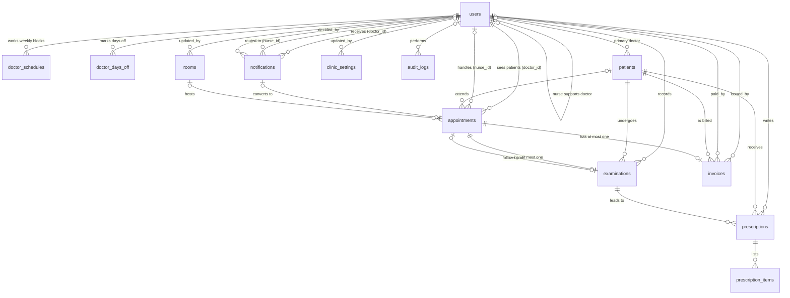

# DATABASE | AppointMed

This document explains the AppointMed database: why it is shaped the way it is, what every table and column means, how the backend reads and writes it, and how it meets the course requirements. It complements `DOCUMENTATION.md` (whole system), `BACKEND.md`, `FRONTEND.md`, and the study notes in [note.md](../../note.md).

**Course Affiliation**

Laguna State Polytechnic University | College of Computer Studies  
CMSC 203 – Object-Oriented Programming, ITEC 104 – Data Structures and Algorithm, ITEC 105 – Information Management  
Instructors: Ms. Roxanne Garbo, Sir Rolan C. Sotomayor, Sir Jencel P. Sofer  
Academic Year: 2026 – 2027  
System Project Assigned: Clinic Appointment System

**Contents**

1. [Overview](#1-overview)
2. [Files and Setup](#2-files-and-setup)
3. [Design Approach](#3-design-approach)
4. [Entity Relationship Diagram](#4-entity-relationship-diagram)
5. [Data Dictionary](#5-data-dictionary)
6. [Relationships and Foreign Keys](#6-relationships-and-foreign-keys)
7. [Constraints and Indexes](#7-constraints-and-indexes)
8. [Normalization](#8-normalization)
9. [The Double-Booking Guard](#9-the-double-booking-guard)
10. [How the Backend Accesses the Database](#10-how-the-backend-accesses-the-database)
11. [Transactions and Concurrency](#11-transactions-and-concurrency)
12. [Workflow and the Tables It Touches](#12-workflow-and-the-tables-it-touches)
13. [Key Queries Explained](#13-key-queries-explained)
14. [Reports and Aggregates](#14-reports-and-aggregates)
15. [Sample Data](#15-sample-data)
16. [Security and Integrity](#16-security-and-integrity)
17. [Maintenance, Backup, and Restore](#17-maintenance-backup-and-restore)
18. [Verification Queries](#18-verification-queries)
19. [Compliance with the Project Instructions](#19-compliance-with-the-project-instructions)
20. [Known Issues and Recommended Improvements](#20-known-issues-and-recommended-improvements)

---

## 1. Overview

AppointMed stores everything in **one MySQL 8 database named `appointmed`**. `schema.sql` creates the normal app tables, including `departments` for the front page. Nobody connects to it directly: the React app and the public pages talk to the FastAPI backend, and only the backend runs SQL.

| Fact | Value |
|---|---|
| DBMS | MySQL 8.0 or newer |
| Storage engine | InnoDB (transactions and foreign keys) |
| Character set | `utf8mb4` |
| Tables | 14 (13 in `schema.sql`, plus `departments`) |
| Driver | `mysql-connector-python`, connection pool of 8 |
| Application account | `appointmed_user`, with `SELECT`, `INSERT`, `UPDATE`, `DELETE` only |
| Structure owner | `root` (loads the SQL files and restores backups) |

| Group | Tables |
|---|---|
| Staff and scheduling | `users`, `doctor_schedules`, `doctor_days_off`, `rooms` |
| Requests and visits | `notifications`, `patients`, `appointments` |
| Clinical | `examinations`, `prescriptions`, `prescription_items` |
| Billing | `invoices` |
| Administration | `clinic_settings`, `audit_logs` |
| Public front page | `departments` |

## 2. Files and Setup

| File | Purpose |
|---|---|
| `source/database/schema.sql` | Structure only: tables, keys, constraints, indexes. Starts with `USE appointmed;` and uses `CREATE TABLE IF NOT EXISTS`, so it is safe to repeat. |
| `source/database/seed.sql` | Fictional sample data. Load **once**. |
| `source/database/schema.sql` | Creates the `departments` table and the rest of the app schema. Safe to repeat. |
| `source/.env` | Connection settings (`DB_*`). Never committed. |
| `backend/core/config.py` | Reads `.env` once into the frozen `Settings` object |
| `backend/core/database.py` | Pool, transactions, retry, and error translation |

Setup order (details in `CONTRIBUTING.md`, Steps 4 to 6):

1. As `root`, create the database and the limited `appointmed_user`.
2. As `root`, load `schema.sql`, then `seed.sql` (once).
3. Put the same password in `source/.env` as `DB_PASSWORD`.

The pool is **created on the first query**, so the backend starts even when MySQL is down. In that case `/api/health/db` reports `connected: false` and API calls return a clean 503. If the database is rebuilt while the backend runs, the next failing call rebuilds the pool once and retries.

## 3. Design Approach

The schema follows the real clinic workflow.

1. A **patient requests** an appointment online. They have no account, so the request carries their details (`notifications`). Only dates the doctor works, and does not mark off (`doctor_days_off`), can be requested.
2. Staff **approve** the request. That creates (or reuses) a `patients` record and an `appointments` row. A rejected request stays as `Dismissed` with a reason.
3. The patient **checks in** (`checked_in_at` sets queue order), the doctor **examines** them, writes a **prescription**, and an **invoice** is totalled.
4. Payment **completes** the appointment.
5. The administrator manages `users`, `doctor_schedules`, `rooms`, and `clinic_settings`, and reviews `audit_logs`.

| Decision | Reason |
|---|---|
| Patients are **not** users | Patients never log in, so `users` stays small and every row has a role |
| Requests are separate from appointments | A request may be rejected, so no half-valid appointment rows |
| `appointments.full_name` even with `patient_id` | An appointment can exist before a patient record does |
| One invoice and one examination per appointment | `UNIQUE` on `appointment_id` makes double billing impossible |
| Users are deactivated, never deleted | History and the audit trail keep their actors |
| Weekly schedule as rows, plus single days off | Slots can be computed for any date. Two rows on a day give a lunch break. |
| Settings as key/value rows | New settings need no schema change |
| Money as `DECIMAL(10,2)` | Exact arithmetic |
| Statuses as `ENUM` | The database rejects an unknown status |

## 4. Entity Relationship Diagram



Symbols: `||` exactly one, `|o` zero or one, `o{` zero or many. `clinic_settings` and `departments` have no incoming relationships.

## 5. Data Dictionary

Legend: **PK** primary key, **FK** foreign key, **UQ** unique, **AI** auto increment, **NN** not null.

### 5.1 `users`

| Column | Type | Rules | Meaning |
|---|---|---|---|
| `id` | INT | PK, AI | Staff id |
| `username` | VARCHAR(50) | NN, UQ | Login name |
| `password_hash` | VARCHAR(255) | NN | bcrypt hash, never plain text |
| `full_name` | VARCHAR(100) | NN | Display name |
| `role` | ENUM('doctor','nurse','admin') | NN | Decides which features the user may open |
| `email` | VARCHAR(100) | NULL | Contact email |
| `specialization` | VARCHAR(100) | NULL | Doctors only. Matches a department name. |
| `assigned_doctor_id` | INT | FK, NULL | Nurses only |
| `avatar` | MEDIUMBLOB | NULL | Small profile picture (up to 300 KB, checked by the backend) |
| `is_active` | BOOLEAN | NN, default TRUE | False blocks the account, history is kept |
| `last_login_at`, `created_at` | TIMESTAMP | | Updated on login, set on creation |

### 5.2 `doctor_schedules`

| Column | Type | Rules | Meaning |
|---|---|---|---|
| `id` | INT | PK, AI | |
| `doctor_id` | INT | NN, FK | |
| `weekday` | TINYINT | NN, CHECK 1 to 7 | ISO weekday: 1 Monday to 7 Sunday |
| `start_time`, `end_time` | TIME | NN, CHECK end > start | One working block |
| `slot_minutes` | SMALLINT | NN, default 30 | Length of one bookable slot |

`UNIQUE (doctor_id, weekday, start_time)` prevents two blocks starting at the same time.

### 5.3 `doctor_days_off`

| Column | Type | Rules | Meaning |
|---|---|---|---|
| `id` | INT | PK, AI | |
| `doctor_id` | INT | NN, FK to `users` | |
| `off_date` | DATE | NN | A date the doctor is unavailable |
| `reason` | VARCHAR(255) | NULL | Visible to staff only. The public page receives dates, never reasons. |
| `created_at` | TIMESTAMP | default now | |

`UNIQUE (doctor_id, off_date)`: a date can be marked once per doctor.

### 5.4 `rooms`

| Column | Type | Rules | Meaning |
|---|---|---|---|
| `id` | INT | PK, AI | |
| `room_name` | VARCHAR(50) | NN, UQ | |
| `status` | ENUM('Available','Occupied','Maintenance') | NN, default Available | |
| `updated_by` | INT | FK, NULL | Who last changed it |
| `updated_at` | TIMESTAMP | `ON UPDATE` now | Maintained by MySQL |

### 5.5 `notifications` (booking requests)

| Column | Type | Rules | Meaning |
|---|---|---|---|
| `id` | INT | PK, AI | |
| `doctor_id` | INT | NN, FK | The doctor the requester chose |
| `nurse_id` | INT | FK, NULL | Nurse it is routed to (fewest pending) |
| `requester_name` | VARCHAR(100) | NN | |
| `contact_number`, `email` | VARCHAR | | Email receives the confirmation or reason |
| `birthdate`, `sex`, `address` | | NULL | Used to create the patient |
| `preferred_datetime` | DATETIME | NULL | The slot picked on the website |
| `reason` | VARCHAR(255) | | |
| `origin` | ENUM('Website','Phone','Other') | NN, default Website | |
| `status` | ENUM('Pending','Converted','Dismissed') | NN, default Pending | Staff see Converted as "Approved" and Dismissed as "Disapproved" |
| `decision_note` | VARCHAR(255) | NULL | Reason given when dismissed (emailed) |
| `decided_by` | INT | FK, NULL | Staff member who decided |
| `created_at`, `resolved_at` | TIMESTAMP | | |

### 5.6 `patients`

| Column | Type | Rules | Meaning |
|---|---|---|---|
| `id` | INT | PK, AI | |
| `full_name` | VARCHAR(100) | NN, indexed | |
| `birthdate` | DATE | | |
| `sex` | ENUM('Male','Female','Other') | NULL | |
| `contact_number`, `email`, `address` | VARCHAR | | Latest known contact details |
| `condition_summary` | VARCHAR(255) | | Short note on the latest condition |
| `doctor_id` | INT | FK, NULL | Current or primary doctor |
| `created_at` | TIMESTAMP | default now | Used by "new patients" in reports |

### 5.7 `appointments`

| Column | Type | Rules | Meaning |
|---|---|---|---|
| `id` | INT | PK, AI | |
| `notification_id` | INT | FK, NULL | Set only when converted from a request |
| `patient_id` | INT | FK, NULL | Filled in when the patient record exists |
| `full_name` | VARCHAR(100) | NN | Appointee's name |
| `doctor_id` | INT | NN, FK | |
| `nurse_id` | INT | FK, NULL | NULL when the doctor booked it |
| `room_id` | INT | FK, NULL | Chosen exam room. **Required before check-in** (enforced by the service). |
| `source` | ENUM('Notification','Walk-in','Follow-up') | NN, default Walk-in | |
| `scheduled_time` | DATETIME | NN | |
| `reason` | VARCHAR(255) | | |
| `status` | ENUM('Scheduled','Checked-in','Consulting','Examined','Completed','Cancelled') | NN, default Scheduled | Workflow state |
| `checked_in_at` | DATETIME | NULL | Orders the waiting queue |
| `created_at` | TIMESTAMP | | |
| `active_slot` | DATETIME | **VIRTUAL generated** | See Section 9 |

### 5.8 `examinations`

| Column | Type | Rules | Meaning |
|---|---|---|---|
| `id` | INT | PK, AI | |
| `appointment_id` | INT | NN, **UQ**, FK | One examination per appointment |
| `patient_id`, `doctor_id` | INT | NN, FK | |
| `diagnosis`, `notes` | TEXT | | The doctor's findings |
| `outcome` | ENUM('Follow-up Scheduled','Sent to History') | NN | |
| `follow_up_appointment_id` | INT | FK, NULL | Set when a follow-up is booked |
| `examined_at` | TIMESTAMP | | |

### 5.9 `prescriptions` and `prescription_items`

`prescriptions`: `id`, `examination_id`, `patient_id`, `doctor_id` (all NN, FK), `notes` (VARCHAR 255), `issued_at`.

`prescription_items`

| Column | Type | Rules | Meaning |
|---|---|---|---|
| `id` | INT | PK, AI | |
| `prescription_id` | INT | NN, FK, `ON DELETE CASCADE` | Deleting a prescription removes its lines |
| `medicine_name` | VARCHAR(150) | NN | |
| `dosage` | VARCHAR(100) | | For example "500 mg" |
| `quantity` | INT | NN, default 1, CHECK > 0 | |
| `unit_price` | DECIMAL(10,2) | NN, default 0, CHECK >= 0 | Billed on the invoice |
| `instructions` | VARCHAR(255) | | |

### 5.10 `invoices`

| Column | Type | Rules | Meaning |
|---|---|---|---|
| `id` | INT | PK, AI | |
| `patient_id` | INT | NN, FK | |
| `appointment_id` | INT | NN, **UQ**, FK | One invoice per appointment |
| `issued_by` | INT | NN, FK | Staff member who started the exam or billed it |
| `consultation_fee`, `medicines_total` | DECIMAL(10,2) | NN, default 0, CHECK >= 0 | |
| `amount` | DECIMAL(10,2) | NN, CHECK >= 0 | Must equal fee plus medicines (`chk_invoices_total`) |
| `status` | ENUM('Unpaid','Paid','Cancelled') | NN, default Unpaid | |
| `issued_at`, `paid_at` | TIMESTAMP | | |
| `paid_by` | INT | FK, NULL | Staff member who received payment |

### 5.11 `clinic_settings`

| Column | Type | Rules | Meaning |
|---|---|---|---|
| `setting_key` | VARCHAR(50) | **PK** | Natural key |
| `setting_value` | VARCHAR(255) | NN | Text, validated by the backend |
| `description` | VARCHAR(255) | | |
| `updated_by` | INT | FK, NULL | |
| `updated_at` | TIMESTAMP | `ON UPDATE` now | |

| Key | Meaning | Validation (backend) |
|---|---|---|
| `clinic_name` | Name on the website and invoices | Required, up to 100 characters |
| `clinic_address` | Clinic address | Required, up to 255 characters |
| `consultation_fee` | Default fee when an exam starts | 0 to 1,000,000, two decimals |
| `default_slot_minutes` | Default slot length | Whole number, 5 to 120 (stored only) |
| `online_booking_enabled` | Public booking switch | `true` or `false` |
| `booking_window_days` | How far ahead patients may book | Whole number, 1 to 365 |

### 5.12 `audit_logs`

| Column | Type | Rules | Meaning |
|---|---|---|---|
| `id` | INT | PK, AI | |
| `user_id` | INT | FK, NULL | NULL for system or unauthenticated actions |
| `action` | VARCHAR(50) | NN | For example LOGIN, CREATE_USER, SET_DAY_OFF |
| `entity`, `entity_id` | VARCHAR(50), INT | NULL | Table or concept affected (not a foreign key) |
| `details` | VARCHAR(255) | NULL | Short text. Never passwords or medical details. |
| `created_at` | TIMESTAMP | | |

Actions the backend writes: `LOGIN`, `LOGIN_FAILED`, `UPDATE_PROFILE`, `CHANGE_PASSWORD`, `BOOKING_REQUEST`, `APPROVE_REQUEST`, `DISMISS_REQUEST`, `CREATE_APPOINTMENT`, `CHECK_IN`, `START_EXAM`, `RETURN_TO_QUEUE`, `FINISH_EXAM`, `CANCEL_APPOINTMENT`, `RESCHEDULE_APPOINTMENT`, `CREATE_INVOICE`, `PAY_INVOICE`, `CREATE_PATIENT`, `UPDATE_PATIENT`, `DELETE_PATIENT`, `UPDATE_ROOM_STATUS`, `SET_DAY_OFF`, `CLEAR_DAY_OFF`, `CREATE_USER`, `UPDATE_USER`, `ACTIVATE_USER`, `DEACTIVATE_USER`, `RESET_PASSWORD`, `UPDATE_SCHEDULE`, `CREATE_ROOM`, `UPDATE_ROOM`, `DELETE_ROOM`, `UPDATE_SETTING`, `DB_INSERT_ROW`, `DB_UPDATE_ROW`, `DB_DELETE_ROW`, `DB_RUN_SQL`, `BACKUP_DATABASE`, `RESTORE_DATABASE`.

### 5.13 `departments` (from `landing_update.sql`)

| Column | Type | Meaning |
|---|---|---|
| `id` | INT | PK, AI |
| `name` | VARCHAR | Department name. Doctors whose `specialization` equals it are counted. |
| `description` | VARCHAR/TEXT | Shown on the front page |
| `icon` | VARCHAR, NULL | Image path under `frontend/public` |
| `is_featured` | BOOLEAN | Shown as a card on the front page |
| `is_active` | BOOLEAN | Inactive departments are hidden |
| `sort_order` | INT | Ordering after featured |

Columns are as read by `DepartmentRepository`. If this table is missing, the endpoint answers 503 and the front page shows its built-in six departments.

## 6. Relationships and Foreign Keys

All foreign keys use the default `RESTRICT` (a parent cannot be deleted while children point to it). The only cascade is `prescription_items` to `prescriptions`.

| Child column | Parent | Meaning |
|---|---|---|
| `users.assigned_doctor_id` | `users.id` | Nurse supports a doctor |
| `doctor_schedules.doctor_id`, `doctor_days_off.doctor_id` | `users.id` | Whose hours and days off |
| `rooms.updated_by`, `clinic_settings.updated_by`, `audit_logs.user_id` | `users.id` | Who changed or did it |
| `notifications.doctor_id`, `.nurse_id`, `.decided_by` | `users.id` | Requested doctor, routed nurse, decider |
| `patients.doctor_id` | `users.id` | Primary doctor |
| `appointments.notification_id` | `notifications.id` | Request it came from |
| `appointments.patient_id` | `patients.id` | The patient |
| `appointments.doctor_id`, `.nurse_id` | `users.id` | Doctor and nurse |
| `appointments.room_id` | `rooms.id` | Exam room |
| `examinations.appointment_id`, `.follow_up_appointment_id` | `appointments.id` | The visit and its follow-up |
| `examinations.patient_id`, `.doctor_id` | `patients.id`, `users.id` | |
| `prescriptions.examination_id`, `.patient_id`, `.doctor_id` | `examinations`, `patients`, `users` | |
| `prescription_items.prescription_id` | `prescriptions.id` | Cascade delete |
| `invoices.patient_id`, `.appointment_id` | `patients.id`, `appointments.id` | |
| `invoices.issued_by`, `.paid_by` | `users.id` | |

**Rules SQL cannot express** (a foreign key only checks that the parent exists). The services enforce them:

- `users.assigned_doctor_id` must point to an **active user whose role is `doctor`**, and only for nurses.
- `appointments.doctor_id`, `notifications.doctor_id`, `doctor_schedules.doctor_id`, and `doctor_days_off.doctor_id` must be doctors.
- A nurse only works with the data of the assigned doctor (doctor scope).

## 7. Constraints and Indexes

### 7.1 Constraints

| Type | Where | Purpose |
|---|---|---|
| `PRIMARY KEY` | Every table (`clinic_settings` uses `setting_key`) | Row identity |
| `FOREIGN KEY` | Section 6 | Referential integrity |
| `UNIQUE` | `users.username`, `rooms.room_name`, `examinations.appointment_id`, `invoices.appointment_id`, `doctor_schedules (doctor_id, weekday, start_time)`, `doctor_days_off (doctor_id, off_date)`, `appointments (doctor_id, active_slot)` | No duplicates where the business forbids them |
| `CHECK` | `chk_schedules_weekday`, `chk_schedules_times`, `chk_rx_items_qty`, `chk_rx_items_price`, `chk_invoices_amount`, `chk_invoices_parts` (fee and medicines >= 0), `chk_invoices_total` (amount = fee + medicines) | Reject impossible values |
| `ENUM`, `NOT NULL`, `DEFAULT` | Roles, statuses, required columns | Valid values and starting values |
| `ON UPDATE CURRENT_TIMESTAMP` | `rooms.updated_at`, `clinic_settings.updated_at` | Automatic change tracking |
| `ON DELETE CASCADE` | `prescription_items.prescription_id` | Lines never outlive their prescription |

### 7.2 Indexes

| Index | Table and columns | Supports |
|---|---|---|
| `idx_users_role`, `idx_users_assigned_doctor` | `users` | Role filters, a doctor's nurses |
| `idx_patients_name` | `patients (full_name)` | Name search and the duplicate check |
| `idx_notifications_nurse_status`, `idx_notifications_doctor_status` | `notifications` | Nurse load balancing, a doctor's inbox |
| `idx_appointments_time` | `appointments (scheduled_time)` | Date lists and reports |
| `idx_appointments_doctor_status` | `appointments (doctor_id, status)` | Queue, exam room, dashboards |
| `idx_appointments_patient` | `appointments (patient_id)` | Patient history |
| `uq_doctor_active_slot` | `appointments (doctor_id, active_slot)` | Double-booking guard |
| `uq_doctor_off_date` | `doctor_days_off (doctor_id, off_date)` | One day off per date, and day-off lookups |
| `idx_exam_patient`, `idx_rx_patient` | `examinations`, `prescriptions` | Patient counts and lists |
| `idx_invoices_status` | `invoices (status)` | Unpaid and paid lists |
| `idx_audit_created`, `idx_audit_user` | `audit_logs` | Newest-first log, per-user activity |

## 8. Normalization

| Normal form | How the design meets it |
|---|---|
| **1NF** | Medicine lines are rows in `prescription_items`. A lunch break is two rows in `doctor_schedules`. Days off are rows, not a comma list. |
| **2NF** | Single-column primary keys, so every non-key column depends on the whole key |
| **3NF** | Staff facts live in `users`, patient facts in `patients`, room facts in `rooms`. Appointments store ids and use joins for names. |

**Deliberate, controlled redundancy:**

| Redundancy | Why it exists |
|---|---|
| `appointments.full_name` | The appointee may not be a patient yet |
| `notifications` holds the requester's details | The requester has no record until approval, and it records what they typed |
| `invoices.amount` = fee + medicines | Cheap reads. Now guarded by `chk_invoices_total`, and the service writes all three together. |
| `patients.condition_summary` | A quick summary for lists. The full record is in `examinations`. |
| `examinations.patient_id` and `doctor_id` | Direct patient and doctor queries |

## 9. The Double-Booking Guard

```sql
active_slot DATETIME GENERATED ALWAYS AS
    (CASE WHEN status = 'Cancelled' THEN NULL ELSE scheduled_time END) VIRTUAL,
UNIQUE KEY uq_doctor_active_slot (doctor_id, active_slot)
```

| Appointment status | `active_slot` | Effect |
|---|---|---|
| Any except Cancelled | Equals `scheduled_time` | Two rows with the same doctor and time collide |
| Cancelled | `NULL` | Many `NULL`s are allowed, so the slot can be booked again |

Between "is the slot free?" and "insert", another request could take it. The service checks first (`conflict_exists`) for a friendly message, but **the index is the final judge**. If the insert hits `ER_DUP_ENTRY` (1062), the repository turns it into `DuplicateEntryError`, and the service re-raises it as `AppointmentConflictError` (HTTP 409). Rescheduling uses the same guard because `active_slot` changes with `scheduled_time`.

## 10. How the Backend Accesses the Database

### 10.1 Layers

```
Route -> Service (rules, transactions) -> Repository (SQL only) -> Executor (Database / Transaction / AdminSession) -> MySQL
```

Only repositories contain SQL. Every value is passed separately from the SQL text (`%s`), which prevents SQL injection.

### 10.2 `Executor`, `Database`, `Transaction`, `AdminSession`

| Class | Role |
|---|---|
| `Executor` (abstract) | `fetch_all`, `execute` (new id), `update` (rows changed), plus `fetch_one` and `server_now` |
| `Database` | A pooled connection **per call**, committed at once (`autocommit=True`). `transaction()`, `is_reachable()`, and a one-time pool rebuild on failure. |
| `Transaction` | Several calls on **one connection**, committed or rolled back together |
| `AdminSession` | A transaction for the admin Database page. Keeps MySQL's own error message for the administrator. |

All of them are `Executor`s, so **a repository works unchanged inside or outside a transaction**. `server_now()` runs `SELECT NOW()`, so Python and SQL agree on "now".

### 10.3 `BaseRepository`

Generic `get`, `create`, `update`, `delete`. Column names come from the repository's fixed `columns` tuple, and an unknown column raises `ValueError`.

### 10.4 Repository to table map

| Repository | Table(s) |
|---|---|
| `UserRepository`, `ScheduleRepository`, `DayOffRepository` | `users`, `doctor_schedules`, `doctor_days_off` |
| `PatientRepository` | `patients` |
| `AppointmentRepository` | `appointments` (joins `users`, `rooms`, `patients`, `notifications`, `invoices`) |
| `NotificationRepository` | `notifications` |
| `ExaminationRepository` | `examinations` (encounters join `appointments`, `invoices`) |
| `PrescriptionRepository` | `prescriptions`, `prescription_items` |
| `InvoiceRepository`, `RoomRepository`, `SettingsRepository`, `AuditRepository` | `invoices`, `rooms`, `clinic_settings`, `audit_logs` |
| `ReportRepository` | Read-only aggregates across several tables |
| `DepartmentRepository`, `StaffDirectoryRepository` | `departments`, `users` (public lists) |
| `DatabaseAdminRepository` | Any table, after the name is checked against `information_schema` |

### 10.5 Error translation

| Driver error | Becomes | HTTP |
|---|---|---|
| `IntegrityError` with `ER_DUP_ENTRY` | `DuplicateEntryError` | 409 |
| Other `IntegrityError` | `ConflictError` | 409 |
| Anything else (connection lost, timeout) | `DatabaseUnavailableError` (real error logged) | 503 |

The admin Database page is the one exception: it returns MySQL's message to an administrator.

## 11. Transactions and Concurrency

`with self._db.transaction() as tx:` starts a transaction, **commits** if the block finishes, and **rolls back on any exception**, then re-raises it.

| Operation | Why it must be atomic |
|---|---|
| `approve_notification`, `dismiss_notification` | Patient, appointment, request status, and audit row |
| `create_appointment`, `check_in`, `start_exam`, `release`, `cancel`, `reschedule`, `assign_room`, `set_room_status` | Status or room change plus its audit entry and side effects |
| `finish_exam` | Examination, prescription and items, invoice totals, room release, status, optional follow-up |
| `pay`, `bill` | Invoice and appointment status together |
| `book` (public) | Slot re-check, nurse choice, request, audit |
| `set_day_off`, `clear_day_off` | Day off and audit |
| `create_user`, `update_user`, `set_active`, `reset_password` | The change and its audit entry |
| `replace_schedule`, `update_settings`, room create, update, delete | All blocks or settings and their audit rows |
| Database page writes and `import_backup` | The change, its audit row, or the whole import |
| Login | `last_login_at` and the `LOGIN` audit row |

| Concurrency risk | Protection |
|---|---|
| Two bookings for the same doctor and time | Unique `active_slot` index |
| Two simultaneous exam starts, bookings, or days off for one doctor | `SELECT ... FOR UPDATE` on the doctor's `users` row inside the transaction |
| Two staff approve the same request | `resolve()` updates only `WHERE status = 'Pending'`, and 0 rows means "already handled" (409) |
| Two people pay the same invoice | `mark_paid()` updates only `WHERE status = 'Unpaid'` |
| Editing an invoice paid meanwhile | `set_amounts()` updates only unpaid invoices |

Note: `PatientService` writes the audit row as a separate commit after the change, and the failed-login audit row is written alone. See Section 20.

## 12. Workflow and the Tables It Touches

| Step | Action | Reads | Writes |
|---|---|---|---|
| 1 | Patient requests online | `users`, `doctor_schedules`, `doctor_days_off`, `appointments`, `notifications`, `clinic_settings` | `notifications` (Pending), `audit_logs` |
| 2a | Staff approve | `notifications`, `patients`, `appointments`, `doctor_days_off`, `rooms`, `clinic_settings`, `users` | `patients`, `appointments` (Scheduled), `notifications` (Converted), `audit_logs` |
| 2b | Staff disapprove | `notifications`, `clinic_settings` | `notifications` (Dismissed, note), `audit_logs` |
| 3 | Check in (room required) | `appointments`, `patients` | `appointments` (Checked-in, `checked_in_at`), `patients` (if created), `audit_logs` |
| 4 | Start exam | `appointments`, `rooms`, `invoices`, `clinic_settings`, `users` (lock) | `appointments` (Consulting, room), `rooms` (Occupied), `invoices` (default fee), `audit_logs` |
| 5 | Finish exam | `appointments`, `invoices`, `users`, `doctor_days_off` | `examinations`, `prescriptions`, `prescription_items`, `invoices` (totals), `rooms`, `appointments` (Examined, optional follow-up), `audit_logs` |
| 6 | Mark paid | `invoices`, `appointments` | `invoices` (Paid), `appointments` (Completed), `audit_logs` |
| 7 | History and patient record | `appointments`, `examinations`, `invoices`, `prescription_items` | None |
| Cancel | Scheduled or Checked-in | `appointments`, `invoices` | `appointments` (Cancelled, frees `active_slot`), `invoices` (Unpaid becomes Cancelled), `audit_logs` |
| Day off | Doctor marks a date | `appointments`, `notifications`, `doctor_days_off` | `doctor_days_off`, `audit_logs` |

State machine enforced by `AppointmentWorkflow`:

```
Scheduled  -> Checked-in, Cancelled
Checked-in -> Consulting, Cancelled
Consulting -> Examined, Checked-in
Examined   -> Completed
Completed, Cancelled -> (final)
```

## 13. Key Queries Explained

**Is the doctor already booked at this time?** (`conflict_exists`)

```sql
SELECT 1 AS hit FROM appointments
WHERE doctor_id = %s AND scheduled_time = %s AND status <> 'Cancelled' AND id <> %s LIMIT 1
```

`id <> %s` lets a reschedule ignore the appointment being moved.

**Which times are already taken on a day?** (`booked_times`)

```sql
SELECT scheduled_time AS taken FROM appointments
  WHERE doctor_id = %s AND DATE(scheduled_time) = %s AND status <> 'Cancelled'
UNION
SELECT preferred_datetime AS taken FROM notifications
  WHERE doctor_id = %s AND status = 'Pending' AND preferred_datetime IS NOT NULL AND DATE(preferred_datetime) = %s
```

`UNION` combines booked appointments with **pending requests**, so two visitors are not offered the same slot. The result becomes a Python `set` for O(1) lookups.

**Is this day marked off?** (`DayOffRepository.is_off`)

```sql
SELECT 1 AS hit FROM doctor_days_off WHERE doctor_id = %s AND off_date = %s LIMIT 1
```

**Which days are busy?** (`booked_days`)

```sql
SELECT DISTINCT DATE(scheduled_time) AS day FROM appointments
WHERE doctor_id = %s AND status IN ('Scheduled', 'Checked-in') AND DATE(scheduled_time) BETWEEN %s AND %s
```

Merged in Python (a set union) with `pending_days` from notifications.

**Is this a returning patient?** (`find_match`)

```sql
SELECT * FROM patients WHERE LOWER(full_name) = LOWER(%s) AND birthdate <=> %s LIMIT 1
```

`<=>` is MySQL's **NULL-safe equality**: two NULL birthdates are equal.

**Patients a doctor may see** (`_SCOPE`)

```sql
(p.doctor_id = %s OR EXISTS (SELECT 1 FROM appointments a WHERE a.patient_id = p.id AND a.doctor_id = %s))
```

**Route a request to the least busy nurse** (`nurses_for_doctor`)

```sql
SELECT u.id, u.full_name, COUNT(n.id) AS pending
FROM users u LEFT JOIN notifications n ON n.nurse_id = u.id AND n.status = 'Pending'
WHERE u.role = 'nurse' AND u.is_active = 1 AND u.assigned_doctor_id = %s
GROUP BY u.id, u.full_name ORDER BY pending, u.id
```

**Lock the doctor row** (`_lock_doctor`)

```sql
SELECT id FROM users WHERE id = %s FOR UPDATE
```

Held until the transaction ends, so a second transaction for the same doctor waits.

**Pay an invoice safely** (`mark_paid`)

```sql
UPDATE invoices SET status = 'Paid', paid_at = NOW(), paid_by = %s WHERE id = %s AND status = 'Unpaid'
```

A second payment changes 0 rows.

**Upsert a setting**

```sql
INSERT INTO clinic_settings (setting_key, setting_value, updated_by) VALUES (%s, %s, %s)
ON DUPLICATE KEY UPDATE setting_value = VALUES(setting_value), updated_by = VALUES(updated_by)
```

**Paged audit log and invoice items without N+1.** A `COUNT(*)` with the same `WHERE` gives the total, then `ORDER BY ... LIMIT %s OFFSET %s` gives the page. One `IN (%s, %s, ...)` query fetches every medicine line, and Python groups them with a `defaultdict(list)`.

**Table metadata** (admin Database page). `information_schema.tables` and `information_schema.columns` give table and column names, types, keys, and generated columns. Any table name from the browser is checked against this list before it is used.

## 14. Reports and Aggregates

`ReportRepository` runs read-only queries for the admin dashboard and reports.

**Dashboard overview:** active users by role (`GROUP BY role`), total patients, today's non-cancelled appointments, pending requests, paid revenue this month, and total unpaid. `COALESCE(SUM(...), 0)` makes empty results return 0.

**Range report** (at most one year):

| Result | Technique |
|---|---|
| Appointments by status | `GROUP BY status` with `COUNT(*)` |
| Per doctor | `users LEFT JOIN appointments LEFT JOIN invoices`, `COUNT(a.id)`, `SUM(a.status = 'Completed')` (a boolean sums as 0 or 1), conditional sums such as `SUM(CASE WHEN i.status = 'Paid' THEN i.amount END)`. `LEFT JOIN` keeps doctors with no activity. |
| Day by day | `GROUP BY DATE(a.scheduled_time)` of non-cancelled appointments with paid revenue |
| New patients | `COUNT(*)` of `patients` created in the range |

## 15. Sample Data

`seed.sql` is **fictional**: staff are SpongeBob SquarePants characters, and patients are cartoon characters (Rick and Morty, Ben 10, Adventure Time, Regular Show, The Simpsons, Family Guy, Scooby-Doo, Dexter's Laboratory, Phineas and Ferb). Emails use `example.com`. Never put real personal or medical data in it. User ids are read back into variables (`@sandy`, `@dora`, and so on) instead of being hard-coded. Appointment dates are relative to `CURDATE()`, so "today" always has a live queue.

| Table | Rows | Notes |
|---|---:|---|
| `users` | 10 | 1 admin, 5 doctors (Cheeks, Tentacles, Pearl, SquarePants, Patrick), 4 nurses (Dora and Blossom support Cheeks, Bubbles supports Tentacles, Buttercup supports Pearl). Passwords are bcrypt hashes (cost 12). Sample passwords are public (`CONTRIBUTING.md`). |
| `doctor_schedules` | 28 | Cheeks Mon to Fri with lunch break. Tentacles Mon, Wed, Fri. Pearl Tue, Thu with lunch. SquarePants Mon to Thu with lunch. Patrick Tue, Thu, Sat. 30-minute slots. |
| `doctor_days_off` | 1 | Dr. Tentacles, 10 days from today (a conference) |
| `rooms` | 5 | Room 101 and 103 and Procedure Room Available, Room 102 Occupied, Room 104 Maintenance |
| `notifications` | 6 | 3 Pending (#1, #2, #6), 2 Converted (#3, #4), 1 Dismissed (#5, a duplicate) |
| `patients` | 12 | Each with a condition summary and a primary doctor |
| `appointments` | 15 | Every status and every source (see below) |
| `examinations` | 4 | Appointments 1, 2, 4, and 12 |
| `prescriptions` / `prescription_items` | 3 / 4 | Amlodipine, Losartan, Cetirizine, lubricant eye drops |
| `invoices` | 4 | #1 Paid 1040.00, #2 Paid 500.00, #3 Unpaid 500.00 (appointment 6, Consulting), #4 Paid 900.00 |
| `clinic_settings` | 6 | The six keys in Section 5.11 |
| `audit_logs` | 9 | Sample entries for the log screen |

| # | Patient | Doctor | When | Status | What it tests |
|---:|---|---|---|---|---|
| 1 | Rick Sanchez | Cheeks | 7 days ago | Completed | History, paid invoice, prescription, follow-up link to #7 |
| 2 | Morty Smith | Tentacles | 3 days ago | Completed | History, paid invoice, prescription |
| 12 | Velma Dinkley | Pearl | 5 days ago | Completed | History for Dr. Pearl |
| 3 | Rigby (walk-in) | Cheeks | 2 days ago | Cancelled | Cancelled slot, no patient record |
| 4 | Ice King | Cheeks | Today 08:30 | Examined | **Examined but not billed** |
| 5 | Mordecai | Cheeks | Today 09:00 | Checked-in | Queue, converted from request #3 |
| 6 | Benson Dunwoody | Cheeks | Today 09:30 | Consulting | Under examination, Room 102, unpaid invoice |
| 7 | Rick Sanchez | Cheeks | Today 10:00 | Scheduled | Follow-up source |
| 13 | Shaggy Rogers | Cheeks | Today 10:30 | Checked-in | A second queue entry |
| 11 | Homer Simpson | Cheeks | Today 11:00 | Scheduled | Scheduled, no room yet |
| 8 | Dr. Cheeks (personal) | Cheeks | Today 14:00 | Scheduled | Booked by the doctor, no nurse |
| 9 | Summer Smith | Tentacles | Today 11:00 | Scheduled | Converted from request #4 |
| 14 | Stewie Griffin | Tentacles | Today 11:30 | Scheduled | Second Tentacles patient |
| 10 | Ben Tennyson | Tentacles | Tomorrow 09:00 | Scheduled | Future appointment |
| 15 | Dexter | Pearl | Today 10:00 | Checked-in | Queue for Dr. Pearl |

**Never run `seed.sql` against a shared or production database**, and load it only once (a second run causes `Duplicate entry` errors).

## 16. Security and Integrity

| Measure | Detail |
|---|---|
| Least privilege | `appointmed_user` has only `SELECT`, `INSERT`, `UPDATE`, `DELETE` on `appointmed.*`. It cannot create, alter, or drop tables. |
| No SQL injection | Parameterized queries. Column names from a fixed whitelist. Table names for the Database page come from `information_schema`. |
| Secrets | Database credentials live only in `source/.env` (gitignored) |
| Passwords | bcrypt hashes. `UserRepository` returns the hash only from `get_by_username` and `get_password_hash`. The Database page never sends `password_hash` or `avatar`. **Backups contain the hashes**, so keep them private. |
| Error hygiene | Database errors become generic messages. Only an administrator on the Database page sees MySQL's message. |
| History protection | Users are deactivated, not deleted. Patients and rooms with appointments cannot be deleted. |
| Audit trail | Important actions are logged. The app only inserts. The Database page treats `audit_logs` as read-only and rejects write statements that mention it. |
| Data content | Audit details must not contain passwords or medical details. The Database page logs the table and row count, not values. |
| Fictional data only | Never load real personal or medical data into development databases |
| Not for real patients yet | Encryption at rest, HTTPS to MySQL, and legal compliance (the Philippine Data Privacy Act, RA 10173) are not addressed. See `SECURITY.md`. |

## 17. Maintenance, Backup, and Restore

**Reset your database** (as `root`):

```sql
DROP DATABASE appointmed;
CREATE DATABASE appointmed CHARACTER SET utf8mb4 COLLATE utf8mb4_unicode_ci;
GRANT SELECT, INSERT, UPDATE, DELETE ON appointmed.* TO 'appointmed_user'@'localhost';
```

Then load `schema.sql`, `seed.sql`, and `landing_update.sql`, or use the dev console (`python dev.py`, option 5, which loads `schema.sql` and `seed.sql` only).

**Back up and restore**

| Way | How | Notes |
|---|---|---|
| Admin Database page | **Create and download backup** makes `appointmed-backup_<date>_<time>.sql` | Structure and data, in the app's own format. Includes password hashes. Audited. |
| Restore with MySQL | `mysql -u root -p appointmed < appointmed-backup_....sql` | Run as `root`. Replaces every table in the file. |
| Import in the app | **Choose backup file and import** | Replaces the rows of every table except `audit_logs`. Structure is not changed. The file must be a complete backup containing your own active admin account. |
| `mysqldump` | `mysqldump -u root -p appointmed > backup.sql` | The standard tool, if you prefer |

**Change the structure**

1. Edit `schema.sql` (and `seed.sql`, `landing_update.sql` if sample data changes). Do not change tables by hand without updating the files.
2. Update the matching repository queries and the frontend types.
3. Describe the change in the pull request.
4. After merging, every teammate resets their database.

**Add a table or column checklist:** key and type chosen, `NOT NULL` and default decided, foreign keys named `fk_<table>_<column>`, `CHECK` constraints `chk_...`, indexes `idx_...`, the repository `columns` whitelist updated, this data dictionary updated, and the backup and import still cover it (a backup must name every table of the database).

## 18. Verification Queries

Run as `root` or `appointmed_user` after loading the schema, seed, and landing update.

```sql
-- 14 tables
SELECT COUNT(*) AS tables_found FROM information_schema.tables WHERE table_schema = 'appointmed';

-- Row counts (expected: 10, 28, 1, 5, 6, 12, 15, 4, 3, 4, 4, 6, 9)
SELECT 'users' t, COUNT(*) n FROM users UNION ALL
SELECT 'doctor_schedules', COUNT(*) FROM doctor_schedules UNION ALL
SELECT 'doctor_days_off', COUNT(*) FROM doctor_days_off UNION ALL
SELECT 'rooms', COUNT(*) FROM rooms UNION ALL
SELECT 'notifications', COUNT(*) FROM notifications UNION ALL
SELECT 'patients', COUNT(*) FROM patients UNION ALL
SELECT 'appointments', COUNT(*) FROM appointments UNION ALL
SELECT 'examinations', COUNT(*) FROM examinations UNION ALL
SELECT 'prescriptions', COUNT(*) FROM prescriptions UNION ALL
SELECT 'prescription_items', COUNT(*) FROM prescription_items UNION ALL
SELECT 'invoices', COUNT(*) FROM invoices UNION ALL
SELECT 'clinic_settings', COUNT(*) FROM clinic_settings UNION ALL
SELECT 'audit_logs', COUNT(*) FROM audit_logs;

-- The double-booking guard should refuse this (use a real doctor id and an existing active time)
-- INSERT INTO appointments (full_name, doctor_id, scheduled_time) VALUES ('Test', 2, '<same time as an existing appointment>');
-- Expected: ERROR 1062 Duplicate entry ... for key 'uq_doctor_active_slot'

-- Invoices whose amount differs from fee + medicines (should return no rows; the CHECK also prevents it)
SELECT id FROM invoices WHERE amount <> consultation_fee + medicines_total;

-- Appointments whose doctor is not a doctor (should return no rows)
SELECT a.id FROM appointments a JOIN users u ON u.id = a.doctor_id WHERE u.role <> 'doctor';

-- Nurses without an assigned doctor (should return no rows)
SELECT id, username FROM users WHERE role = 'nurse' AND assigned_doctor_id IS NULL;

-- Days off on a day that still has open appointments (should return no rows)
SELECT d.doctor_id, d.off_date FROM doctor_days_off d JOIN appointments a
  ON a.doctor_id = d.doctor_id AND DATE(a.scheduled_time) = d.off_date
 AND a.status IN ('Scheduled', 'Checked-in', 'Consulting');

-- Sessions that are examined but not billed (seed: appointment 4)
SELECT a.id, a.full_name FROM appointments a LEFT JOIN invoices i ON i.appointment_id = a.id
WHERE a.status = 'Examined' AND i.id IS NULL;
```

## 19. Compliance with the Project Instructions

`CONTRIBUTING.md` lists only the CMSC 203 rubric. The ITEC 105 table maps the database to the standard information management topics. Replace or extend it when the instructor's requirements are available.

### 19.1 CMSC 203 – Object-Oriented Programming

| Brief requires | Database-related evidence |
|---|---|
| Save and Load Data | Every change is committed to MySQL through `Database` and `Transaction`. Pages load through repositories and services. Backups can be downloaded and imported. |
| Add, Edit, Delete, Search, Display | Per table (Section 12), with `BaseRepository` giving generic `create`, `update`, `delete`, `get`. The Database page offers them for any table. |
| Encapsulation | `Database` hides the pool, locking, retry, and error translation. `Settings` is frozen. |
| Abstraction | `Executor` and `BaseRepository` (abstract `table` and `columns`) |
| Inheritance | Every repository extends `BaseRepository`. `Database`, `Transaction`, and `AdminSession` extend `Executor`. |
| Polymorphism | The three executors are interchangeable |
| Constructors | `Database.__init__` (lazy pool), repositories receive their `Executor` |
| Custom exceptions | `DuplicateEntryError`, `AppointmentConflictError`, `DatabaseUnavailableError`, `ConflictError`, created in `_translate` |
| Exception handling | Driver errors never leak. Failures roll back the transaction. |
| Code quality | Only repositories contain SQL |

### 19.2 ITEC 105 – Information Management (standard topics)

| Topic | Where it appears |
|---|---|
| Requirements to entities, ER diagram | Sections 3 and 4 |
| Data dictionary | Section 5 |
| Primary, foreign, and unique keys | Sections 5 to 7 |
| Domain and integrity constraints | Section 7 |
| Referential actions | Section 6 |
| Normalization and justified redundancy | Section 8 |
| Indexing | Section 7.2 |
| Generated columns and unique-index technique | Section 9 |
| DDL and DML | `schema.sql`, `seed.sql`, repositories |
| Joins, subqueries (`EXISTS`), set operations (`UNION`) | Section 13 |
| Aggregation | Section 14 |
| Transactions, row locks, and concurrency | Section 11 |
| Security (least privilege, parameterized queries, hashing) | Section 16 |
| Backup, restore, and change management | Section 17 |
| Auditing | `audit_logs` (Section 5.12) |

### 19.3 ITEC 104 – Data Structures and Algorithms (database touchpoints)

| Item | Where |
|---|---|
| Priority queue (min-heap) by check-in time | `WaitingQueue`, fed by `AppointmentRepository.queue` |
| Set operations for open slots | `booked_times` returns a set, so slot generation tests membership in O(1) |
| Hash grouping | `defaultdict(list)` for medicine lines and weekdays |
| Sorting | `ORDER BY` on indexed columns, sorted schedule blocks |
| Searching and paging | `LIKE`, `LIMIT`, `OFFSET` |

## 20. Known Issues and Recommended Improvements

| # | Finding | Impact | Suggested fix |
|---|---|---|---|
| 1 | `departments` is created by `landing_update.sql`, not `schema.sql`, and the dev console reset skips that file | After a reset the front page uses its built-in six departments until the file is loaded | Move the table into `schema.sql` and seed its rows in `seed.sql` |
| 2 | Role rules on foreign keys (doctor, nurse) exist only in Python | Direct SQL edits (or the SQL console) could break them | Add triggers, or keep writes behind the backend |
| 3 | `default_slot_minutes` is stored but not used to build slots | The setting has no effect | Use it as the default for new schedule blocks, or remove it |
| 4 | `DATETIME` and `TIMESTAMP` carry no time zone | Fine for one clinic | Store UTC and convert in the frontend |
| 5 | `audit_logs.entity_id` is not a foreign key, and an import keeps old audit rows while replacing users | Audit rows may reference ids that changed | Keep as is, and never delete audited rows. Consider storing the username in the log. |
| 6 | `PatientService` and failed-login audit entries commit separately from the change | A crash between them could leave a change without an audit entry | Wrap them in `with self._db.transaction()` |
| 7 | Filters such as `DATE(scheduled_time) = %s` cannot use the time index | Slower date queries as data grows | Use `scheduled_time >= day AND scheduled_time < day + 1 day` |
| 8 | Two Pending requests for the same slot are possible under a race | Staff see a warning, and approval conflict checks and the unique index stop the second approval | Acceptable |
| 9 | Walk-in "check in now" does not require a room, though normal check-in does | Inconsistent rule | Apply one rule in the service |
| 10 | The SQL console masks hash columns by result name, and an administrator can write to most tables | An alias can reveal a hash, and a bad statement can break history | Block `password_hash` in console statements and limit writable tables |
| 11 | A doctor is counted in a department only when `specialization` equals the name | A spelling difference hides the doctor | Add a `department_id` foreign key |
| 12 | No automated database tests | Schema changes are verified by hand | Add a script that loads the SQL files and runs the Section 18 queries |

**Resolved since the last update:** `CREATE DATABASE` removed from `schema.sql`; seed invoices #2 and #3 are now consistent with their appointments; `CHECK (amount = consultation_fee + medicines_total)` added; unused legacy backend files removed.

---

*Last Updated: November 2026*