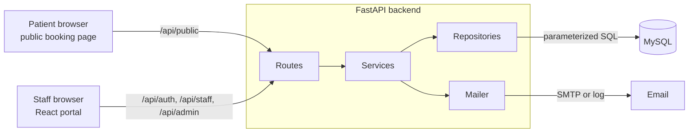
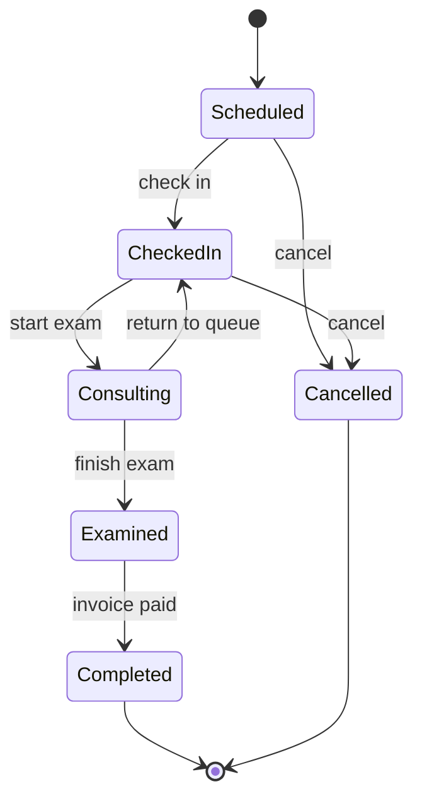
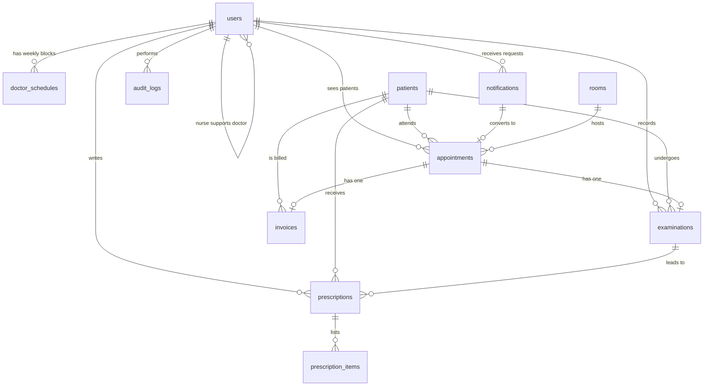
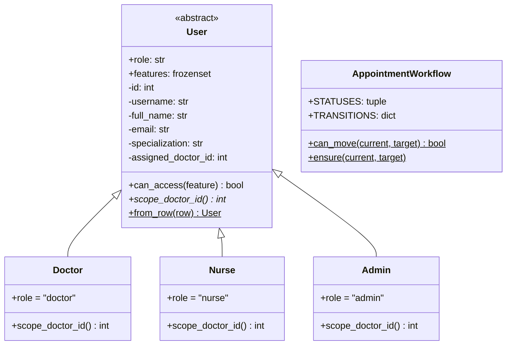
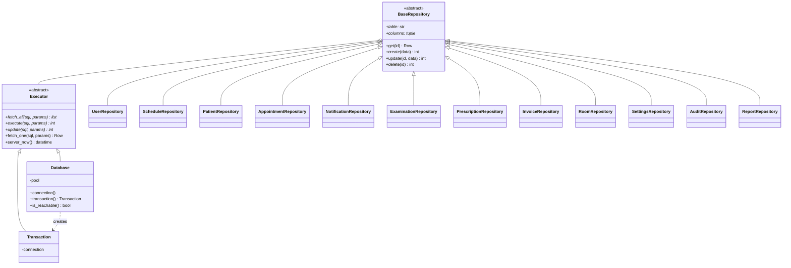
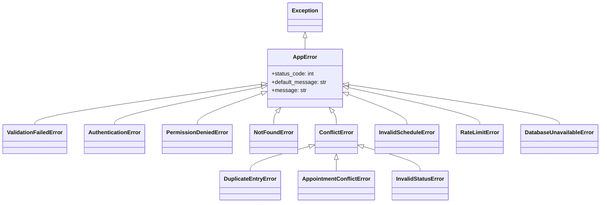
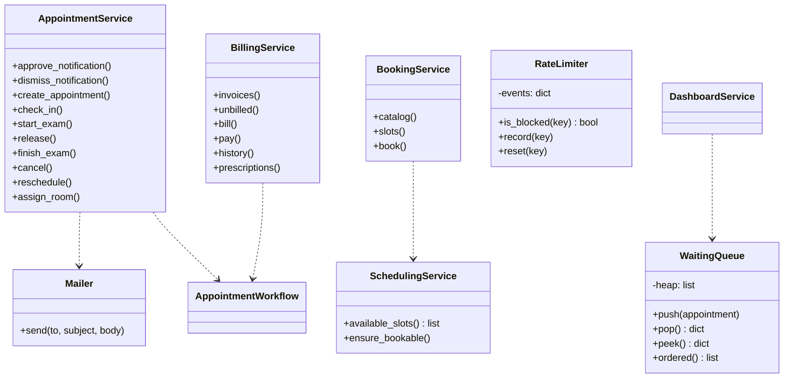
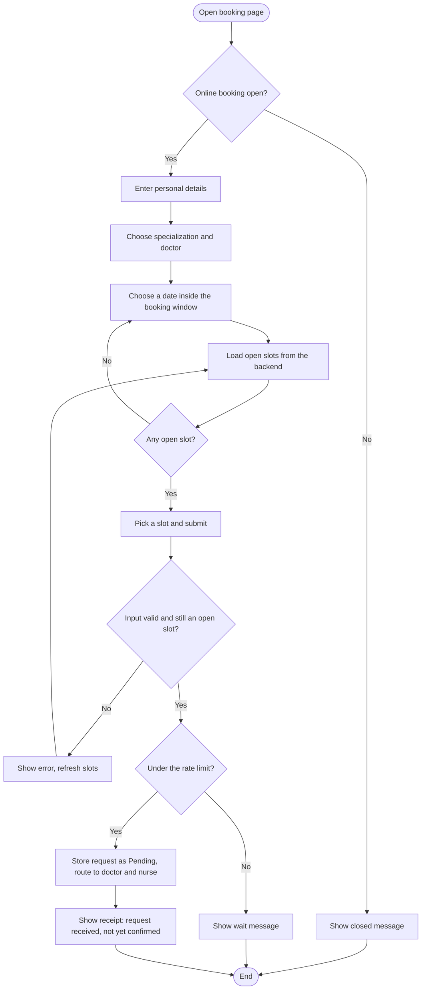
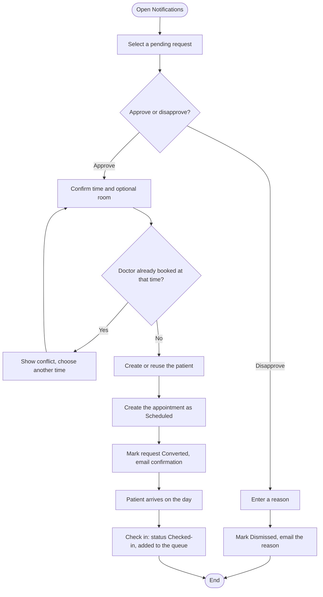
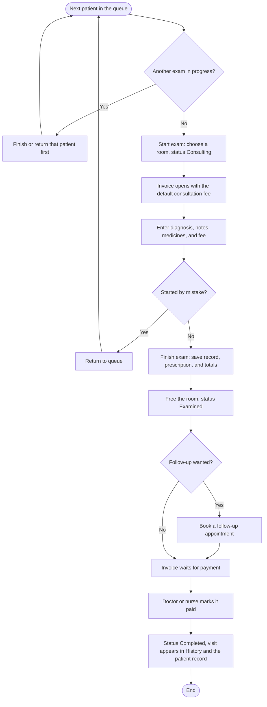

# DOCUMENTATION | AppointMed

AppointMed is a web-based clinic appointment and management system. Patients request appointments on a public booking page. Clinic staff (doctors, nurses, and administrators) use a role-based browser portal that takes each visit from request to payment. A Python (FastAPI) backend serves both, and every record lives in one shared MySQL database.

This document describes the problem the system addresses, how it is designed and built, how the object-oriented, data-structure, and information-management concepts appear in the code, and how it is tested.

**Developers**

Ambrocio, Rhen Jemimah L.  
Altobar, Loraine R.  
Conel, Kelsen Gile S.  
Ortega, Xavier Kent C.

**Course Affiliation**

Laguna State Polytechnic University | College of Computer Studies  
CMSC 203 – Object-Oriented Programming, ITEC 104 – Data Structures and Algorithm, ITEC 105 – Information Management  
Instructors: Ms. Roxanne Garbo, Sir Rolan C. Sotomayor, Sir Jencel P. Sofer  
Academic Year: 2026 – 2027  
System Project Assigned: Clinic Appointment System

**Contents**

1. [Introduction](#1-introduction)
2. [Statement of the Problem](#2-statement-of-the-problem)
3. [Objectives](#3-objectives)
4. [Scope and Limitations](#4-scope-and-limitations)
5. [Review of Related Studies and Systems](#5-review-of-related-studies-and-systems)
6. [System Features](#6-system-features)
7. [System Architecture](#7-system-architecture)
8. [Roles and Permissions](#8-roles-and-permissions)
9. [Appointment Workflow](#9-appointment-workflow)
10. [Database Design](#10-database-design)
11. [API Reference](#11-api-reference)
12. [Object-Oriented Design](#12-object-oriented-design)
13. [UML Class Diagrams](#13-uml-class-diagrams)
14. [Flowcharts](#14-flowcharts)
15. [Data Structures and Algorithms](#15-data-structures-and-algorithms)
16. [Information Management](#16-information-management)
17. [Security](#17-security)
18. [Exception Handling and Validation](#18-exception-handling-and-validation)
19. [Screenshots of the Application](#19-screenshots-of-the-application)
20. [Testing Results](#20-testing-results)
21. [Conclusion](#21-conclusion)
22. [References](#22-references)

---

## 1. Introduction

AppointMed is a web application for managing clinic appointments. Clinic staff sign in through a web browser to manage schedules, patient records, examinations, prescriptions, and billing. Patients use a public booking page to request an appointment without needing an account. All users share a single MySQL database, reached only through the FastAPI backend, so everyone sees the same up-to-date information.

Because it runs in a browser, AppointMed needs no installation on each clinic computer. Any device on the clinic network with a modern browser can use it.

The system is built as the final project for three courses, so it is deliberately structured to show each course's ideas (see [Section 12](#12-object-oriented-design), [Section 15](#15-data-structures-and-algorithms), and [Section 16](#16-information-management)).

| Part | Technology |
|---|---|
| Frontend | React 18, TypeScript (strict), Vite, Tailwind CSS, React Router 7 |
| Backend | Python 3.11+, FastAPI, Pydantic 2, PyJWT, bcrypt |
| Database | MySQL 8.0+ through `mysql-connector-python` |
| Tooling | Git, GitHub |

## 2. Statement of the Problem

Many small clinics still rely on paper logbooks, phone calls, and scattered spreadsheets to manage appointments. This leads to several problems:

- Double-booked time slots and unclear doctor availability.
- Patients who must phone the clinic during office hours just to book a visit.
- Appointment requests that get lost or are handled late.
- Patient records that are hard to find and not shared between doctor and nurse.
- No clear record of who changed what, or which sessions have been billed and paid.
- No orderly waiting queue, so patients are not always served in the order they arrived.

## 3. Objectives

**General objective:** To design and develop a web-based, object-oriented clinic appointment system that centralizes scheduling, patient records, and billing for clinic staff and lets patients request appointments online.

**Specific objectives:**

1. Provide a public booking page where patients can view available time slots and request an appointment, with confirmation or disapproval sent by email.
2. Let nurses (or the doctor) approve or disapprove requests, register walk-ins, check patients in, and manage the waiting queue.
3. Let doctors examine patients one at a time, record diagnoses, issue prescriptions, assign exam rooms, and schedule follow-ups.
4. Generate an invoice for each session (consultation fee plus medicines) and track it through payment.
5. Prevent conflicting bookings for the same doctor and time, even when two requests arrive at once.
6. Restrict system functions by user role (Admin, Doctor, Nurse) with secure authentication, enforced on the server.
7. Give administrators tools for users, schedules, rooms, clinic settings, reports, and an audit log.
8. Handle invalid input, database errors, and scheduling conflicts with clear, plain messages.
9. Apply object-oriented principles (encapsulation, inheritance, polymorphism, abstraction) in the backend design.

## 4. Scope and Limitations

**Scope**

- Web application for a single clinic, used by Doctor, Nurse, and Admin roles.
- Public booking page for patients (no patient accounts).
- Management of users, doctor weekly schedules, rooms, booking requests, appointments, examinations, prescriptions, and session invoices.
- Patient records with visit history.
- Admin tools for clinic settings, reports (with CSV download), and an audit log.
- Booking confirmation and disapproval emails (sent through SMTP when configured, otherwise written to the backend log).
- Centralized MySQL database accessed only through the FastAPI backend.

**Limitations**

- Intended for one clinic; multi-branch support is not included.
- Each nurse supports exactly one doctor, and each doctor's data is separate. A nurse cannot work with several doctors at once.
- Prescriptions are record-keeping only. There is no pharmacy or inventory module.
- Billing covers per-session invoices only, with no online payment processing and no printed invoice layout.
- Emails are sent only for approved and disapproved booking requests. There are no appointment reminders and no SMS.
- No patient portal for viewing records.
- The `default_slot_minutes` clinic setting is stored for reference. The length of bookable slots comes from each doctor's schedule blocks.
- Rate limiting is kept in memory, so it resets when the backend restarts and is not shared between server processes.
- There are no automated tests yet. Testing is done by hand (see [Section 20](#20-testing-results)).
- Uses fictional sample data only and is not designed or certified for real medical records. See `SECURITY.md` for the full list of known gaps.

## 5. Review of Related Studies and Systems

*To be completed by the team.* Suggested approach:

1. Identify 3–5 existing clinic or appointment systems (commercial or open source) and compare their features against AppointMed. Useful comparison points: online booking, queue handling, per-role access, billing, audit trail, and cost.
2. Summarize 2–3 published studies or articles on appointment scheduling, no-show reduction, or clinic information systems.
3. State what AppointMed does the same, what it does differently, and what it leaves out.
4. Cite every source in [References](#22-references).

## 6. System Features

| Feature | Description | Primary role |
|---|---|---|
| Online booking | Patients pick a doctor, a date, and an open time slot and submit a request. No account is needed. Requests are rate-limited. | Public |
| Slot generation | Open times are computed from the doctor's weekly schedule, minus taken appointments, pending requests, and past times. | System |
| Request inbox | Staff approve (choosing the time and an optional room) or disapprove (with a reason) each request. The patient is emailed the result. | Nurse, Doctor |
| Patient creation and reuse | Approving a request creates the patient record, or reuses one with the same name and birthdate. | System |
| Walk-in booking | Create an appointment for a new or existing patient, optionally checking them in at once. | Nurse, Doctor |
| Reschedule and cancel | Move a scheduled appointment, or cancel a scheduled or checked-in one. Cancelling frees the slot and cancels an unpaid invoice. | Nurse, Doctor |
| Conflict prevention | A doctor cannot hold two active appointments at the same time. Enforced in the service and by a unique index in MySQL. | System |
| Check-in and queue | Patients are checked in and served in check-in order (a min-heap `WaitingQueue`). The doctor is told when someone arrives. | Nurse, Doctor |
| Room board | Rooms can be Available, Occupied, or Maintenance. Starting an exam occupies the room and finishing frees it. | Nurse, Doctor, Admin |
| Examination | One patient at a time: diagnosis, notes, prescription, consultation fee, optional follow-up booking. | Doctor |
| Prescriptions | Medicines with dosage, quantity, unit price, and instructions, listed per doctor with search. | Doctor |
| Billing | The invoice opens when the exam starts and is totalled when it finishes. Marking it paid completes the visit. Unbilled sessions can be billed manually. | Doctor, Nurse |
| Patient records | Search, add, edit, and delete patients (only if they have no appointments), with full visit history. | Doctor, Nurse |
| History | Completed visits with prescriptions and bills, searchable and filterable by date range. | Doctor, Nurse |
| Dashboards | Today's numbers, who is being examined, the waiting queue, and upcoming appointments. Refreshes automatically. | Doctor, Nurse |
| User management | Create, edit, deactivate, and reactivate staff, reset passwords, and set each doctor's weekly schedule. | Admin |
| Rooms | Add, rename, set status, and delete rooms (rooms used in appointments cannot be deleted). | Admin |
| Clinic settings | Clinic name and address, default consultation fee, slot length, booking window, and the online booking switch. | Admin |
| Reports | Appointments by status, per-doctor totals, and day-by-day revenue for a date range, with CSV download. | Admin |
| Audit log | Searchable, filterable, paged log of who did what and when, with CSV download of the current page. | Admin |
| Profile | Edit name and email, upload or remove a photo, and change the password. | All staff |
| Help | Short guides written for each role. | All staff |
| Authentication and roles | Login with bcrypt and JWT, role checks on the server, and login rate limiting. | All staff |

## 7. System Architecture

### 7.1 Overview



In development, the Vite dev server on port 5173 forwards every `/api` request to the backend on port 8000, so the browser never deals with CORS.

### 7.2 Backend layers

A request flows downward, and each layer only calls the one below it.

| Layer | Role | Location |
|---|---|---|
| Routes | Thin endpoints. Declare the required feature with `require_feature(...)`, call one service method, and return the result. | `backend/routes/` |
| Schemas | Pydantic request bodies. Every input is validated before it reaches a service. | `backend/schemas/api.py` |
| Services | Business rules: booking conflicts, the status workflow, doctor scoping, transactions, audit logging, and emails. | `backend/services/` |
| Repositories | The only place that contains SQL. Each extends `BaseRepository` and uses parameterized queries. | `backend/repositories/` |
| Models | Domain objects: `User` and its role subclasses, and the `AppointmentWorkflow` state machine. | `backend/models/domain.py` |
| Core | Settings, the database pool and transactions, exceptions and their handlers, security, the mailer, and utilities. | `backend/core/` |

Services and what they own:

| Service | Responsibility |
|---|---|
| `AuthService` | Login, profile, avatar, password change |
| `BookingService` | Public catalog, open slots, and booking requests |
| `SchedulingService` | Turns schedule blocks into open slots and checks that a time is bookable |
| `AppointmentService` | Request approval and dismissal, walk-ins, check-in, exam start and finish, cancel, reschedule, rooms |
| `BillingService` | Invoices, payment, history, prescriptions |
| `PatientService` | Patient search, create, update, delete |
| `DashboardService` | Staff and admin dashboards and admin reports |
| `AdminService` | Users, schedules, rooms, settings, audit |
| `WaitingQueue` | The check-in priority queue (a data structure rather than a service) |

### 7.3 Frontend structure

The frontend is a single-page React app.

| Folder | Contents |
|---|---|
| `api/` | `client.ts` (the only place that calls `fetch`, adds the token, and turns errors into `ApiError`) and `endpoints.ts` (every backend call) |
| `components/` | Shared pieces: `Badge`, `Modal`, `Alert`, `ExamPanel`, `EncounterCard`, `ScheduleEditor`, `WalkInModal`, `StatCard`, `ProtectedRoute`, and more |
| `config/Navigation.ts` | The side-panel items for each role |
| `context/AuthContext.tsx` | The signed-in user. The token is kept in `sessionStorage`. |
| `hooks/usePolling.ts` | Loads data now and again on an interval, and reloads when its inputs change |
| `layouts/DashboardLayout.tsx` | The side panel and page frame |
| `pages/` | `LandingPage`, `BookingPage`, plus `staff/`, `admin/`, and `shared/` pages |
| `types/index.ts` | Types that match the backend JSON |
| `utils/` | Formatting of dates, money, and age; image resizing; CSV download |

`ProtectedRoute` and the hidden menu items are conveniences only. The backend enforces every role rule.

## 8. Roles and Permissions

Each role class lists the features it may open. Routes declare the feature they need, and the permission check is `User.can_access(feature)`.

| Feature | Doctor | Nurse | Admin |
|---|:---:|:---:|:---:|
| `dashboard` | Yes | Yes | |
| `appointments` | Yes | Yes | |
| `notifications` | Yes | Yes | |
| `patients` | Yes | Yes | |
| `history` | Yes | Yes | |
| `invoice` | Yes | Yes | |
| `prescriptions` | Yes | | |
| `exam` (start, release, and finish an examination) | Yes | | |
| `admin_dashboard`, `users`, `rooms`, `settings`, `reports`, `audit` | | | Yes |

**Doctor scope.** Clinical data belongs to a doctor. A doctor works with their own data. A nurse works with the data of the doctor they are assigned to. Administrators do not work with clinical records. The `scope_doctor_id` property on each role class returns the doctor, or raises `PermissionDeniedError`. Services compare a record's doctor with the user's scope and answer "not found" for anything outside it.

## 9. Appointment Workflow

### 9.1 From request to payment

1. A patient submits a request on the booking page. It is stored in `notifications` as **Pending** and routed to the doctor and to the assigned nurse with the fewest pending requests.
2. Staff **approve** it (the patient record is created or reused, an appointment is created, and the patient is emailed) or **disapprove** it with a reason (the patient is emailed the reason).
3. On arrival, staff **check the patient in**. Only today's appointments can be checked in. This sets `checked_in_at`, which orders the queue.
4. The doctor **starts the examination**. Only one examination per doctor can be in progress. A room can be chosen. The invoice is created with the default consultation fee.
5. The doctor **finishes the examination**: diagnosis, notes, prescription, and the final consultation fee are saved, the invoice is totalled, the room is freed, and an optional follow-up appointment is booked.
6. The doctor or nurse **marks the invoice paid**. The appointment becomes **Completed** and appears in History and the patient's record.

### 9.2 Appointment status state machine



`CheckedIn` is the `Checked-in` status in the database. `AppointmentWorkflow.TRANSITIONS` holds this table, and `AppointmentWorkflow.ensure(current, target)` raises `InvalidStatusError` for any other change.

### 9.3 Other status values

| Item | Values |
|---|---|
| Booking request (`notifications.status`) | Pending, Converted (shown to staff as "Approved"), Dismissed (shown as "Disapproved") |
| Invoice (`invoices.status`) | Unpaid, Paid, Cancelled |
| Room (`rooms.status`) | Available, Occupied, Maintenance |
| Appointment source (`appointments.source`) | Notification, Walk-in, Follow-up |

## 10. Database Design

The schema has 12 tables in `source/database/schema.sql`. Sample data lives in `seed.sql`.

### 10.1 Entity relationship diagram



`clinic_settings` is a standalone key/value table, with `updated_by` pointing to `users`.

### 10.2 Tables

| Table | Purpose | Notable columns and rules |
|---|---|---|
| `users` | Clinic staff only. Patients have no accounts. | `role` enum (doctor, nurse, admin), `password_hash` (bcrypt), `assigned_doctor_id` (nurses only), `avatar` (small image), `is_active` (deactivate instead of delete) |
| `doctor_schedules` | Weekly working hours | `weekday` 1 to 7 (ISO), `start_time`, `end_time`, `slot_minutes`. `CHECK` that the end is after the start. Unique per doctor, weekday, and start. Two rows on one day make a lunch break. |
| `rooms` | Exam room board | Unique `room_name`, `status` enum, `updated_by` |
| `notifications` | Booking requests | Requester details (name, birthdate, sex, contact, email, address), `preferred_datetime`, `origin`, `status`, `decision_note`, `decided_by`, `resolved_at` |
| `patients` | Clinical records | Indexed by name, `condition_summary`, `doctor_id` (primary doctor) |
| `appointments` | Every booked visit | `status` enum, `checked_in_at`, `source`, nullable `notification_id`, `patient_id`, `nurse_id`, `room_id`. Generated column `active_slot` with a unique index (see below). |
| `examinations` | The doctor's record of a visit | One per appointment (`appointment_id` is unique), `diagnosis`, `notes`, `outcome`, `follow_up_appointment_id` |
| `prescriptions` | One per examination that has medicines or a note | Links examination, patient, and doctor |
| `prescription_items` | Medicine lines | `quantity > 0` and `unit_price >= 0` checks, `ON DELETE CASCADE` from the prescription |
| `invoices` | One per appointment | `consultation_fee`, `medicines_total`, `amount` (their sum), `status`, `paid_at`, `paid_by`, `CHECK (amount >= 0)` |
| `clinic_settings` | Admin-managed key/value settings | Keys: `clinic_name`, `clinic_address`, `consultation_fee`, `default_slot_minutes`, `online_booking_enabled`, `booking_window_days` |
| `audit_logs` | Append-only activity log | `user_id` (null for system or public actions), `action`, `entity`, `entity_id`, `details` |

### 10.3 Double-booking guard

```sql
active_slot DATETIME GENERATED ALWAYS AS
    (CASE WHEN status = 'Cancelled' THEN NULL ELSE scheduled_time END) VIRTUAL,
UNIQUE KEY uq_doctor_active_slot (doctor_id, active_slot)
```

A doctor cannot have two non-cancelled appointments at the same time. A cancelled row has a `NULL` `active_slot`, and MySQL allows many `NULL` values in a unique index, so a cancelled slot can be booked again. The services also check for conflicts first so the user gets a friendly message, but the index is what stops two simultaneous requests from both succeeding. The repository turns a duplicate-entry error into `AppointmentConflictError`.

### 10.4 Database access

The web app connects as `appointmed_user`, which has only `SELECT`, `INSERT`, `UPDATE`, and `DELETE` on the `appointmed` database. It cannot change the table structure. Only `root` loads `schema.sql`.

## 11. API Reference

All endpoints are under `/api`. Errors always look like `{"detail": "..."}`. Interactive documentation is at `http://127.0.0.1:8000/docs` while the backend runs.

### 11.1 Health

| Method | Path | Purpose |
|---|---|---|
| GET | `/api/health` | Confirms the backend is running |
| GET | `/api/health/db` | Confirms the backend can reach MySQL |

### 11.2 Authentication and profile (`/api/auth`)

| Method | Path | Purpose |
|---|---|---|
| POST | `/login` | Sign in and receive a token |
| GET | `/me` | The signed-in user's profile |
| PUT | `/me` | Change own name and email |
| PUT | `/me/avatar` | Upload a profile picture (base64 data URL) |
| DELETE | `/me/avatar` | Remove the profile picture |
| POST | `/change-password` | Change own password |

### 11.3 Public booking (`/api/public`, no login)

| Method | Path | Purpose |
|---|---|---|
| GET | `/catalog` | Clinic info, whether booking is open, the booking window, and bookable doctors |
| GET | `/slots?doctor_id=&day=` | Open times for a doctor on a day |
| POST | `/bookings` | Submit an appointment request (rate-limited per visitor) |

### 11.4 Doctor and nurse (`/api/staff`)

| Method | Path | Feature | Purpose |
|---|---|---|---|
| GET | `/dashboard` | `dashboard` | Today's numbers, queue, exam room, upcoming |
| GET | `/notifications` | `notifications` | Booking requests, optionally by status |
| POST | `/notifications/{id}/approve` | `notifications` | Approve a request (time and room) |
| POST | `/notifications/{id}/dismiss` | `notifications` | Disapprove a request with a reason |
| GET | `/appointments` | `appointments` | List by day (`today`, `upcoming`, `all`, or a date) and search |
| POST | `/appointments` | `appointments` | Create a walk-in appointment |
| POST | `/appointments/{id}/check-in` | `appointments` | Add to the waiting queue |
| POST | `/appointments/{id}/start` | `exam` | Start the examination |
| POST | `/appointments/{id}/release` | `exam` | Return the patient to the queue |
| POST | `/appointments/{id}/finish` | `exam` | Finish the examination |
| POST | `/appointments/{id}/cancel` | `appointments` | Cancel |
| POST | `/appointments/{id}/reschedule` | `appointments` | Move to a new time |
| PUT | `/appointments/{id}/room` | `appointments` | Choose or clear the room |
| POST | `/appointments/{id}/bill` | `invoice` | Create an invoice for an examined, unbilled session |
| GET | `/rooms` | `appointments` | Rooms with the patient inside |
| PUT | `/rooms/{id}/status` | `appointments` | Change room status |
| GET, POST | `/patients` | `patients` | Search or add patients |
| PUT, DELETE | `/patients/{id}` | `patients` | Edit or delete a patient |
| GET | `/patients/{id}/history` | `patients` | A patient's completed visits |
| GET | `/history` | `history` | Completed visits with search and date range |
| GET | `/invoices` | `invoice` | Invoices, optionally by status |
| GET | `/invoices/unbilled` | `invoice` | Examined sessions with no invoice |
| POST | `/invoices/{id}/pay` | `invoice` | Mark paid and complete the visit |
| GET | `/prescriptions` | `prescriptions` | The doctor's prescriptions |

### 11.5 Administrator (`/api/admin`)

| Method | Path | Feature | Purpose |
|---|---|---|---|
| GET | `/dashboard` | `admin_dashboard` | Clinic-wide totals and recent activity |
| GET, POST | `/users` | `users` | List or create users |
| PUT | `/users/{id}` | `users` | Edit a user |
| POST | `/users/{id}/active` | `users` | Activate or deactivate |
| POST | `/users/{id}/password` | `users` | Reset a password |
| GET, PUT | `/users/{id}/schedule` | `users` | Read or replace a doctor's weekly schedule |
| GET | `/doctors` | `users` | Active doctors (for assigning nurses) |
| GET, POST | `/rooms` | `rooms` | List or add rooms |
| PUT, DELETE | `/rooms/{id}` | `rooms` | Edit or delete a room |
| GET, PUT | `/settings` | `settings` | Read or save clinic settings |
| GET | `/reports` | `reports` | Summaries for a date range (up to one year) |
| GET | `/audit` | `audit` | A page of audit entries |

### 11.6 Status codes

| Code | Meaning |
|---|---|
| 200, 201 | OK, created |
| 400, 422 | Invalid input or a broken business rule |
| 401 | Not signed in, or the session ended |
| 403 | Signed in but not allowed |
| 404 | Not found (or outside the user's doctor scope) |
| 409 | Conflict, such as a double booking or an invalid status change |
| 429 | Too many attempts |
| 503 | Database unavailable |

## 12. Object-Oriented Design

This table maps the CMSC 203 requirements to the code.

| Concept | Where it lives |
|---|---|
| **Classes and objects** | `User`, `Doctor`, `Nurse`, `Admin`, `AppointmentWorkflow`, `Settings`, `Database`, `Transaction`, `Mailer`, `RateLimiter`, `WaitingQueue`, every repository and every service |
| **Constructors** | `User.__init__` rejects a missing username or full name. Repositories receive their `Executor`. Services receive their `Database` and `Mailer`. |
| **Factory methods** | `User.from_row` builds the correct subclass from a database row. `Settings.from_env` builds the settings from the environment. |
| **Encapsulation** | `Settings` is a frozen dataclass that reads the environment once. `Database` hides the connection pool, locking, and error translation. `User` keeps private fields (`_id`, `_username`, ...) and exposes them through read-only properties. `RateLimiter` hides its event store and lock. |
| **Abstraction** | `Executor` is an abstract way to run SQL (`fetch_all`, `execute`, `update`). `BaseRepository` declares abstract `table` and `columns`. `User.scope_doctor_id` is an abstract property. |
| **Inheritance** | `Doctor`, `Nurse`, and `Admin` extend `User`. Every repository extends `BaseRepository`. Every business error extends `AppError`. `DuplicateEntryError`, `AppointmentConflictError`, and `InvalidStatusError` extend `ConflictError`. |
| **Polymorphism** | Each role answers `scope_doctor_id` in its own way (a doctor returns their own id, a nurse returns the assigned doctor, an admin raises an error). `Database` and `Transaction` are interchangeable `Executor`s, so a repository works inside or outside a transaction without changing. |
| **Custom exceptions** | The `AppError` family (see [Section 18](#18-exception-handling-and-validation)) |
| **Method overloading** | Python has no overloading. `ReportRepository` and `AppointmentRepository.list_for_doctor` achieve the same effect by accepting a `str` or a `date` for the day filter and optional filter arguments. |
| **Interfaces and abstract classes** | `Executor`, `BaseRepository`, `User` (all `ABC`) |

## 13. UML Class Diagrams

The diagrams below are written in Mermaid, which GitHub renders directly. Export them to images in `source/documentation/diagrams/` if the course requires picture files.

### 13.1 Users and the appointment workflow



### 13.2 Data access



### 13.3 Exceptions



### 13.4 Services and helpers



## 14. Flowcharts

### 14.1 A patient books an appointment online



### 14.2 Staff review a request and check the patient in



### 14.3 Doctor examines the patient and the invoice is paid



## 15. Data Structures and Algorithms

| Item | Where | Notes |
|---|---|---|
| **Min-heap priority queue** | `services/waiting_queue.py` | `WaitingQueue` orders checked-in patients by `(checked_in_at, id)`. `heapq` gives O(log n) insertion and O(log n) removal of the earliest arrival, instead of sorting the whole list every time. Patients with no check-in time sort last. `ordered()` drains the heap and tags each patient with a 1-based `queue_position`. |
| **Sliding-window rate limiter** | `core/security.py` | `RateLimiter` keeps a `deque` of event times for each key. Old events are removed from the left, and a key is blocked when the window is full. Used for logins (5 per username per 5 minutes) and bookings (6 per IP per 10 minutes). |
| **State machine** | `models/domain.py` | `AppointmentWorkflow.TRANSITIONS` is a dictionary from each status to the set of statuses it may become. Checking a change is a constant-time set lookup. |
| **Slot generation** | `services/scheduling_service.py` | For each schedule block on the weekday, step from start to end by `slot_minutes`. Keep a slot if it is in the future and not in the `taken` set. The taken set is built once per request, so each membership test is O(1). The result is sorted. |
| **Hash-based grouping** | `repositories/clinical_repository.py`, `user_repository.py` | Prescription items are grouped by appointment id with a `defaultdict(list)`, which avoids one query per row. Doctors' weekdays are grouped the same way. |
| **Set operations** | `AppointmentRepository.booked_times` | The `UNION` of appointment times and pending request times is returned as a Python `set`. |
| **Schedule validation** | `AdminService.replace_schedule` | Blocks are sorted by `(weekday, start_time)`, then adjacent pairs are compared to find overlaps in one pass. |
| **Searching and sorting** | Repositories | `LIKE` searches, `ORDER BY` on indexed columns, `LIMIT` and `OFFSET` paging in the audit log. |

## 16. Information Management

| Concept | Where it shows up |
|---|---|
| **Normalization** | 12 tables with each fact stored once: staff in `users`, medicine lines in `prescription_items` rather than repeated in `prescriptions`, settings in a key/value table. |
| **Keys** | Primary keys on every table. Foreign keys between users, patients, appointments, examinations, prescriptions, invoices, rooms, and logs. Unique keys on `username`, `room_name`, one examination per appointment, and one invoice per appointment. |
| **Constraints** | `CHECK` constraints for weekday range, schedule times, quantity, unit price, and invoice amount. `ENUM` columns for roles and statuses. `NOT NULL` where a value is required. |
| **Indexes** | On role, assigned doctor, patient name, appointment time, doctor and status, notification status, invoice status, and audit time and user. |
| **Integrity beyond SQL** | Role rules on foreign-key targets (for example "a nurse must be assigned to a doctor") cannot be written in plain SQL, so the services enforce them. |
| **Double-booking guard** | The generated `active_slot` column with a unique index (see [Section 10.3](#103-double-booking-guard)). |
| **Transactions** | `Database.transaction()` wraps multi-step changes (approving a request, finishing an examination, paying an invoice, saving a schedule) so they all succeed or all roll back. |
| **Parameterized queries** | Every value is passed separately from the SQL text. Column names for generic inserts and updates come from a fixed whitelist in each repository. |
| **Aggregate queries** | `ReportRepository` uses `GROUP BY`, `SUM`, `COUNT`, `COALESCE`, and joins for the dashboard and reports. |
| **Audit trail** | `audit_logs` records who did what. Rows are only ever added by the app. |
| **Referential safety** | Users are deactivated, not deleted. Patients with appointments and rooms used in appointments cannot be deleted, which protects history. |
| **Money** | Prices and totals are handled as `Decimal` (`to_money`) in Python and `DECIMAL(10,2)` in MySQL, never as floating point. |
| **Server clock** | `Executor.server_now()` reads `NOW()` from MySQL so Python's idea of "now" agrees with `CURDATE()` and `NOW()` used in queries. |

## 17. Security

The full policy, including known gaps and the checklist before any real deployment, is in `SECURITY.md`. A summary:

- **Passwords:** salted bcrypt hashes. New passwords must be 8 to 72 characters. Changing a password needs the current one.
- **Tokens:** a signed JWT (HS256) that expires after `JWT_EXPIRE_MINUTES` (default 480). The signing key comes from `JWT_SECRET`, and the backend refuses to start without it.
- **Fresh user on every request:** the backend reloads the user from the database each time and uses the stored role, so deactivation and role changes take effect at once.
- **Server-side role checks:** every protected route uses `require_feature(...)`. Hiding something in the frontend is never relied on.
- **Doctor scope:** a nurse reaches only the assigned doctor's data. Records outside the scope answer "not found".
- **Rate limiting:** logins and public bookings.
- **Public booking:** validated by Pydantic, restricted to the booking window, re-checked against real open slots, and only a request until staff approve it.
- **Database:** parameterized SQL, a least-privilege account, and generic error messages with no SQL or driver details.
- **Uploads:** profile pictures are PNG, JPEG, or WebP only (identified from the file's first bytes), at most 300 KB.
- **Audit:** important actions are logged, with no passwords or medical details.
- **Data:** only fictional sample data. The sample passwords are public and must never be used outside a personal computer.

## 18. Exception Handling and Validation

### 18.1 Validation

Every request body is validated by Pydantic before it reaches a service: lengths, formats (email and phone patterns), ranges (quantity, price, slot minutes, weekdays), and rules such as "birthdate cannot be in the future". The frontend repeats the same checks for fast feedback, but the backend is the authority.

### 18.2 Custom exceptions

| Exception | Status | Raised when |
|---|---|---|
| `AppError` | 400 | Base class for every expected error |
| `ValidationFailedError` | 400 | Input is well-formed but breaks a business rule |
| `AuthenticationError` | 401 | Not signed in, wrong credentials, or the account is deactivated |
| `PermissionDeniedError` | 403 | The role may not do this (or has no assigned doctor) |
| `NotFoundError` | 404 | A record does not exist or is outside the user's scope |
| `ConflictError` | 409 | The change clashes with current data |
| `DuplicateEntryError` | 409 | A unique value (such as a username) already exists |
| `AppointmentConflictError` | 409 | The doctor already has an appointment at that time |
| `InvalidStatusError` | 409 | The status change is not allowed by the workflow |
| `InvalidScheduleError` | 400 | The time is outside the schedule, the booking window, or in the past |
| `RateLimitError` | 429 | Too many attempts in a short time |
| `DatabaseUnavailableError` | 503 | MySQL could not be reached or failed |

### 18.3 How errors reach the user

`register_exception_handlers` turns every `AppError` into `{"detail": "<plain message>"}` with the right status code. Pydantic validation errors become a readable sentence with status 422. Unexpected errors are logged on the server and return a plain "Something went wrong" message. The frontend's `ApiError` carries that message, and every page shows it in an alert. Database driver errors are translated by `_translate` so SQL text is never leaked.

## 19. Screenshots of the Application

*To be added.* Save screenshots in `source/documentation/screenshots/`, using fictional data only. Suggested list:

1. Landing page.
2. Public booking page (details, doctor, and open times).
3. Staff login.
4. Nurse dashboard.
5. Notifications (pending request, approve form, and the conflict warning).
6. Appointments page (queue, exam room, agenda, rooms).
7. Doctor examination form with the live invoice.
8. Invoice page.
9. Patient record with visit history.
10. History and Prescriptions pages.
11. Admin users page and the schedule editor.
12. Admin rooms and clinic settings.
13. Admin reports and audit log.
14. Profile and settings pages.

## 20. Testing Results

The project has no automated tests yet. Test by hand using the sample logins in `CONTRIBUTING.md`, and fill in the **Actual result** and **Status** columns as you run each case. Add automated tests as the backend grows.

| ID | Feature | Test case | Expected result | Actual result | Status |
|---|---|---|---|---|---|
| T-01 | Health check | Open `http://127.0.0.1:8000` with backend and MySQL running | Shows API: Online and Database: Connected | | |
| T-02 | Health check | Stop MySQL and reload the status page | Shows Database: Not connected, with no error details | | |
| T-03 | Login | Sign in as `nurse.spongebob` with the right password | Lands on the nurse dashboard | | |
| T-04 | Login | Sign in with a wrong password | "Incorrect username or password." | | |
| T-05 | Login | Fail five times for one username within 5 minutes | "Too many failed attempts." until the window passes | | |
| T-06 | Login | Sign in as a deactivated user | "This account is deactivated." | | |
| T-07 | Access control | As a nurse, open `/doctor/dashboard` by URL | Redirected to `/nurse` | | |
| T-08 | Access control | As a nurse, call `POST /api/staff/appointments/{id}/start` in `/docs` | 403 | | |
| T-09 | Doctor scope | As `dr.cheeks`, request an appointment that belongs to `dr.tentacles` | 404 "Appointment not found." | | |
| T-10 | Booking | Submit a request with all fields valid on an open slot | Receipt shown, request appears as Pending for the doctor and nurse | | |
| T-11 | Booking | Submit with an empty name, bad email, and bad phone | Field errors shown, nothing sent | | |
| T-12 | Booking | Pick a date for a doctor's day off | "No open times on this day." | | |
| T-13 | Booking | Switch online booking off in Clinic Settings, then open `/book` | "Online booking is currently closed." | | |
| T-14 | Booking | Send 7 requests from one address within 10 minutes | The seventh is refused with a wait message | | |
| T-15 | Approval | Approve a pending request | Appointment created, request becomes Approved, email logged or sent | | |
| T-16 | Approval | Approve a request whose time was just booked | Warning shown, then 409 if confirmed | | |
| T-17 | Approval | Disapprove with a reason of two characters | Blocked with a message asking for at least 3 | | |
| T-18 | Double booking | Create two walk-ins for one doctor at the same minute | Second one fails with "That time is already booked for this doctor." | | |
| T-19 | Double booking | Cancel an appointment, then book its time again | Booking succeeds | | |
| T-20 | Check-in | Check in an appointment dated tomorrow | Button disabled, server also refuses | | |
| T-21 | Queue | Check in three patients in order | Queue positions 1, 2, 3 match the check-in order | | |
| T-22 | Exam | Start a second exam while one is in progress | "Finish the examination that is already in progress first." | | |
| T-23 | Exam | Start an exam in a room that is Occupied | Refused with the room's status in the message | | |
| T-24 | Exam | Finish with medicines and a follow-up time | Totals correct, room freed, status Examined, follow-up appointment created | | |
| T-25 | Exam | Finish with a follow-up in the past | "The follow-up must be in the future." | | |
| T-26 | Invoice | Pay an invoice before the exam is finished | Refused: the exam must be finished first | | |
| T-27 | Invoice | Mark an Examined invoice as paid | Status Paid, appointment Completed, visit appears in History and the patient record | | |
| T-28 | Invoice | Create an invoice for an Examined session with none | Invoice created from the default fee plus medicines | | |
| T-29 | Cancel | Cancel a Checked-in appointment that has an unpaid invoice | Appointment and invoice both Cancelled | | |
| T-30 | Reschedule | Reschedule to a past time | "Choose a time in the future." | | |
| T-31 | Patients | Add a patient with the same name and birthdate as an existing one | "A patient with this name and birthdate already exists." | | |
| T-32 | Patients | Delete a patient who has appointments | Refused to protect history | | |
| T-33 | Users | Create a nurse with no assigned doctor | "Choose the doctor this nurse supports." | | |
| T-34 | Users | Create a user with a taken username | "That username is already taken." | | |
| T-35 | Users | As admin, deactivate your own account | Refused | | |
| T-36 | Schedule | Save two overlapping blocks on one day | "Schedule blocks on the same day cannot overlap." | | |
| T-37 | Rooms | Delete a room used in an appointment | Refused, with advice to set it to Maintenance | | |
| T-38 | Settings | Save a slot length of 3 | Validation message (5 to 120) | | |
| T-39 | Reports | Request a range longer than one year | "Choose a range of one year or less." | | |
| T-40 | Audit | Perform an action, then open Audit Logs | A matching entry with the acting user appears | | |
| T-41 | Profile | Upload a PNG, then a file renamed from `.txt` to `.png` | The PNG works, the fake image is rejected | | |
| T-42 | Password | Change password to the same value as the current one | "Choose a password that is different..." | | |
| T-43 | Error handling | Turn the backend off and use any page | "Cannot reach the server. Check that the backend is running." | | |
| T-44 | Build | Run `npm run build` in `source/frontend` | Finishes with no TypeScript errors | | |
| T-45 | Database | Reset the database and load `schema.sql` then `seed.sql` | Loads cleanly: 12 tables, 5 users | | |

## 21. Conclusion

*To be written by the team after testing and the final demonstration.* Suggested points:

1. What the system achieved against each objective in [Section 3](#3-objectives).
2. Which object-oriented, data-structure, and information-management ideas proved most useful, and where.
3. Challenges met (for example, preventing double booking under simultaneous requests, or keeping role rules on the server).
4. Lessons learned from working as a team.
5. Recommendations for future work. Natural next steps are automated tests, appointment reminders, a patient portal, a pharmacy module, and the hardening steps listed in `SECURITY.md`.

## 22. References

- FastAPI documentation. https://fastapi.tiangolo.com
- React documentation. https://react.dev
- Vite documentation. https://vite.dev
- Tailwind CSS documentation. https://tailwindcss.com/docs
- React Router documentation. https://reactrouter.com
- Pydantic documentation. https://docs.pydantic.dev
- MySQL Reference Manual. https://dev.mysql.com/doc/
- Python `heapq` module. https://docs.python.org/3/library/heapq.html
- PyJWT documentation. https://pyjwt.readthedocs.io
- bcrypt for Python. https://pypi.org/project/bcrypt/
- Contributor Covenant, version 2.1. https://www.contributor-covenant.org

*Add the related studies and systems from [Section 5](#5-review-of-related-studies-and-systems) here.*

---

*Last Updated: October 2026*