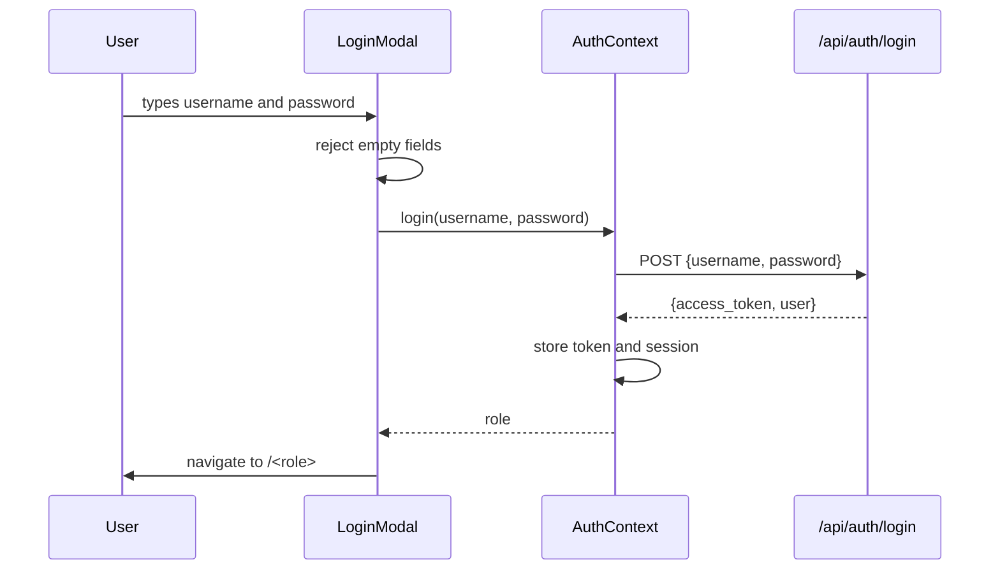

# FRONTEND | AppointMed

This document explains the AppointMed web frontend: what it is made of, how it starts, how it talks to the backend, what every page and component does, and how it maps to the course requirements. It complements `DOCUMENTATION.md` (whole system) and `DATABASE.md` (data layer).

**Course Affiliation**

Laguna State Polytechnic University | College of Computer Studies  
CMSC 203 – Object-Oriented Programming, ITEC 104 – Data Structures and Algorithm, ITEC 105 – Information Management  
Instructors: Ms. Roxanne Garbo, Sir Rolan C. Sotomayor, Sir Jencel P. Sofer  
Academic Year: 2026 – 2027  
System Project Assigned: Clinic Appointment System

**Contents**

1. [Overview](#1-overview)
2. [Technology and Tooling](#2-technology-and-tooling)
3. [Running, Building, and Configuration](#3-running-building-and-configuration)
4. [Folder Structure](#4-folder-structure)
5. [Startup and Routing](#5-startup-and-routing)
6. [Authentication and Session Handling](#6-authentication-and-session-handling)
7. [API Layer](#7-api-layer)
8. [Loading Data: the usePolling Hook](#8-loading-data-the-usepolling-hook)
9. [Layout and Navigation](#9-layout-and-navigation)
10. [Shared Components](#10-shared-components)
11. [Pages](#11-pages)
12. [Utilities](#12-utilities)
13. [Types](#13-types)
14. [Styling and Design System](#14-styling-and-design-system)
15. [Validation and Error Handling](#15-validation-and-error-handling)
16. [Frontend Security](#16-frontend-security)
17. [Accessibility](#17-accessibility)
18. [Frontend to Backend Contract](#18-frontend-to-backend-contract)
19. [Compliance with the Project Instructions](#19-compliance-with-the-project-instructions)
20. [How to Extend the Frontend](#20-how-to-extend-the-frontend)
21. [Known Limitations and Notes](#21-known-limitations-and-notes)
22. [Manual Test Checklist](#22-manual-test-checklist)

---

## 1. Overview

The frontend is a **single-page application** (SPA). It has two kinds of screens:

| Kind | Who uses it | Login | Routes |
|---|---|---|---|
| **Public** | Patients and visitors | No | `/` (landing page), `/book` (booking page) |
| **Staff portal** | Doctors, nurses, administrators | Yes | `/doctor/...`, `/nurse/...`, `/admin/...` |

The frontend never talks to MySQL. Every read and write goes through the FastAPI backend under `/api`. The frontend only shows data and collects input. **The backend decides who may do what**, so hiding a button is a convenience and never security.

What the frontend does for each kind of user:

| User | What they can do in the browser |
|---|---|
| Patient | Read the landing page, choose a doctor, date, and open time slot, and submit an appointment request |
| Nurse | Review booking requests, create walk-ins, check patients in, reschedule or cancel, switch room status, manage patient records, and mark invoices paid |
| Doctor | Everything a nurse can do for their own data, plus start and finish examinations, write prescriptions, and view prescriptions |
| Admin | Manage users and weekly schedules, rooms, clinic settings, view reports, and review the audit log |
| Any staff member | Edit their profile and photo, change their password, and read role-specific help |

## 2. Technology and Tooling

| Item | Version (from `package.json`) | Purpose |
|---|---|---|
| React | ^18.3.1 | Component-based UI |
| React DOM | ^18.3.1 | Renders React in the browser |
| React Router DOM | ^7.18.4 | Client-side routing |
| TypeScript | ^5.5.4 | Static typing, strict mode |
| Vite | ^5.4.8 | Dev server and bundler |
| `@vitejs/plugin-react` | ^4.3.1 | React support in Vite |
| Tailwind CSS | ^3.4.14 | Utility-first styling |
| PostCSS, Autoprefixer | ^8.4.47, ^10.4.20 | Processes Tailwind CSS |

Design choices worth noting:

- **No state library, UI kit, or fetch library.** State is React state plus one context (`AuthContext`). HTTP is the browser's `fetch`, wrapped once in `api/client.ts`. Fewer dependencies means less to learn, review, and secure.
- **TypeScript strict mode** is on, and `noUnusedLocals` and `noUnusedParameters` make unused code a build error.
- **`npm run build` is `tsc && vite build`.** The type check must pass before a bundle is produced.

## 3. Running, Building, and Configuration

From `source/frontend`:

| Command | What it does |
|---|---|
| `npm install` | Installs dependencies into `node_modules` (gitignored) |
| `npm run dev` | Starts Vite on http://localhost:5173 |
| `npm run build` | Type-checks, then builds to `dist/` |
| `npm run preview` | Serves the built `dist/` locally |

**Dev proxy.** `vite.config.ts` fixes the port to 5173 (`strictPort: true`) and forwards `/api` to `http://127.0.0.1:8000`:

```ts
server: { port: 5173, strictPort: true, proxy: { "/api": "http://127.0.0.1:8000" } }
```

Because the browser only ever talks to port 5173, there are no cross-origin requests during development. Start the backend first, otherwise every call fails with "Cannot reach the server."

**Configuration files**

| File | Role |
|---|---|
| `index.html` | HTML shell with `<div id="root">`, the favicon (`/appointmed-logo.png`), and the module script `/src/main.tsx` |
| `tailwind.config.js` | Scans `index.html` and `src/**/*.{ts,tsx}`, and defines the `brand` colour palette |
| `postcss.config.js` | Enables Tailwind and Autoprefixer |
| `tsconfig.json` | Strict TypeScript, `jsx: react-jsx`, bundler module resolution, `noEmit` |
| `src/vite-env.d.ts` | Vite client types |
| `public/` | Static files: `appointmed-logo.png` and an optional `hero.jpg` for the landing page |

## 4. Folder Structure

```
source/frontend/src/
├── main.tsx                  # mounts <App /> in React.StrictMode
├── app.tsx                   # routes, and pageFor(): navigation item -> page
├── index.css                 # Tailwind layers and body defaults
├── vite-env.d.ts
├── api/
│   ├── client.ts             # the only fetch call; token handling; ApiError
│   └── endpoints.ts          # every backend call, grouped as authApi/publicApi/staffApi/adminApi
├── components/               # Alert, Badge, EncounterCard, ExamPanel, LoginModal, Logo, Modal,
│                             #   ProtectedRoute, ScheduleEditor, StatCard, WalkInModal, ui.ts
├── config/Navigation.ts      # side-panel items for each role
├── context/AuthContext.tsx   # signed-in user, login, logout, updateSession
├── hooks/usePolling.ts       # load now and on an interval
├── layouts/DashboardLayout.tsx
├── pages/
│   ├── LandingPage.tsx, BookingPage.tsx, PlaceholderPage.tsx
│   ├── staff/                # Dashboard, Appointments, Notifications, Patients, History, Invoice, Prescriptions
│   ├── admin/                # AdminDashboard, Users, Rooms, ClinicSettings, Reports, Audit
│   └── shared/               # Profile, Settings, Help
├── routes/                   # empty (.gitkeep)
├── types/index.ts            # types that match the backend JSON
└── utils/                    # format.ts, csv.ts, image.ts
```

Dependency direction (each layer only imports from the ones to its right):

```
pages  ->  components, hooks, context, config  ->  api  ->  types, utils
```

## 5. Startup and Routing

### 5.1 Startup

1. `index.html` loads `/src/main.tsx`.
2. `main.tsx` imports `index.css` and renders `<App />` inside `React.StrictMode`.
3. `App` wraps everything in `<AuthProvider>` and `<BrowserRouter>`, then declares the routes.

### 5.2 Route table (`app.tsx`)

| Path | Element | Protected |
|---|---|---|
| `/` | `LandingPage` | No |
| `/book` | `BookingPage` | No |
| `/doctor`, `/nurse`, `/admin` | `ProtectedRoute role=...` wrapping `DashboardLayout` | Yes |
| `/<role>` (index) | Redirects to the role's first navigation item (the Dashboard) | Yes |
| `/<role>/<item.path>` | The page chosen by `pageFor(role, item)` | Yes |
| `*` | Redirects to `/` | No |

The role routes are generated by looping over `ROLES` (`["doctor", "nurse", "admin"]`), and each role's child routes are generated from `NAV[role]`. **Adding an item to `config/Navigation.ts` adds both the menu entry and the route.**

### 5.3 `pageFor(role, item)`

A `switch` maps a navigation `path` to a page component:

| Group | Paths | Pages |
|---|---|---|
| All roles | `dashboard` | `AdminDashboardPage` for admin, `DashboardPage` for doctor and nurse |
| All roles | `profile`, `settings`, `help` | `ProfilePage`, `SettingsPage`, `HelpPage` |
| Admin only | `users`, `rooms`, `clinic`, `reports`, `audits` | `UsersPage`, `RoomsPage`, `ClinicSettingsPage`, `ReportsPage`, `AuditPage` |
| Doctor and nurse | `appointments`, `notifications`, `patients`, `history`, `invoice`, `prescriptions` | The staff pages |
| Anything else | | `PlaceholderPage` (a "not built yet" stand-in) |

Doctors and nurses **share** the same page components. Role differences are handled inside the page (for example `isDoctor` in `AppointmentsPage`) and, authoritatively, by the backend.

### 5.4 `ProtectedRoute`

```
no user              -> redirect to "/"
user.role != route   -> redirect to "/<user.role>"
otherwise            -> render children
```

This only improves the experience. A user who edits the URL still cannot get data, because every API call is checked on the server.

## 6. Authentication and Session Handling

### 6.1 What is stored where

| Data | Location | Lifetime |
|---|---|---|
| Access token (JWT) | `sessionStorage["appointmed.token"]` (managed in `api/client.ts`) | Until the tab closes or logout |
| Username, full name, role | `sessionStorage["appointmed.session"]` | Same |
| Profile picture (data URL) | React state only (not stored, because it can be large) | Until refresh, then re-fetched |

`sessionStorage` is used instead of `localStorage` so a login does not survive closing the tab.

### 6.2 `AuthContext`

| Member | Behavior |
|---|---|
| `user` | `SessionUser` (`username`, `fullName`, `role`, optional `avatar`) or `null` |
| `login(username, password)` | Calls `authApi.login`, stores the token, sets the user, saves the session, and returns the role so the caller can navigate to `/<role>` |
| `logout()` | Clears the user, the token, and the saved session |
| `updateSession(patch)` | Updates `fullName` or `avatar` after a profile change and re-saves the session |

Behaviors worth knowing:

- **`load()` trusts a saved session only if a token is also stored.** A stray session record without a token is ignored.
- **After sign-in or a page refresh**, an effect calls `authApi.me()` to load the latest name and the avatar. If the token is no longer valid, the API client fires the unauthorized event (below) and the user is signed out.
- **Unauthorized event.** `client.ts` dispatches `appointmed:unauthorized` when the server answers `401` while a token exists. `AuthProvider` listens and calls `logout()`. This is how an expired token or a deactivated account ends the session without every page handling it.

### 6.3 Login flow



## 7. API Layer

### 7.1 `api/client.ts`

`request<T>(path, { method?, body? })` is the **only** place that calls `fetch`. It:

1. Adds `Authorization: Bearer <token>` when a token exists.
2. Adds `Content-Type: application/json` and serializes the body when one is given.
3. Turns a network failure into `ApiError("Cannot reach the server. Check that the backend is running.", 0)`.
4. Reads the response as text and parses it as JSON when possible (an empty body gives `null`).
5. On a non-2xx status: dispatches the unauthorized event for `401` when a token was sent, then throws `ApiError(message, status)`.

`messageFrom(body, fallback)` builds the message. It reads FastAPI's `{"detail": ...}`, where `detail` is either a string (our own errors) or an array (Pydantic details, joined as `field: message`). If nothing usable is found it uses `Request failed (<status>).`

`ApiError extends Error` and adds a `status` field. It is the frontend's **custom exception**.

### 7.2 `api/endpoints.ts`

Every backend call is one function, grouped by audience:

| Object | Prefix | Functions |
|---|---|---|
| `authApi` | `/api/auth` | `login`, `me`, `updateMe`, `setAvatar`, `removeAvatar`, `changePassword` |
| `publicApi` | `/api/public` | `catalog`, `slots`, `book` |
| `staffApi` | `/api/staff` | dashboard; notifications (`notifications`, `approve`, `dismiss`); appointments (`appointments`, `createAppointment`, `checkIn`, `start`, `release`, `finish`, `cancel`, `reschedule`, `assignRoom`, `bill`); rooms (`rooms`, `setRoomStatus`); patients (`patients`, `createPatient`, `updatePatient`, `deletePatient`, `patientHistory`); `history`, `invoices`, `unbilled`, `pay`, `prescriptions` |
| `adminApi` | `/api/admin` | `dashboard`; users (`users`, `doctors`, `createUser`, `updateUser`, `setActive`, `resetPassword`, `schedule`, `saveSchedule`); rooms (`rooms`, `createRoom`, `updateRoom`, `deleteRoom`); `settings`, `saveSettings`; `reports`; `audit` |

The helper `qs(params)` builds a query string and **skips empty values**, so `qs({ q: "", day: "2026-10-24" })` gives `?day=2026-10-24`. Filter tabs that mean "all" send an empty `status` for the same reason.

Each function is typed with the response type from `types/index.ts`, so a page that misuses a field fails the TypeScript build.

## 8. Loading Data: the usePolling Hook

```ts
const { data, error, loading, reload } = usePolling(loader, intervalMs = 0, deps = []);
```

| Part | Meaning |
|---|---|
| `loader` | An async function returning the data (usually an `*Api` call) |
| `intervalMs` | `0` loads once. A positive value reloads on that interval, which is how screens stay current without WebSockets |
| `deps` | Values that trigger a fresh load when they change (a search term, a filter tab, a date) |
| `data`, `error`, `loading` | Latest result, latest error message, and whether the first or a deps-triggered load is running |
| `reload()` | Load again now (called after an action succeeds) |

Implementation notes:

- The latest `loader` is kept in a `ref`, so the interval always calls the newest closure without restarting.
- `loading` is set to `true` again whenever `deps` change, but pages show "Loading..." only when `loading && !data`, so a background refresh does not flash.
- The interval is cleared in the effect cleanup.

**Polling intervals used**

| Screen | Data | Interval |
|---|---|---|
| Staff dashboard | `staffApi.dashboard` | 10 s |
| Appointments | `staffApi.dashboard` (queue and exam room), `staffApi.appointments(day)` | 8 s |
| Appointments | `staffApi.rooms` | 15 s |
| Notifications | `staffApi.notifications` | 15 s |
| Invoice | `staffApi.invoices`, `staffApi.unbilled` | 10 s |
| Admin dashboard | `adminApi.dashboard` | 15 s |
| Admin rooms | `adminApi.rooms` | 10 s |
| Everything else | Loaded once, or when search or filter inputs change | 0 |

## 9. Layout and Navigation

### 9.1 `config/Navigation.ts`

One list per role. Each `NavItem` has `path`, `label`, `description`, and either a `group` (header in the side panel) or a `pin` (fixed spot).

| Role | Group: items |
|---|---|
| Doctor | **Overview:** Dashboard. **Consultations:** Appointments, Notifications. **Records:** Patients, History, Invoice, Prescriptions |
| Nurse | Same as doctor **without Prescriptions** |
| Admin | **Overview:** Dashboard. **Management:** Users, Rooms. **System:** Clinic Settings (`clinic`), Reports, Audit Logs (`audits`) |
| All | **Pinned:** Profile (top), Settings and Help (bottom) |

The first item must be the Dashboard because `/<role>` redirects to it. Paths are lowercase so URLs are predictable.

### 9.2 `DashboardLayout`

The page frame for every staff screen.

- **Side panel** (`<aside>`): logo linking to the landing page, a profile block (photo or initial, full name, role), grouped navigation with headers and separators, a bottom row with **Settings** and a **?** Help button, and **Log out**.
- **Open and close:** open by default when the window is at least 768 px wide (Tailwind's `md`), closed on phones. A panel icon closes it, and a bordered button appears in the page when it is closed. On phones the panel closes after choosing a page.
- **Active link styling** comes from `NavLink`'s `isActive`.
- **Content area:** `<main>` renders the chosen page through `<Outlet />`.
- **Initial letter:** the avatar fallback takes the first letter of the name after removing a leading "Dr.".

## 10. Shared Components

| Component | Purpose | Key props and behavior |
|---|---|---|
| `Alert` | Coloured message box | `kind`: `error`, `success`, `info`, `warning`. Errors use `role="alert"`, others `role="status"`. Optional `onClose` shows a Dismiss button |
| `Badge` | Small status pill | `tone`: green, amber, red, blue, slate |
| `Modal` | Dialog over the page | Closes with Escape, the Close button, or a click on the backdrop. `wide` widens it. `role="dialog"` and `aria-modal` set |
| `Logo` | Logo image and name | `size`, `showName`, `onDark` (white text on dark backgrounds) |
| `StatCard` | A number with a label | Becomes a router `Link` when `to` is given |
| `ProtectedRoute` | Role guard | See [5.4](#54-protectedroute) |
| `LoginModal` | Staff login form | Focuses the first field, closes on Escape, rejects empty fields, shows API errors, navigates to `/<role>` |
| `EncounterCard` | One completed visit | Diagnosis, notes, a medicines table, and the bill line `consultation + medicines = total (paid date)`. `showName` switches the heading between patient name and visit date |
| `ExamPanel` | The doctor's examination form | See [10.1](#101-exampanel) |
| `WalkInModal` | New walk-in or phone appointment | See [10.2](#102-walkinmodal) |
| `ScheduleEditor` | A doctor's weekly working hours | See [10.3](#103-scheduleeditor) |
| `ui.ts` | Shared class strings and `statusTone()` | See [14](#14-styling-and-design-system) |

### 10.1 `ExamPanel`

Shown on the Appointments page while a patient is under examination (doctor only).

- **Inputs:** diagnosis, notes, a prescription list (medicine, dosage, quantity, unit price, instructions), an optional general prescription note, the consultation fee (pre-filled from the invoice), and an optional follow-up date and time.
- **Live invoice:** medicines total is the sum of `quantity x unit price`, and the grand total is fee plus medicines, recomputed on every keystroke.
- **Checks before sending** (these mirror the backend rules):
  - Diagnosis has at least 2 characters.
  - Fee is a finite number, zero or more, with at most two decimals (`hasTwoDecimals`).
  - For every medicine with a name: integer quantity from 1 to 9999, price zero or more with at most two decimals.
  - A follow-up, if given, is in the future.
- **Submit:** calls `staffApi.finish` with an `ExamPayload`. Blank optional text is sent as `null`. Rows with no medicine name are dropped. On success it calls `onDone`, and on failure it shows the message and re-enables the button.

### 10.2 `WalkInModal`

- Two modes: **New patient** (name, optional birthdate, sex, contact) or **Existing patient** (a `<select>` filled from `staffApi.patients("")`).
- Also asks for reason, date and time (empty means right now), and a **Check in now** checkbox (today only).
- Checks: a patient must be chosen, or a name of at least 2 characters entered, and the birthdate cannot be in the future.
- Builds an `AppointmentCreatePayload` and calls `staffApi.createAppointment`, then `onCreated(patientName)`.

### 10.3 `ScheduleEditor`

- Opened from the Users page for a doctor. Loads blocks with `adminApi.schedule`.
- Shows Monday to Sunday. Each day has zero or more blocks (start time, end time, slot minutes). **Two blocks on a day make a lunch break.** A day with none is a day off.
- Rows carry a client-side `key` so React can track them.
- `check()` validates before saving: both times filled, end after start, block at least one slot long, slot between 5 and 120 minutes, and no overlap on the same day. The backend repeats these rules.
- **Save replaces the doctor's entire weekly schedule** with `adminApi.saveSchedule`.

## 11. Pages

### 11.1 Public pages

**`LandingPage` (`/`)**

| Section | Content |
|---|---|
| Header | Logo, anchor links (Services, Doctors, Contact), and **Staff login** (opens `LoginModal`) or **Dashboard** when already signed in |
| Hero | Headline, a short pitch, and a **Book an appointment** button to `/book`. Background is the gradient, and `public/hero.jpg` is layered on top if present |
| Services | General Medicine, Pediatrics, Prescriptions |
| Doctors | Dr. Sandy Cheeks and Dr. Squidward Tentacles with their days |
| Footer | Clinic name and address (fictional) |

The services and doctors are **static arrays in the file**, not loaded from the API (see [21](#21-known-limitations-and-notes)).

**`BookingPage` (`/book`)**

Loads `publicApi.catalog()` and shows one of: a loading line, a load error, a "booking is closed" notice, or the form.

*Form sections*

1. **Your details:** full name, birthdate, sex, contact number, email, address, reason.
2. **Doctor and time:** specialization filter (built from the catalog), doctor, a note of the weekdays the doctor works, a date limited to today through today plus `window_days`, and the open time slots as a radio group of buttons.

*Behavior*

- When the doctor or date changes, the chosen slot is cleared and `publicApi.slots` is called. A `cancelled` flag in the effect cleanup stops a slow response from overwriting a newer one.
- `validate()` produces field errors (name at least 2 characters, birthdate present and not in the future, sex chosen, phone matches `^[0-9+()\-\s]{7,20}$`, email matches `^[^@\s]+@[^@\s]+\.[^@\s]+$`, address at least 3, reason at least 3, doctor, date, and slot chosen). The form uses `noValidate` so these messages replace the browser's own.
- On submit the request goes to `publicApi.book`. On success a **receipt** screen says the request was received and is **not yet confirmed**. On failure the message is shown, the slot list is refreshed (the slot may have just been taken), and the chosen slot is cleared.

### 11.2 Staff pages (doctor and nurse)

**`DashboardPage`** (poll 10 s). Eight `StatCard`s: Booked today, Waiting, Under examination, Completed today, Pending requests, Awaiting payment, Unbilled sessions, Cancelled today (several link to the relevant page). Below: the patient under examination, the waiting queue (numbered by `queue_position`, with check-in time), and the next five upcoming appointments.

**`AppointmentsPage`** (poll 8 s). The working screen.

| Section | Shows | Actions |
|---|---|---|
| Under examination | The patient in the exam room | Doctor: the `ExamPanel` and **Return to queue**. Nurse: a note that the doctor is examining |
| Queue (checked in) | Patients in check-in order | Doctor: choose a free room and **Start examination** (disabled while someone is under examination). Both: **Cancel** |
| Booked / Agenda | Scheduled appointments for the chosen day | **Check in** (disabled for future days), room selector, **Reschedule**, **Cancel** |
| Finished or cancelled on this day | Examined, completed, and cancelled items | Read-only badges |
| Rooms | Every room, who is inside, and a status selector | Change status between Available, Occupied, Maintenance |

Other behavior:

- A date picker ("Agenda for") changes the agenda day. The queue and exam room always show, whatever their date.
- `run(id, action, doneMessage)` is the shared action wrapper: sets a busy id, clears messages, runs the call, shows success or error, then always refreshes all three data sources.
- **Doctor notification:** each poll compares the queue with the previous set of ids. When new ids appear, an info alert says who checked in. This works while the page is open.
- An amber alert appears when examined patients are waiting to pay, linking to Invoice.
- Cancelling asks `window.confirm` first. **New appointment** opens `WalkInModal`, and **Reschedule** opens `RescheduleModal` (rejects a time that is not in the future).

**`NotificationsPage`** (poll 15 s). Filter tabs: Pending, Approved, Disapproved, All (the API values are `Converted` and `Dismissed`). Each card shows the requester, age and birthdate, requested time, reason, contact, email, address, received time and origin, and any decision note.

- A **slot-taken warning** appears on pending requests whose time is already booked (`slot_taken`).
- **Approve** opens an inline form with the time (pre-filled, editable) and an optional room (rooms under maintenance are excluded), then **Confirm approval**.
- **Disapprove** opens an inline reason field (at least 3 characters). The reason is emailed to the patient.
- Success messages say whether an email was sent or the patient has no email on file.

**`PatientsPage`.** Search box (name, contact, email) and a list with sex, age, and visit count. Selecting a patient shows their details and **visit history** (`EncounterCard` with `showName={false}`). **Add patient** and **Edit** open `PatientForm` (checks: name at least 2 characters, birthdate not in the future, phone and email formats). **Delete** asks for confirmation, and the backend refuses when the patient has appointments.

**`HistoryPage`.** Search (patient, diagnosis, reason) plus From and To dates, with a **Clear dates** button. Shows a visit count and an `EncounterCard` per completed visit.

**`InvoicePage`** (poll 10 s). An amber box lists **sessions without an invoice** with a **Create invoice** button. Tabs: Unpaid, Paid, Cancelled, All. Each invoice shows the examination fee, each medicine line, and the total. **Mark as paid** is enabled only when the appointment is `Examined` (after a confirmation). While the exam is still in progress a note explains why.

**`PrescriptionsPage`** (doctor only, because only the doctor has the `prescriptions` feature). Search by patient or diagnosis. Each prescription shows the diagnosis, note, a medicines table, and the medicines total.

### 11.3 Admin pages

**`AdminDashboardPage`** (poll 15 s). Active doctors, nurses, and administrators, patients, appointments today, pending requests, paid this month, unpaid invoices, and the latest activity table with a link to Audit Logs.

**`UsersPage`.** Search and role filter. A table with name, role, details (specialization or supported doctor), status badge, and last sign-in. Row actions: **Edit**, **Password**, **Schedule** (doctors only), and **Deactivate or Reactivate**. The Deactivate button is disabled for your own active account.

- `UserForm` handles create and edit. Create checks: username `^[A-Za-z0-9._-]{3,50}$`, password 8 to 72 characters, full name, optional email, and a doctor for nurses.
- `PasswordForm` asks for the new password twice.
- Deactivate and Reactivate ask for confirmation.

**`RoomsPage`** (poll 10 s). Table of rooms with status, patient inside, and last change. **Add room**, **Edit** (both use `RoomForm`), and **Delete** (confirmed, and the backend refuses when the room appears in appointments).

**`ClinicSettingsPage`.** A form generated from the `FIELDS` list: clinic name, address, default consultation fee, default slot length, booking window, and an online booking toggle. `problem(key, value)` mirrors the backend rules. **Only changed values are sent**, which keeps the audit log clean, and "Nothing was changed" is shown when nothing differs.

**`ReportsPage`.** From and To dates (default: the last 30 days) and two CSV downloads. Shows totals, appointments by status (a `Bar` chart built with plain divs), a per-doctor table, and a day-by-day table with revenue bars.

**`AuditPage`.** Text search, action filter (the list of known actions comes from the API), 25 rows per page with Previous and Next, "Showing x to y of z", and a CSV download of the current page. Changing a filter resets the offset to 0.

### 11.4 Shared pages

**`ProfilePage`.** Shows the photo or initial, name, role, specialization, and the doctor a nurse supports. **Upload photo** runs `resizeImage` (center-cropped 256x256 JPEG) before sending, so it fits the 300 KB backend limit. **Remove photo**, plus a form to edit full name and email. Both update the side panel through `updateSession`.

**`SettingsPage`.** Change password: current password required, new password 8 to 72 characters, confirmation must match, and it must differ from the current one.

**`HelpPage`.** Short guides for the signed-in role plus two common topics, written as `<details>` sections with numbered steps. The first topic opens by default.

## 12. Utilities

**`utils/format.ts`**

| Function | Purpose |
|---|---|
| `isoDate(d)` | Local date as `YYYY-MM-DD` |
| `isoDateTimeLocal(d)` | Local value for `datetime-local` inputs |
| `toInputDateTime(value)` | Cuts an API timestamp to `YYYY-MM-DDTHH:mm` |
| `toNumber(value)` | Converts MySQL `DECIMAL` text (`"500.00"`) to a number, giving `0` for invalid input |
| `formatDate`, `formatTime`, `formatDateTime` | `en-PH` formatting. A plain date is read as local midnight so it never shifts a day. Missing values give `-` |
| `formatMoney(value)` | `Intl.NumberFormat("en-PH", { currency: "PHP" })` |
| `ageFrom(birthdate)` | Age in years, for example `34 yrs` |
| `weekdayList(days)` | `[1,3,5]` becomes `Mon, Wed, Fri` |
| `WEEKDAY_NAMES` | Monday to Sunday |

**`utils/csv.ts`.** `downloadCsv(filename, rows)` builds a CSV with a BOM (so Excel reads UTF-8), quotes cells that contain commas, quotes, or line breaks, and **neutralizes a leading `= + - @` by prefixing `'`** so spreadsheets cannot run a cell as a formula. It creates a temporary Blob link, clicks it, and releases the URL.

**`utils/image.ts`.** `resizeImage(file, size = 256)` rejects non-images, crops the centre square, scales it, and returns a JPEG data URL (quality 0.85).

## 13. Types

`types/index.ts` mirrors the backend JSON field for field. Highlights:

| Type | Notes |
|---|---|
| `Role`, `ROLES` | `"doctor" \| "nurse" \| "admin"` and the array used to generate routes |
| `Money` | `number \| string`. MySQL `DECIMAL` arrives as text, so use `toNumber()` before arithmetic |
| `SessionUser`, `NavItem` | Frontend-only shapes |
| `UserRecord`, `Profile` | Staff accounts (`Profile` adds `avatar`) |
| `Catalog`, `DoctorOption`, `BookingPayload`, `BookingReceipt` | Public booking |
| `NotificationItem` (adds `slot_taken`), `AppointmentItem`, `AppointmentStatus`, `RoomItem`, `StaffDashboard` | Daily workflow |
| `ExamPayload`, `PrescriptionLine`, `InvoiceItem`, `Encounter`, `PrescriptionRecord` | Clinical and billing |
| `PatientItem`, `PatientPayload` | Patient records |
| `ScheduleBlock`, `SettingRow`, `AuditRow`, `AuditPage`, `AdminDashboard`, `ReportData`, `UserCreatePayload`, `UserUpdatePayload` | Admin |

When a backend response changes, update this file in the same pull request. TypeScript will then point to every page that needs a fix.

## 14. Styling and Design System

- **Tailwind utility classes** style everything. `index.css` only loads the Tailwind layers and sets the body (`bg-slate-50`, `text-brand-900`, system font stack).
- **Brand palette** (`tailwind.config.js`): `brand-50 #effaf8`, `100 #d3f1ec`, `500 #14917f`, `600 #0f7b6c`, `700 #0d6459`, `900 #12302f`.
- **Shared class strings** in `components/ui.ts`: `inputClass`, `primaryButton`, `secondaryButton`, `dangerButton`, `cardClass`. Reusing them keeps every form and button identical.
- **`statusTone(status)`** maps every status word to a badge colour, so the same status always looks the same:

| Tone | Statuses |
|---|---|
| Green | Completed, Paid, Available, Converted, Active |
| Amber | Pending, Unpaid, Checked-in, Occupied, Examined |
| Blue | Consulting, Scheduled |
| Red | Cancelled, Dismissed, Maintenance, Inactive |
| Slate | Anything else |

- **Responsive layout:** grids use `sm:`, `md:`, and `lg:` breakpoints, tables sit in `overflow-x-auto` wrappers, and the side panel collapses on phones.

## 15. Validation and Error Handling

The frontend handles errors in four layers. **The backend is always the authority**, and the frontend repeats the rules only for fast feedback.

| Layer | Examples | Where |
|---|---|---|
| 1. Field validation before sending | Required fields, email and phone patterns, number ranges and two-decimal money, future-only dates, username pattern, password length, schedule overlap | Form submit handlers, `ExamPanel`, `ScheduleEditor`, `BookingPage.validate`, `ClinicSettingsPage.problem` |
| 2. Typed API errors | `ApiError` with `status` and a plain message | `api/client.ts` |
| 3. User-visible messages | `Alert`, inline `role="alert"` text, field-level errors | Every page that calls the API |
| 4. Confirmation of destructive actions | `window.confirm` for cancel, delete, deactivate, and mark paid | Appointments, Rooms, Users, Patients, Invoice |

Patterns used consistently:

- Every submit handler uses `try / catch / finally`, with a `busy` flag that disables the button and shows "Saving..." text.
- Each data screen handles **loading, empty, and error** states (`usePolling` supplies `loading` and `error`).
- Error messages never contain SQL, stack traces, or hashes, because the backend never sends them.
- `usePolling` and `AuthContext` swallow only the errors that are safe to ignore (a failed profile fetch), and still sign out on `401`.

## 16. Frontend Security

| Concern | What the frontend does |
|---|---|
| Role enforcement | `ProtectedRoute` and hidden menu items are convenience only. The server checks every request |
| Token storage | `sessionStorage`, sent as a `Bearer` header, cleared on logout or when the server returns `401` |
| XSS | React escapes text. No `dangerouslySetInnerHTML` is used. Keep it that way |
| CSV injection | `downloadCsv` neutralizes leading `= + - @` |
| Image upload | Resized to a JPEG on the client, and the server re-checks type and size |
| Secrets | None in the frontend. There is no `.env` use, and the API address is the same-origin `/api` |
| CORS | Avoided in development by the Vite proxy. The backend still lists allowed origins |

Known gap: because the token lives in `sessionStorage`, a cross-site scripting bug would expose it. No Content-Security-Policy is set yet (see `SECURITY.md`).

## 17. Accessibility

- Form fields are wrapped in `<label>`, and inputs without a visible label (search boxes, table selects) use `aria-label`.
- Dialogs use `role="dialog"`, `aria-modal`, and `aria-label`, and close with Escape.
- Tab groups use `role="tablist"` and `aria-selected`. The time slot picker and patient type picker use `role="radiogroup"` and `aria-checked`.
- `Alert` uses `role="alert"` for errors and `role="status"` for the rest.
- Interactive elements have visible `focus-visible` rings.
- Decorative icons use `aria-hidden`, and icon-only buttons have `aria-label` and `title`.
- Status is never shown by colour alone: every badge also contains the status word.

## 18. Frontend to Backend Contract

| Frontend call | Method and path |
|---|---|
| `authApi.login` | POST `/api/auth/login` |
| `authApi.me`, `updateMe` | GET, PUT `/api/auth/me` |
| `authApi.setAvatar`, `removeAvatar` | PUT, DELETE `/api/auth/me/avatar` |
| `authApi.changePassword` | POST `/api/auth/change-password` |
| `publicApi.catalog` | GET `/api/public/catalog` |
| `publicApi.slots` | GET `/api/public/slots?doctor_id=&day=` |
| `publicApi.book` | POST `/api/public/bookings` |
| `staffApi.dashboard` | GET `/api/staff/dashboard` |
| `staffApi.notifications` | GET `/api/staff/notifications?status=` |
| `staffApi.approve`, `dismiss` | POST `/api/staff/notifications/{id}/approve`, `/dismiss` |
| `staffApi.appointments`, `createAppointment` | GET, POST `/api/staff/appointments` |
| `staffApi.checkIn`, `start`, `release`, `finish`, `cancel`, `reschedule`, `bill` | POST `/api/staff/appointments/{id}/check-in`, `/start`, `/release`, `/finish`, `/cancel`, `/reschedule`, `/bill` |
| `staffApi.assignRoom` | PUT `/api/staff/appointments/{id}/room` |
| `staffApi.rooms`, `setRoomStatus` | GET `/api/staff/rooms`, PUT `/api/staff/rooms/{id}/status` |
| `staffApi.patients`, `createPatient` | GET, POST `/api/staff/patients` |
| `staffApi.updatePatient`, `deletePatient` | PUT, DELETE `/api/staff/patients/{id}` |
| `staffApi.patientHistory` | GET `/api/staff/patients/{id}/history` |
| `staffApi.history` | GET `/api/staff/history?q=&date_from=&date_to=` |
| `staffApi.invoices`, `unbilled`, `pay` | GET `/api/staff/invoices`, `/invoices/unbilled`, POST `/invoices/{id}/pay` |
| `staffApi.prescriptions` | GET `/api/staff/prescriptions?q=` |
| `adminApi.dashboard` | GET `/api/admin/dashboard` |
| `adminApi.users`, `createUser`, `updateUser` | GET, POST `/api/admin/users`, PUT `/users/{id}` |
| `adminApi.setActive`, `resetPassword` | POST `/api/admin/users/{id}/active`, `/password` |
| `adminApi.doctors` | GET `/api/admin/doctors` |
| `adminApi.schedule`, `saveSchedule` | GET, PUT `/api/admin/users/{id}/schedule` |
| `adminApi.rooms`, `createRoom`, `updateRoom`, `deleteRoom` | GET, POST `/api/admin/rooms`, PUT, DELETE `/rooms/{id}` |
| `adminApi.settings`, `saveSettings` | GET, PUT `/api/admin/settings` |
| `adminApi.reports` | GET `/api/admin/reports?date_from=&date_to=` |
| `adminApi.audit` | GET `/api/admin/audit?q=&action=&limit=&offset=` |

## 19. Compliance with the Project Instructions

The project is graded against the CMSC 203 final project brief in `CONTRIBUTING.md`. The sections below show how the frontend supports each rubric item.

> **Important note on the GUI framework.** The brief says to build a Python GUI (Tkinter preferred, or "another instructor-approved Python GUI framework"), and lists "Clinic Appointment System" as an allowed theme. AppointMed uses a **Python backend with a React and TypeScript web frontend**. The team should confirm in writing with Ms. Garbo, Sir Sotomayor, and Sir Sofer that this architecture is approved, and mention it in the presentation. The Python side (OOP, exceptions, data structures, SQL) is where the OOP-specific rubric items are demonstrated.

### 19.1 Graphical User Interface (10 pts)

| Brief requires | How the frontend meets it |
|---|---|
| Multiple windows/forms | Public landing and booking pages, a login dialog, and 16 routed staff and admin pages. Modals for add and edit forms, reschedule, passwords, and schedules |
| Buttons | Primary, secondary, and danger button styles in `ui.ts`, used across all pages |
| Labels | Every field has a visible label or an `aria-label` |
| Textboxes | Text, search, email, tel, number, password, date, time, and `datetime-local` inputs, plus `<textarea>` |
| Combo boxes | `<select>` for sex, doctor, specialization, room, role, status filter, and action filter |
| Menus | Grouped side-panel navigation per role, plus a pinned Settings, Help, and Log out area |
| Tables / list displays | Users, rooms, audit log, reports, medicine lists, invoices, queue lists, and cards |
| Appropriate fonts and colors | System font stack and one consistent brand palette, with status colours from `statusTone` |

### 19.2 Functional features (20 pts)

| Brief requires | Where it exists |
|---|---|
| User login | `LoginModal`, `AuthContext`, `ProtectedRoute` |
| Add records | Booking requests, walk-in appointments, patients, users, rooms, prescriptions (through examination), invoices |
| Edit records | Patients, users, rooms, profile, clinic settings, doctor schedules, rescheduling |
| Delete records | Patients (with no visits), rooms (not used in appointments). Users are deactivated instead, which protects history |
| Search records | Patients, history, prescriptions, users, audit log, appointment agenda |
| Display records | Dashboards, lists, cards, and tables on every page |
| Save data | Every change is sent to the backend and stored in MySQL |
| Load data | Pages load from the backend, and `usePolling` keeps them current. Reports and the audit log can also be **exported to CSV** |

### 19.3 Exception handling and robustness (10 pts)

| Brief requires | How it appears in the frontend |
|---|---|
| Invalid input | Field validation before submit (see [15](#15-validation-and-error-handling)) |
| Empty fields | Required-field checks with plain messages |
| File errors | `resizeImage` rejects non-images and unreadable images, and `ProfilePage` shows the message |
| Invalid data types | `toNumber()` guards bad numbers, `Number.isInteger`, `Number.isFinite`, and `hasTwoDecimals` checks in forms |
| Custom exceptions (at least one) | `ApiError extends Error` (frontend). The backend's `AppError` family is described in `DOCUMENTATION.md` |

### 19.4 Code quality and organization (10 pts)

- Clear naming: `PascalCase` components, `camelCase` functions, and lowercase route paths.
- Modular design: pages compose small reusable components, and all HTTP goes through two files.
- Reusable pieces: `Modal`, `Alert`, `Badge`, `StatCard`, `EncounterCard`, `usePolling`, `ui.ts`, and `format.ts`.
- Comments explain purpose at the top of each file and *why* in tricky spots.
- Strict TypeScript catches mismatches between frontend and backend shapes at build time.

### 19.5 Object-oriented programming (30 pts)

OOP is mainly demonstrated in the Python backend (see `DOCUMENTATION.md`, Section 12). On the frontend the closest equivalents are:

| Concept | Frontend example |
|---|---|
| Classes and inheritance | `ApiError extends Error` |
| Encapsulation | `AuthContext` hides the token and session storage behind `login`, `logout`, and `updateSession`. `client.ts` is the only code that touches `fetch` and the token |
| Abstraction | `usePolling` hides the load, interval, and cleanup logic. `endpoints.ts` hides URLs behind named functions |
| Composition and reuse | `EncounterCard`, `Modal`, and the shared class strings are reused by many pages |
| Polymorphism (in spirit) | One `Badge` and `statusTone` handle every status. One page component serves two roles by reading `user.role` |

### 19.6 Documentation (10 pts) and presentation (10 pts)

This file feeds the System Features, Screenshots, and Testing sections of `DOCUMENTATION.md`. For the presentation, suggested demo order: landing page, book as a patient, nurse approves, nurse checks in, doctor examines and prescribes, mark paid, History and patient record, then the admin's Reports and Audit Logs.

### 19.7 ITEC 104 and ITEC 105 touchpoints in the frontend

| Course | Where it shows |
|---|---|
| ITEC 104 | `WaitingQueue` order shown as `queue_position`. Overlap detection in `ScheduleEditor.check` (sort by weekday and start time, then compare neighbours). Grouping days and filtering lists. Debounce-free search that reloads through `usePolling` deps |
| ITEC 105 | Forms mirror the database limits (`maxLength` values match column sizes, money limited to two decimals, quantity 1 to 9999). `DECIMAL` text is converted safely. Paged audit log (`limit`, `offset`) and CSV export |

## 20. How to Extend the Frontend

**Add a new page**

1. Create the component in `pages/staff/`, `pages/admin/`, or `pages/shared/`.
2. Add a `NavItem` to the role's list in `config/Navigation.ts`.
3. Map its `path` to the component in `pageFor()` in `app.tsx`. Until then the placeholder shows.
4. Add the API function to `api/endpoints.ts` and the response type to `types/index.ts`.
5. Use `usePolling` for loading, and handle the loading, empty, and error states.
6. Run `npm run build` and test the page as every role that should (and should not) reach it.

**Add a field to a form**

1. Add it to the payload type in `types/index.ts`.
2. Add the input and its validation in the form.
3. Send it in the `endpoints.ts` call.
4. Make sure the backend schema (`schemas/api.py`) accepts it.

**Add a status value:** add it to the type, then to `statusTone()` in `components/ui.ts` so it gets a colour.

## 21. Known Limitations and Notes

- **Landing page content is static.** The doctors and services on `LandingPage` are hard-coded. If an administrator changes a doctor or a schedule, the landing page does not follow. The booking page does, because it uses the API.
- **Polling, not push.** Updates arrive within the polling interval (8 to 15 seconds). There are no WebSockets.
- **Doctor notification** for newly checked-in patients works only while the Appointments page is open.
- **Time zones.** API timestamps have no time zone and are shown as written. This is correct for a single clinic, but not for several time zones.
- **Hidden does not mean secure.** The nurse menu has no Prescriptions entry, but the backend is what refuses the request.
- **No automated frontend tests yet.** See the checklist below.
- **Empty `src/routes/` folder** is only a placeholder (`.gitkeep`).
- **`PlaceholderPage`** is kept as a safe fallback for any navigation item that has no page yet.
- **Token in `sessionStorage`** is readable by scripts if XSS ever occurs (see `SECURITY.md`).

## 22. Manual Test Checklist

Run with the backend and MySQL running, using the sample logins from `CONTRIBUTING.md`.

| ID | Area | Steps | Expected |
|---|---|---|---|
| F-01 | Build | `npm run build` | No TypeScript errors |
| F-02 | Login | Sign in with an empty username | "Enter your username and password." |
| F-03 | Login | Wrong password | "Incorrect username or password." |
| F-04 | Routing | As nurse, open `/doctor/dashboard` | Redirected to `/nurse` |
| F-05 | Routing | Signed out, open `/admin/users` | Redirected to `/` |
| F-06 | Session | Close the tab, reopen the site | Signed out |
| F-07 | Expiry | Deactivate a signed-in user from another browser, then click anything | Signed out automatically |
| F-08 | Booking | Submit with every field empty | Field errors, nothing sent |
| F-09 | Booking | Pick a doctor and a day off | "No open times on this day." |
| F-10 | Booking | Complete a valid request | Receipt says it is not yet confirmed |
| F-11 | Notifications | Approve a request | Success message, appears in Appointments |
| F-12 | Notifications | Disapprove with a 2-character reason | Blocked with a message |
| F-13 | Appointments | Check in tomorrow's appointment | Button disabled |
| F-14 | Appointments | Start a second exam while one is open | Start disabled, server also refuses |
| F-15 | Exam | Finish with a quantity of 0 | Validation message |
| F-16 | Exam | Finish with a fee of 10.555 | "at most two decimals" message |
| F-17 | Invoice | Mark paid before the exam is finished | Button disabled |
| F-18 | Patients | Delete a patient who has appointments | Server message shown |
| F-19 | Users | Deactivate your own account (admin) | Button disabled |
| F-20 | Schedule | Overlapping blocks on one day | Overlap message, not saved |
| F-21 | Settings | Slot length 3 | Validation message |
| F-22 | Reports | Download both CSV files | Files open in a spreadsheet with correct columns |
| F-23 | Audit | Filter by an action and page through | Counts and pages stay consistent |
| F-24 | Profile | Upload a non-image file | Error message |
| F-25 | Offline | Stop the backend and use any page | "Cannot reach the server..." |
| F-26 | Responsive | Resize to phone width | Side panel closed by default, tables scroll sideways |

---

*Last Updated: October 2026*