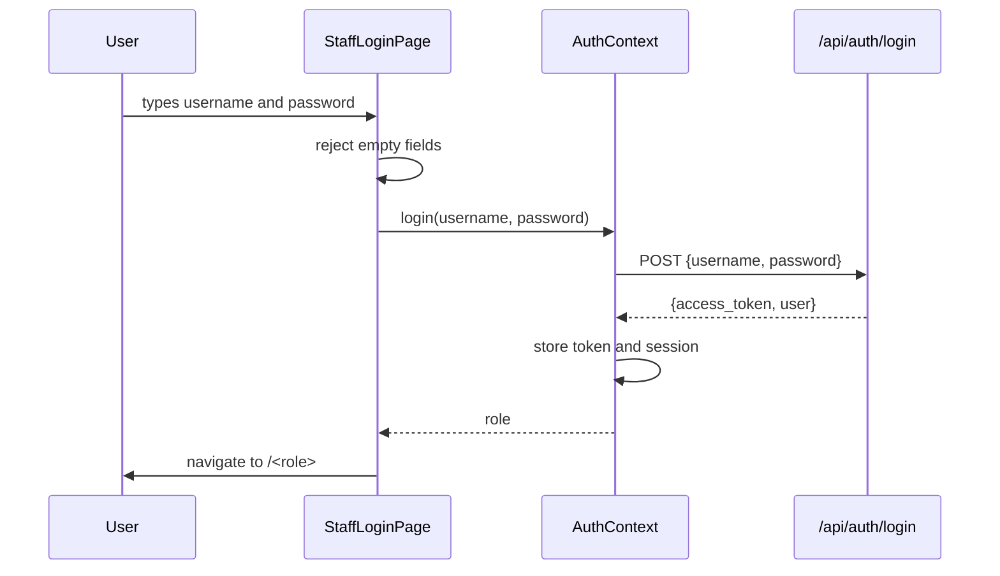

# FRONTEND | AppointMed

This document explains the AppointMed web frontend: what it is made of, how it starts, how it talks to the backend, what every page and component does, and how it maps to the course requirements. It complements `DOCUMENTATION.md` (whole system), `BACKEND.md`, `DATABASE.md`, and the study notes in [note.md](../../note.md).

**Course Affiliation**

Laguna State Polytechnic University | College of Computer Studies  
CMSC 203 – Object-Oriented Programming, ITEC 104 – Data Structures and Algorithm, ITEC 105 – Information Management  
Instructors: Ms. Roxanne Garbo, Sir Rolan C. Sotomayor, Sir Jencel P. Sofer  
Academic Year: 2026 – 2027  
System Project Assigned: Clinic Appointment System

**Contents**

1. [Overview](#1-overview)
2. [Technology and Tooling](#2-technology-and-tooling)
3. [Running, Building, and Configuration](#3-running-building-and-configuration)
4. [Folder Structure](#4-folder-structure)
5. [Startup and Routing](#5-startup-and-routing)
6. [Authentication and Session Handling](#6-authentication-and-session-handling)
7. [API Layer](#7-api-layer)
8. [Loading Data: the usePolling Hook](#8-loading-data-the-usepolling-hook)
9. [Layout and Navigation](#9-layout-and-navigation)
10. [Shared Components](#10-shared-components)
11. [Pages](#11-pages)
12. [Utilities](#12-utilities)
13. [Types](#13-types)
14. [Styling and Design System](#14-styling-and-design-system)
15. [Validation and Error Handling](#15-validation-and-error-handling)
16. [Frontend Security](#16-frontend-security)
17. [Accessibility](#17-accessibility)
18. [Frontend to Backend Contract](#18-frontend-to-backend-contract)
19. [Compliance with the Project Instructions](#19-compliance-with-the-project-instructions)
20. [How to Extend the Frontend](#20-how-to-extend-the-frontend)
21. [Known Limitations and Notes](#21-known-limitations-and-notes)
22. [Manual Test Checklist](#22-manual-test-checklist)

---

## 1. Overview

The frontend is a **single-page application** (SPA) with two kinds of screens:

| Kind | Who uses it | Login | Routes |
|---|---|---|---|
| **Public** | Patients and visitors | No | `/` (landing page), `/book` (booking page) |
| **Staff** | Everyone on the team | No (it is the sign-in) | `/staff-login` |
| **Staff portal** | Doctors, nurses, administrators | Yes | `/doctor/...`, `/nurse/...`, `/admin/...` |

The frontend never talks to MySQL. Every read and write goes through the FastAPI backend under `/api`. It shows data and collects input. **The backend decides who may do what**, so hiding a button is a convenience and never security.

| User | What they can do in the browser |
|---|---|
| Patient | Read the landing page, choose a doctor, a date from a color-coded calendar, and an open slot, and submit a request |
| Nurse | Review requests, create walk-ins, choose rooms and check patients in, reschedule or cancel, switch room status, manage patient records, mark invoices paid |
| Doctor | Everything a nurse can for their own data, plus start and finish examinations, write prescriptions, view prescriptions, and mark days off |
| Admin | Manage users and weekly schedules, rooms, clinic settings, reports, the audit log, and the Database page |
| Any staff member | Edit their profile and photo, change their password, and read role-specific help |

## 2. Technology and Tooling

| Item | Version (from `package.json`) | Purpose |
|---|---|---|
| React, React DOM | ^18.3.1 | Component-based UI |
| React Router DOM | ^7.18.4 | Client-side routing |
| TypeScript | ^5.5.4 | Static typing, strict mode |
| Vite | ^5.4.8 | Dev server and bundler |
| `@vitejs/plugin-react` | ^4.3.1 | React support in Vite |
| Tailwind CSS | ^3.4.14 | Utility-first styling |
| PostCSS, Autoprefixer | ^8.4.47, ^10.4.20 | Processes Tailwind CSS |

- **No state library, UI kit, or fetch library.** State is React state plus one context (`AuthContext`). HTTP is `fetch`, wrapped once in `api/client.ts`.
- **TypeScript strict mode** is on, and `noUnusedLocals` and `noUnusedParameters` make unused code a build error.
- **`npm run build` is `tsc && vite build`.** The type check must pass first.
- Fonts: Poppins is loaded from Google Fonts in `index.html`, with a system fallback.

## 3. Running, Building, and Configuration

From `source/frontend`:

| Command | What it does |
|---|---|
| `npm install` | Installs dependencies into `node_modules` (gitignored) |
| `npm run dev` | Starts Vite on http://localhost:5173 |
| `npm run build` | Type-checks, then builds to `dist/` |
| `npm run preview` | Serves the built `dist/` locally |

**Dev proxy.** `vite.config.ts` fixes the port (`strictPort: true`) and forwards `/api` to `http://127.0.0.1:8000`, so there are no cross-origin requests in development. Start the backend first, otherwise every call fails with "Cannot reach the server."

| File | Role |
|---|---|
| `index.html` | HTML shell with `<div id="root">`, the favicon, Poppins, and `/src/main.tsx` |
| `tailwind.config.js` | Scans `index.html` and `src/**/*.{ts,tsx}`. Defines the `brand` palette and the `landing` palette. |
| `postcss.config.js`, `tsconfig.json`, `src/vite-env.d.ts` | Tailwind, strict TypeScript, Vite types |
| `public/` | Static images: `appointmed-logo.png`, `logo-mark.png`, `footer-logo.png`, `footer-bg.png`, `hero-building.png`, `service-*.png`, `doctor-N.png` and `docchar-N.png` (staff art), `dept-*.png` (department icons), `staff-login-bg.jpg`, `staff-login-logo.png` |

## 4. Folder Structure

```
source/frontend/src/
├── main.tsx                  # mounts <App /> in React.StrictMode
├── app.tsx                   # routes, and pageFor(): navigation item -> page
├── index.css                 # Tailwind layers, app-theme, glass login styles, book-btn
├── api/
│   ├── client.ts             # the only fetch calls; token; ApiError; download()
│   ├── endpoints.ts          # authApi, publicApi, staffApi, adminApi
│   ├── databaseApi.ts        # admin Database page calls
│   ├── departmentApi.ts      # public departments
│   └── staffDirectoryApi.ts  # public staff list
├── components/               # Alert, Badge, EncounterCard, ExamPanel, Logo, Modal, ProtectedRoute,
│                             #   ScheduleEditor, StatCard, WalkInModal, AgendaCalendar,
│                             #   BookingCalendar, DepartmentsModal, PasswordRequirements, ui.ts
├── config/Navigation.ts      # side-panel items for each role
├── context/AuthContext.tsx
├── hooks/usePolling.ts
├── layouts/DashboardLayout.tsx
├── pages/
│   ├── LandingPage.tsx, BookingPage.tsx, StaffLoginPage.tsx, PlaceholderPage.tsx
│   ├── staff/                # Dashboard, Appointments, Notifications, Patients, History, Invoice, Prescriptions
│   ├── admin/                # AdminDashboard, Users, Rooms, ClinicSettings, Reports, Audit, Database
│   └── shared/               # Profile, Settings, Help
├── types/                    # index.ts, database.ts, department.ts, staff.ts
└── utils/                    # format.ts, csv.ts, image.ts, input.ts, password.ts
```

Dependency direction:

```
pages  ->  components, hooks, context, config  ->  api  ->  types, utils
```

## 5. Startup and Routing

### 5.1 Startup

1. `index.html` loads `/src/main.tsx`.
2. `main.tsx` imports `index.css` and renders `<App />` inside `React.StrictMode`.
3. `App` wraps everything in `<AuthProvider>` and `<BrowserRouter>`, then declares the routes.

### 5.2 Route table (`app.tsx`)

| Path | Element | Protected |
|---|---|---|
| `/` | `LandingPage` | No |
| `/book` | `BookingPage` | No |
| `/staff-login` | `StaffLoginPage` | No |
| `/doctor`, `/nurse`, `/admin` | `ProtectedRoute role=...` wrapping `DashboardLayout` | Yes |
| `/<role>` (index) | Redirects to the role's first navigation item (Dashboard) | Yes |
| `/<role>/<item.path>` | The page chosen by `pageFor(role, item)` | Yes |
| `*` | Redirects to `/` | No |

Role routes are generated by looping over `ROLES`, and each role's child routes from `NAV[role]`. **Adding an item to `config/Navigation.ts` adds both the menu entry and the route.**

### 5.3 `pageFor(role, item)`

| Group | Paths | Pages |
|---|---|---|
| All roles | `dashboard` | `AdminDashboardPage` for admin, `DashboardPage` for doctor and nurse |
| All roles | `profile`, `settings`, `help` | `ProfilePage`, `SettingsPage`, `HelpPage` |
| Admin only | `users`, `rooms`, `clinic`, `reports`, `audits`, `database` | `UsersPage`, `RoomsPage`, `ClinicSettingsPage`, `ReportsPage`, `AuditPage`, `DatabasePage` |
| Doctor and nurse | `appointments`, `notifications`, `patients`, `history`, `invoice`, `prescriptions` | The staff pages |
| Anything else | | `PlaceholderPage` |

Doctors and nurses **share** the same page components. Role differences are handled inside the page (for example `isDoctor`) and, authoritatively, by the backend.

### 5.4 `ProtectedRoute`

```
no user              -> redirect to "/"
user.role != route   -> redirect to "/<user.role>"
otherwise            -> render children
```

This only improves the experience. Every API call is checked on the server.

## 6. Authentication and Session Handling

### 6.1 What is stored where

| Data | Location | Lifetime |
|---|---|---|
| Access token (JWT) | `sessionStorage["appointmed.token"]` (in `api/client.ts`) | Until the tab closes or logout |
| Username, full name, role | `sessionStorage["appointmed.session"]` | Same |
| Profile picture (data URL) | React state only | Until refresh, then re-fetched |
| "Remember me" username | `localStorage["appointmed.remembered-username"]` | Until cleared. **Username only**, never the password or token. |

### 6.2 `AuthContext`

| Member | Behavior |
|---|---|
| `user` | `SessionUser` (`username`, `fullName`, `role`, optional `avatar`) or `null` |
| `login(username, password)` | Calls `authApi.login`, stores the token, sets the user, saves the session, returns the role |
| `logout()` | Clears the user, token, and saved session |
| `updateSession(patch)` | Updates `fullName` or `avatar` after a profile change |

- `load()` trusts a saved session only if a token is also stored.
- After sign-in or refresh, an effect calls `authApi.me()` to load the latest name and the avatar.
- `client.ts` dispatches `appointmed:unauthorized` on a `401` when a token was sent, and `AuthProvider` calls `logout()`. That is how an expired token or a deactivated account ends the session.

### 6.3 Login flow



## 7. API Layer

### 7.1 `api/client.ts`

`request<T>(path, { method?, body? })` is the **only** place that calls `fetch` for JSON. It adds the Bearer token and `Content-Type`, turns a network failure into `ApiError("Cannot reach the server. Check that the backend is running.", 0)`, parses the JSON, and on a non-2xx status dispatches the unauthorized event for `401` and throws `ApiError(message, status)`.

`download(path)` is the second `fetch` use. It sends the token, returns `{ blob, filename }` (the name comes from `Content-Disposition`), and shares the same error handling. It is used for the database backup, because a plain link cannot carry the token.

`messageFrom(body, fallback)` reads FastAPI's `{"detail": ...}`, whether a string (our errors) or an array (Pydantic details, joined as `field: message`). `ApiError extends Error` with a `status` field is the frontend's **custom exception**.

### 7.2 Endpoint modules

| Module | Prefix | Functions |
|---|---|---|
| `authApi` | `/api/auth` | `login`, `me`, `updateMe`, `setAvatar`, `removeAvatar`, `changePassword` |
| `publicApi` | `/api/public` | `catalog`, `slots`, `calendar`, `book` |
| `departmentApi`, `staffDirectoryApi` | `/api/public` | `list` (departments), `list` (staff) |
| `staffApi` | `/api/staff` | dashboard; notifications (`notifications`, `approve`, `dismiss`); appointments (`appointments`, `createAppointment`, `checkIn`, `start`, `release`, `finish`, `cancel`, `reschedule`, `assignRoom`, `bill`); rooms; patients; `history`, `invoices`, `unbilled`, `pay`, `prescriptions`; `calendar`, `setDayOff`, `clearDayOff` |
| `adminApi` | `/api/admin` | `dashboard`; users (`users`, `doctors`, `createUser`, `updateUser`, `setActive`, `resetPassword`, `schedule`, `saveSchedule`); rooms; `settings`, `saveSettings`; `reports`; `audit` |
| `databaseApi` | `/api/admin/database` | `tables`, `table`, `insertRow`, `updateRow`, `deleteRow`, `query`, `backup`, `importBackup` |

The helper `qs(params)` builds a query string and **skips empty values**, so filter tabs that mean "all" send an empty `status`. Each function is typed with the response type from `types/`, so a page that misuses a field fails the TypeScript build.

## 8. Loading Data: the usePolling Hook

```ts
const { data, error, loading, reload } = usePolling(loader, intervalMs = 0, deps = []);
```

| Part | Meaning |
|---|---|
| `loader` | An async function returning the data |
| `intervalMs` | `0` loads once. A positive value reloads on that interval, so screens stay current without WebSockets |
| `deps` | Values that trigger a fresh load when they change (search term, filter, date) |
| `data`, `error`, `loading` | Latest result, latest error message, and whether a load is running |
| `reload()` | Load again now |

- The latest `loader` is kept in a `ref`, so the interval always calls the newest closure.
- **Only the newest request may update the screen.** Each load gets an increasing id, and an older, slower answer is ignored.
- Pages show "Loading..." only when `loading && !data`, so a background refresh does not flash.
- The interval is cleared in the effect cleanup.

| Screen | Data | Interval |
|---|---|---|
| Staff dashboard | `staffApi.dashboard` | 10 s |
| Appointments | `staffApi.dashboard`, `staffApi.appointments(day)` | 8 s |
| Appointments | `staffApi.rooms` | 15 s |
| Notifications | `staffApi.notifications` | 15 s |
| Invoice | `staffApi.invoices`, `staffApi.unbilled` | 10 s |
| Admin dashboard | `adminApi.dashboard` | 15 s |
| Admin rooms | `adminApi.rooms` | 10 s |
| Everything else (including the calendars) | Loaded once, or when inputs change | 0 |

## 9. Layout and Navigation

### 9.1 `config/Navigation.ts`

| Role | Group: items |
|---|---|
| Doctor | **Overview:** Dashboard. **Consultations:** Appointments, Notifications. **Records:** Patients, History, Invoice, Prescriptions |
| Nurse | Same as doctor **without Prescriptions** |
| Admin | **Overview:** Dashboard. **Management:** Users, Rooms. **System:** Clinic Settings (`clinic`), Reports, Audit Logs (`audits`), Database |
| All | **Pinned:** Profile (top), Settings and Help (bottom) |

The first item must be the Dashboard because `/<role>` redirects to it. Paths are lowercase.

### 9.2 `DashboardLayout`

- **Side panel** (`<aside>`, a rounded translucent card): logo linking to the landing page, a profile block (photo or initial, name, role), grouped navigation, **Settings** and a **?** Help button, and **Log out**.
- **Open and close:** open by default from 768 px (Tailwind `md`), closed on phones. A panel icon closes it, and a bordered button in the page reopens it. On phones it closes after choosing a page.
- **Active link** uses `NavLink` with a blue gradient. The page root carries the `app-theme` class, which restyles cards, headings, and table heads.
- The avatar fallback takes the first letter of the name after removing a leading "Dr.".

## 10. Shared Components

| Component | Purpose | Key props and behavior |
|---|---|---|
| `Alert` | Colored message box | `kind`: `error`, `success`, `info`, `warning`. Errors use `role="alert"`. Optional `onClose`. |
| `Badge` | Status pill | `tone`: green, amber, red, blue, slate |
| `Modal` | Dialog over the page | Escape, Close, or backdrop click closes it. `wide` option. |
| `Logo` | Logo mark and name | `size`, `showName`, `onDark` |
| `StatCard` | A number with a label | A router `Link` when `to` is given |
| `ProtectedRoute` | Role guard | See 5.4 |
| `EncounterCard` | One completed visit | Diagnosis, notes, medicines table, and the bill line |
| `ExamPanel` | The doctor's examination form | See 10.1 |
| `WalkInModal` | New walk-in or phone appointment | See 10.2 |
| `ScheduleEditor` | A doctor's weekly working hours | See 10.3 |
| `AgendaCalendar` | Day picker for the agenda, with day-off management | See 10.4 |
| `BookingCalendar` | Public date picker that follows a doctor's schedule | See 10.5 |
| `DepartmentsModal` | Searchable list of every department | Opened from the landing page |
| `PasswordRequirements` | Live checklist under a new-password field | Each rule turns green when met (`utils/password.ts`) |
| `ui.ts` | Shared class strings and `statusTone()` | See Section 14 |

### 10.1 `ExamPanel`

Shown on the Appointments page while a patient is under examination (doctor only).

- **Inputs:** diagnosis, notes, a prescription list (medicine, **dosage amount plus a unit selector** such as mg, mL, tablet, quantity, unit price, instructions), an optional general note, the consultation fee (pre-filled from the invoice), and an optional follow-up date and time.
- **Typing filters:** the fields use `utils/input.ts`, so letters cannot be typed in number boxes and control characters are removed.
- **Live invoice:** medicines total is the sum of `quantity x unit price`, and the total is recomputed on every keystroke.
- **Checks before sending** (mirroring the backend): diagnosis at least 2 characters; fee 0 to 1,000,000 with at most two decimals (`isMoney`); for each named medicine, a whole quantity 1 to 9999, a valid price, and a dosage amount above 0; total at most 99,999,999.99; follow-up in the future.
- **Submit:** calls `staffApi.finish`. Blank optional text goes as `null`, and rows with no medicine name are dropped. On failure it shows the message and re-enables the button.

### 10.2 `WalkInModal`

Two modes: **New patient** (name, optional birthdate, sex, contact) or **Existing patient** (a `<select>`). Also reason, date and time (empty means now), and **Check in now** (today only). Checks mirror the backend (`isName`, `isPhone`, birthdate range). Builds an `AppointmentCreatePayload` and calls `staffApi.createAppointment`.

### 10.3 `ScheduleEditor`

Opened from the Users page for a doctor. Shows Monday to Sunday with zero or more blocks per day (two blocks make a lunch break; none is a day off). `check()` validates before saving: both times filled, end after start, at least one slot long, slot 5 to 120 minutes, no overlap, at most 70 blocks. **Save replaces the whole weekly schedule.** Single-date absences are handled by days off (10.4), not here.

### 10.4 `AgendaCalendar`

A popup month calendar (6 weeks, Monday first) that replaces the plain date input on Appointments.

| Look | Meaning |
|---|---|
| Red | Not a working weekday |
| Violet | Not available (a day off). Faded and locked unless managing days off. |
| Amber | Has booked appointments or pending requests |
| Faded | Past dates (cannot be chosen) |

- The data comes from `staffApi.calendar(first, last)` when it opens.
- The reason for a day off shows under the grid when you hover, focus, or select the day (visible on touch screens too).
- **Doctors only** get **Manage days off**. Clicking a free date opens `DayOffModal` (reason is optional and staff-only, with a reminder not to enter medical details). Clicking a violet date offers **Make available**. The backend refuses a day that still has open appointments or pending requests, and the message is shown.
- Escape and an outside click close it. `Today` jumps back.

### 10.5 `BookingCalendar`

The public date picker. After a doctor is chosen it loads `publicApi.calendar` for the visible grid. Red days (not a working weekday, or the doctor marked it off) and amber days (fully booked) are disabled, as are days before today or after the booking window. Reasons for days off are never sent to the public.

## 11. Pages

### 11.1 Public pages

**`LandingPage` (`/`)**, built from the Figma design "Desktop - 6".

| Section | Content |
|---|---|
| Header | Floating pill navbar: logo, anchor links (Services, About, Staff, Departments), and **Staff login** (or **Dashboard** when signed in) |
| Hero | "Booked in a click!" over a hospital photo, and a **Book an appointment** button to `/book` |
| About us | A short fixed text band |
| Services | Four image cards (General Medicine, Prescriptions, Preventive Care, Smart Scheduling) in a bento grid |
| Meet Our Staff | Every active account from `GET /api/public/staff`: a character cutout, name, role, specialization or supported doctor, weekdays, and a green **Available** badge when a doctor works today. Skeleton cards load first. |
| Clinical departments | Featured departments from `GET /api/public/departments` as cards. **Learn More** and **View All** open `DepartmentsModal` with a search box. If the request fails or is empty, six built-in departments are shown. |
| Footer | Logo, text, social links, quick links, and the clinic address and name from `GET /api/public/catalog` (with defaults if the request fails) |

The staff list, departments, clinic name, and address are **live**. The about text, service cards, footer phone, email, and hours, and the fallback departments are fixed in the file.

**`StaffLoginPage` (`/staff-login`)**, built from the Figma design "Desktop - 9". Two overlapping frosted-glass panels: the AppointMed logo over a blurred photo (left) and the form (right). The background is the landing page itself, blurred and dimmed behind the panels (marked `aria-hidden` and `inert`, so it is not focusable).

| Detail | Behavior |
|---|---|
| Fields | Username and password (with a Show or Hide button), both in `<label>`s |
| Remember me | Checked by default. Stores the **username only** in `localStorage` to prefill the next visit. The token stays in `sessionStorage`. |
| Forgot Password? | Shows a hint: passwords are reset by an administrator |
| Cancel | Back to `/` |
| Log in | Rejects empty fields, calls `authApi.login`, navigates to `/<role>` with `replace`. Errors show inline with `role="alert"`. |
| Known deviation | The design says "Email address"; the first field asks for the username because the backend signs staff in by username |

**`BookingPage` (`/book`)**

Loads `publicApi.catalog()` and shows a loading line, a load error, a "booking is closed" notice, or the form (in a page shell with a floating header).

1. **Your details:** full name, birthdate, sex (Male or Female), contact number, email, address, reason. Each field removes characters it must never contain while the visitor types or pastes (`CLEAN` map using `utils/input.ts`).
2. **Doctor and time:** specialization filter, doctor, a note of the weekdays the doctor works, the `BookingCalendar`, and the open slots as a radio group.

- When the doctor or date changes, the slot is cleared and `publicApi.slots` is called. A `cancelled` flag stops a slow response from overwriting a newer one.
- `validate()` produces field errors (name letters only, birthdate in range, phone 7 to 15 digits, email pattern, address and reason at least 3, doctor, date, slot). The form uses `noValidate`.
- On success a **receipt** says the request was received and is **not yet confirmed**. On failure the message is shown, the slot list refreshes, and the slot is cleared.

### 11.2 Staff pages (doctor and nurse)

**`DashboardPage`** (poll 10 s). Eight `StatCard`s (Booked today, Waiting, Under examination, Completed today, Pending requests, Awaiting payment, Unbilled sessions, Cancelled today), then the patient under examination, the waiting queue (numbered by `queue_position`), and the next five appointments.

**`AppointmentsPage`** (poll 8 s). The working screen.

| Section | Shows | Actions |
|---|---|---|
| Under examination | The patient in the exam room | Doctor: `ExamPanel` and **Return to queue**. Nurse: a note that the doctor is examining |
| Queue (checked in) | Patients in check-in order | Doctor: choose a free room and **Start examination** (disabled while someone is under examination). Both: **Cancel** |
| Booked / Agenda | Scheduled appointments for the chosen day | A **room dropdown** on each card, **Check in** (disabled for future days **and until a room is chosen**), **Reschedule**, **Cancel** |
| Finished or cancelled on this day | Examined, completed, and cancelled items | Read-only badges |
| Rooms | Every room, who is inside, and a status selector | Change status |

- The **Agenda for** control is the `AgendaCalendar`. A warning banner appears when the selected day is a day off (with its reason).
- `run(id, action, doneMessage)` is the shared action wrapper (busy id, clear messages, run, show result, always refresh).
- **Doctor notification:** each poll compares the queue with the previous ids and shows an info alert about new arrivals (only while the page is open).
- An amber alert links to Invoice when examined patients are waiting to pay. Cancelling asks `window.confirm`.

**`NotificationsPage`** (poll 15 s). Tabs: Pending, Approved, Disapproved, All (API values `Converted` and `Dismissed`). Each card shows the requester, age, requested time, reason, contact, email, address, and any decision note. A **slot-taken warning** appears when the time is already booked. **Approve** opens an inline form (time and optional room, rooms in maintenance excluded). **Disapprove** needs a reason of at least 3 characters, emailed to the patient. Messages say whether an email was sent.

**`PatientsPage`.** Search (name, contact, email), a list with sex, age, and visit count, and a record with **visit history** (`EncounterCard`). **Add patient** and **Edit** open `PatientForm` (input filters and checks). **Delete** asks for confirmation, and the backend refuses when the patient has appointments.

**`HistoryPage`.** Search plus From and To dates, with **Clear dates**, and an `EncounterCard` per completed visit.

**`InvoicePage`** (poll 10 s). An amber box lists **sessions without an invoice** with **Create invoice**. Tabs: Unpaid, Paid, Cancelled, All. **Mark as paid** is enabled only when the appointment is `Examined` (after a confirmation).

**`PrescriptionsPage`** (doctor only). Search by patient or diagnosis, with a medicines table and total per prescription.

### 11.3 Admin pages

**`AdminDashboardPage`** (poll 15 s). Active doctors, nurses, and administrators, patients, appointments today, pending requests, paid this month, unpaid, and a recent activity table.

**`UsersPage`.** Search and role filter. Row actions: **Edit**, **Password**, **Schedule** (doctors), **Deactivate or Reactivate** (disabled for your own active account). `UserForm` checks the username pattern, the password (with `PasswordRequirements`), name, email, and a doctor for nurses. `PasswordForm` asks for the new password twice.

**`RoomsPage`** (poll 10 s). Add, edit (`RoomForm`), and delete rooms. The backend refuses to delete a room used in appointments.

**`ClinicSettingsPage`.** A form generated from `FIELDS` (name, address, fee, slot length, booking window, booking toggle). Each field filters characters as you type, `problem(key, value)` mirrors the backend rules, and **only changed values are sent**.

**`ReportsPage`.** From and To dates (default last 30 days), two CSV downloads, totals, appointments by status (a `Bar` made of divs), a per-doctor table, and a day-by-day table.

**`AuditPage`.** Search, action filter, 25 rows per page with Previous and Next, "Showing x to y of z", and a CSV download of the current page.

**`DatabasePage`.** Admin only.

| Part | Behavior |
|---|---|
| Backup | **Create and download backup** calls `databaseApi.backup()` (`download()` with the token) and saves the `.sql` file |
| Import | **Choose backup file and import**: must be a `.sql` file of at most 25 MB, asks for confirmation (replaces every table except the audit log), then `importBackup(text)`. Shows rows and tables loaded. |
| Tables tab | A list of tables with row and column counts and a **Read only** badge. Selecting one shows a paged, searchable table (hidden columns are never shown). **Add row**, **Edit** (only changed fields are sent), and **Delete** (confirmed). |
| `RowForm` | Builds an input per column: `<select>` for `ENUM` columns (parsed from the column type), `<textarea>` for text, otherwise a text box. Blank means default on add and `NULL` on edit. |
| SQL console tab | One statement at a time. Writes ask for confirmation. Results show as a table (500 rows at most) or "N row(s) changed". |

### 11.4 Shared pages

**`ProfilePage`.** Photo or initial, name, role, specialization, supported doctor. **Upload photo** runs `resizeImage` (center-cropped 256x256 JPEG) so it fits the 300 KB limit. **Remove photo**, and a form for full name and email. Both update the side panel through `updateSession`.

**`SettingsPage`.** Change password: current password required, new password checked by `passwordProblem` (8 to 72 bytes, upper, lower, number, special) with the `PasswordRequirements` checklist, confirmation must match, and it must differ from the current one.

**`HelpPage`.** Short `<details>` guides for the signed-in role plus two common topics. The first opens by default.

## 12. Utilities

**`utils/format.ts`**

| Function | Purpose |
|---|---|
| `isoDate(d)`, `isoDateTimeLocal(d)`, `toInputDateTime(value)` | Local dates and `datetime-local` values |
| `toNumber(value)` | Converts MySQL `DECIMAL` text to a number (0 for invalid) |
| `formatDate`, `formatTime`, `formatDateTime` | `en-PH` formatting. A plain date is read as local midnight so it never shifts a day. |
| `formatMoney(value)` | `Intl.NumberFormat("en-PH", { currency: "PHP" })` |
| `ageFrom(birthdate)`, `weekdayList(days)`, `WEEKDAY_NAMES` | Age text, `Mon, Wed, Fri`, weekday names |

**`utils/input.ts`.** Character filters that remove what a field must never contain (so users can only type valid values), and matching checkers. The backend (`schemas/api.py`) enforces the same rules.

| Group | Functions |
|---|---|
| Text filters | `cleanName`, `cleanSpecialization`, `cleanRoomName`, `cleanMedicine`, `cleanDosage`, `cleanAddress`, `cleanClinicName`, `cleanText`, `cleanMultiline`, `cleanEmail`, `cleanUsername` |
| Numbers | `cleanInt`, `cleanMoney` (digits, one dot, two decimals), `cleanPhone` (15 digits at most, `+` only first) |
| Checks | `isName`, `isEmail`, `isUsername`, `isPhone`, `isMoney`, `MIN_BIRTHDATE` |
| Props to spread | `MONEY_PROPS`, `INT_PROPS` (text input with a numeric keypad, so letters and "e" cannot be typed) |

**`utils/password.ts`.** `PASSWORD_RULES` (8+ characters, uppercase, lowercase, number, special) and `passwordProblem()`. It mirrors `_check_password_strength` on the backend, which is the authority.

**`utils/csv.ts`.** `downloadCsv(filename, rows)` builds a CSV with a BOM (so Excel reads UTF-8), quotes cells with commas, quotes, or line breaks, and **neutralizes a leading `= + - @`** by prefixing `'` so spreadsheets cannot run a cell as a formula.

**`utils/image.ts`.** `resizeImage(file, size = 256)` rejects non-images, crops the center square, and returns a JPEG data URL (quality 0.85).

## 13. Types

`types/index.ts` mirrors the backend JSON field for field.

| Type | Notes |
|---|---|
| `Role`, `ROLES` | `"doctor" \| "nurse" \| "admin"` and the array used to generate routes |
| `Money` | `number \| string`. Use `toNumber()` before arithmetic. |
| `SessionUser`, `NavItem` | Frontend-only shapes |
| `UserRecord`, `Profile` | Staff accounts (`Profile` adds `avatar`) |
| `Catalog`, `DoctorOption`, `BookingPayload`, `BookingReceipt`, `BookingCalendarData` | Public booking (calendar: `working_weekdays`, `full_days`, `off_days`) |
| `NotificationItem`, `AppointmentItem`, `AppointmentStatus`, `RoomItem`, `StaffDashboard` | Daily workflow |
| `DayOff`, `CalendarData` | Agenda calendar (`working_weekdays`, `busy_days`, `off_days` with reasons) |
| `ExamPayload`, `PrescriptionLine`, `InvoiceItem`, `Encounter`, `PrescriptionRecord` | Clinical and billing |
| `PatientItem`, `PatientPayload` | Patient records |
| `ScheduleBlock`, `SettingRow`, `AuditRow`, `AuditPage`, `AdminDashboard`, `ReportData`, `UserCreatePayload`, `UserUpdatePayload` | Admin |
| `types/database.ts` | `DbTableSummary`, `DbColumn`, `DbTableData`, `DbRow`, `DbCell`, `DbQueryResult`, `DbImportResult` |
| `types/department.ts`, `types/staff.ts` | `DepartmentItem`, `StaffMember` for the front page |

When a backend response changes, update these files in the same pull request. TypeScript then points to every page that needs a fix.

## 14. Styling and Design System

- **Tailwind utility classes** style everything. `index.css` loads the Tailwind layers, sets the body (Poppins, `bg-slate-50`), and defines the shared looks below.
- **Brand palette** (`tailwind.config.js`): `brand-50 #EFF5FE`, `100 #DCE9FB`, `200 #BBD4F3`, `500 #2468CF`, `600 #0B52B5`, `700 #06408F`, `800 #203554`, `900 #05316E`, `950 #1F3655`.
- **Landing palette** (`landing-*`): `ink`, `heading`, `body #355882`, `muted`, `soft`, `faint`, `leaf` (green badge), `navy`, `pagebg`.
- **`app-theme`** class (portal and booking page roots) applies the landing look to existing cards: larger radius, soft blue shadows, navy headings.
- **`.book-btn`**: the glossy blue gradient used by primary buttons. **`.glass-panel`, `.glass-input`, `.glass-login-button`**: the staff login look.
- **Shared class strings** in `components/ui.ts`: `inputClass`, `primaryButton`, `secondaryButton`, `dangerButton`, `cardClass`.
- **`statusTone(status)`** maps every status to a badge color:

| Tone | Statuses |
|---|---|
| Green | Completed, Paid, Available, Converted, Active |
| Amber | Pending, Unpaid, Checked-in, Occupied, Examined |
| Blue | Consulting, Scheduled |
| Red | Cancelled, Dismissed, Maintenance, Inactive |
| Slate | Anything else |

- **Responsive layout:** grids use `sm:`, `md:`, `lg:`, `xl:` breakpoints, tables sit in `overflow-x-auto` wrappers, and the side panel collapses on phones. The staff login card is capped at 1100 px wide and about 80% of the window height.

## 15. Validation and Error Handling

The **backend is always the authority**. The frontend repeats the rules only for fast feedback.

| Layer | Examples | Where |
|---|---|---|
| 1. Typing filters | Letters only in names, digits only in numbers, no control characters, phone limited to 15 digits | `utils/input.ts`, applied in every form field |
| 2. Validation before sending | Required fields, email and phone patterns, number ranges and two-decimal money, future-only dates, username pattern, password rules, schedule overlap | Form submit handlers, `ExamPanel`, `ScheduleEditor`, `BookingPage.validate`, `ClinicSettingsPage.problem` |
| 3. Typed API errors | `ApiError` with `status` and a plain message | `api/client.ts` |
| 4. User-visible messages | `Alert`, inline `role="alert"` text, field errors | Every page that calls the API |
| 5. Confirmation of destructive actions | `window.confirm` for cancel, delete, deactivate, mark paid, SQL writes, and import | Appointments, Rooms, Users, Patients, Invoice, Database |

- Every submit handler uses `try / catch / finally` with a `busy` flag that disables the button.
- Each data screen handles **loading, empty, and error** states.
- Error messages never contain SQL, stack traces, or hashes, because the backend never sends them (the admin Database page shows MySQL's message to an administrator).

## 16. Frontend Security

| Concern | What the frontend does |
|---|---|
| Role enforcement | `ProtectedRoute` and hidden menu items are convenience only. The server checks every request. |
| Token storage | `sessionStorage`, sent as a `Bearer` header, cleared on logout or `401` |
| Remember me | Stores the **username only** in `localStorage` |
| Passwords | Never stored. Inputs use the right `autocomplete` values. New passwords show a live rule checklist. |
| XSS | React escapes text. No `dangerouslySetInnerHTML` is used. Keep it that way. |
| CSV injection | `downloadCsv` neutralizes leading `= + - @` |
| Image upload | Resized to a JPEG on the client, and the server re-checks type and size |
| Backups | The file is downloaded through `download()` with the token. It contains password hashes, so keep it private. |
| Secrets | None in the frontend. The API address is the same-origin `/api`. |
| CORS | Avoided in development by the Vite proxy. The backend still lists allowed origins. |

Known gap: because the token is in `sessionStorage`, an XSS bug would expose it. No Content-Security-Policy is set yet (see `SECURITY.md`).

## 17. Accessibility

- Form fields are wrapped in `<label>`, and inputs without a visible label use `aria-label`.
- Dialogs use `role="dialog"`, `aria-modal`, and `aria-label`, and close with Escape.
- Tab groups use `role="tablist"` and `aria-selected`. The slot picker and patient type picker use `role="radiogroup"` and `aria-checked`.
- `Alert` uses `role="alert"` for errors and `role="status"` for the rest.
- Interactive elements have visible `focus-visible` rings.
- Calendars are `role="dialog"` popups. Locked days use `aria-disabled` so their reason can still be read.
- The password checklist adds "(met)" and "(not met)" text for screen readers.
- Decorative icons use `aria-hidden`, and icon-only buttons have `aria-label` and `title`.
- Status is never shown by color alone: every badge contains the status word.

## 18. Frontend to Backend Contract

| Frontend call | Method and path |
|---|---|
| `authApi.login` | POST `/api/auth/login` |
| `authApi.me`, `updateMe` | GET, PUT `/api/auth/me` |
| `authApi.setAvatar`, `removeAvatar` | PUT, DELETE `/api/auth/me/avatar` |
| `authApi.changePassword` | POST `/api/auth/change-password` |
| `publicApi.catalog`, `slots`, `calendar`, `book` | GET `/api/public/catalog`, `/slots?doctor_id=&day=`, `/calendar?doctor_id=&date_from=&date_to=`, POST `/bookings` |
| `departmentApi.list`, `staffDirectoryApi.list` | GET `/api/public/departments`, `/api/public/staff` |
| `staffApi.dashboard` | GET `/api/staff/dashboard` |
| `staffApi.notifications`, `approve`, `dismiss` | GET `/api/staff/notifications?status=`, POST `/{id}/approve`, `/{id}/dismiss` |
| `staffApi.appointments`, `createAppointment` | GET, POST `/api/staff/appointments` |
| `staffApi.calendar` | GET `/api/staff/calendar?date_from=&date_to=` |
| `staffApi.setDayOff`, `clearDayOff` | POST `/api/staff/days-off`, DELETE `/api/staff/days-off/{day}` |
| `staffApi.checkIn`, `start`, `release`, `finish`, `cancel`, `reschedule`, `bill` | POST `/api/staff/appointments/{id}/check-in`, `/start`, `/release`, `/finish`, `/cancel`, `/reschedule`, `/bill` |
| `staffApi.assignRoom` | PUT `/api/staff/appointments/{id}/room` |
| `staffApi.rooms`, `setRoomStatus` | GET `/api/staff/rooms`, PUT `/api/staff/rooms/{id}/status` |
| `staffApi.patients`, `createPatient`, `updatePatient`, `deletePatient`, `patientHistory` | `/api/staff/patients` and `/patients/{id}` and `/patients/{id}/history` |
| `staffApi.history`, `invoices`, `unbilled`, `pay`, `prescriptions` | GET `/api/staff/history`, `/invoices`, `/invoices/unbilled`, POST `/invoices/{id}/pay`, GET `/prescriptions` |
| `adminApi.dashboard`, `reports`, `audit` | GET `/api/admin/dashboard`, `/reports`, `/audit` |
| `adminApi.users`, `doctors`, `createUser`, `updateUser`, `setActive`, `resetPassword` | `/api/admin/users`, `/doctors`, `/users/{id}`, `/users/{id}/active`, `/users/{id}/password` |
| `adminApi.schedule`, `saveSchedule` | GET, PUT `/api/admin/users/{id}/schedule` |
| `adminApi.rooms`, `createRoom`, `updateRoom`, `deleteRoom` | `/api/admin/rooms` and `/rooms/{id}` |
| `adminApi.settings`, `saveSettings` | GET, PUT `/api/admin/settings` |
| `databaseApi.tables`, `table` | GET `/api/admin/database/tables`, `/tables/{name}?q=&limit=&offset=` |
| `databaseApi.insertRow`, `updateRow`, `deleteRow` | POST `/tables/{name}/rows`, PUT, DELETE `/tables/{name}/rows/{key}` |
| `databaseApi.query` | POST `/api/admin/database/query` |
| `databaseApi.backup`, `importBackup` | GET `/api/admin/database/backup`, POST `/api/admin/database/import` |

## 19. Compliance with the Project Instructions

> **Important note on the GUI framework.** The brief says to build a Python GUI (Tkinter preferred, or "another instructor-approved Python GUI framework") and lists "Clinic Appointment System" as an allowed theme. AppointMed uses a **Python backend with a React and TypeScript web frontend**. The team should confirm in writing with Ms. Garbo, Sir Sotomayor, and Sir Sofer that this architecture is approved, and mention it in the presentation. The Python side is where the OOP-specific rubric items are shown.

### 19.1 Graphical User Interface (10 pts)

| Brief requires | How the frontend meets it |
|---|---|
| Multiple windows/forms | Public landing, booking, and staff login pages, and 17 routed portal pages. Modals for add and edit forms, reschedule, passwords, schedules, days off, and departments. |
| Buttons | Primary, secondary, and danger styles in `ui.ts` |
| Labels | Every field has a visible label or an `aria-label` |
| Textboxes | Text, search, email, tel, number, password, date, time, `datetime-local`, and `<textarea>` |
| Combo boxes | `<select>` for sex, doctor, specialization, room, role, filters, dosage unit |
| Menus | Grouped side-panel navigation per role, plus Settings, Help, and Log out |
| Tables / list displays | Users, rooms, audit log, reports, database tables, medicine lists, invoices, queues, cards |
| Appropriate fonts and colors | Poppins, one blue brand palette, and status colors from `statusTone` |

### 19.2 Functional features (20 pts)

| Brief requires | Where it exists |
|---|---|
| User login | `StaffLoginPage`, `AuthContext`, `ProtectedRoute` |
| Add records | Booking requests, walk-ins, patients, users, rooms, prescriptions, invoices, days off, database rows |
| Edit records | Patients, users, rooms, profile, settings, schedules, rescheduling, database rows |
| Delete records | Patients (no visits), rooms (unused), days off, database rows. Users are deactivated instead. |
| Search records | Patients, history, prescriptions, users, audit log, departments, database tables |
| Display records | Dashboards, lists, cards, tables, front page staff and departments |
| Save data | Every change goes to the backend and MySQL. Backups can be downloaded. |
| Load data | Pages load from the backend, and `usePolling` keeps them current. Backups can be imported. Reports and audit can be **exported to CSV**. |

### 19.3 Exception handling and robustness (10 pts)

| Brief requires | How it appears |
|---|---|
| Invalid input | Typing filters and validation before submit (Section 15) |
| Empty fields | Required-field checks with plain messages |
| File errors | `resizeImage` rejects non-images. The backup import checks the extension and size. The server rejects bad files. |
| Invalid data types | `toNumber()`, `isMoney`, `Number.isInteger`, and numeric-only inputs |
| Custom exceptions | `ApiError extends Error`. The backend `AppError` family is in `DOCUMENTATION.md`. |

### 19.4 Code quality and organization (10 pts)

- `PascalCase` components, `camelCase` functions, lowercase route paths.
- Pages compose small reusable components, and all HTTP goes through `api/client.ts`.
- Reusable pieces: `Modal`, `Alert`, `Badge`, `StatCard`, `EncounterCard`, both calendars, `usePolling`, `ui.ts`, `format.ts`, `input.ts`.
- Strict TypeScript catches frontend and backend mismatches at build time.

### 19.5 Object-oriented programming (30 pts)

OOP is mainly shown in the Python backend (`DOCUMENTATION.md`, Section 12). On the frontend:

| Concept | Frontend example |
|---|---|
| Classes and inheritance | `ApiError extends Error` |
| Encapsulation | `AuthContext` hides the token and session storage. `client.ts` is the only code that touches `fetch` and the token. |
| Abstraction | `usePolling` hides load, interval, and cleanup. `endpoints.ts` hides URLs behind named functions. |
| Composition and reuse | `EncounterCard`, `Modal`, calendars, and shared class strings are reused by many pages |
| Polymorphism (in spirit) | One `Badge` and `statusTone` handle every status. One page component serves two roles by reading `user.role`. |

### 19.6 Documentation (10 pts) and presentation (10 pts)

This file feeds the System Features, Screenshots, and Testing sections of `DOCUMENTATION.md`. Suggested demo order: landing page, book as a patient (show the calendar colors), nurse approves, nurse chooses a room and checks in, doctor examines and prescribes, mark paid, History, a day off, then the admin's Reports, Audit Logs, and Database page.

### 19.7 ITEC 104 and ITEC 105 touchpoints

| Course | Where it shows |
|---|---|
| ITEC 104 | `WaitingQueue` order shown as `queue_position`. Overlap detection in `ScheduleEditor.check`. Sets for calendar days (`working`, `busy`, `daysOff`). The newest-request-wins counter in `usePolling`. |
| ITEC 105 | Forms mirror the database limits (`maxLength`, two-decimal money, quantity 1 to 9999). `DECIMAL` text is converted safely. Paged audit log and database tables (`limit`, `offset`). CSV export. Backup and restore. |

## 20. How to Extend the Frontend

**Add a new page**

1. Create the component in `pages/staff/`, `pages/admin/`, or `pages/shared/`.
2. Add a `NavItem` to the role's list in `config/Navigation.ts`.
3. Map its `path` to the component in `pageFor()` in `app.tsx`.
4. Add the API function and response type.
5. Use `usePolling`, and handle loading, empty, and error states.
6. Run `npm run build` and test as every role that should (and should not) reach it.

**Add a field to a form**

1. Add it to the payload type.
2. Add the input with a character filter from `utils/input.ts` and its validation.
3. Send it in the API call.
4. Make sure the backend schema accepts and validates it.

**Add a status value:** add it to the type, then to `statusTone()` in `components/ui.ts`.

## 21. Known Limitations and Notes

- **Part of the landing page is fixed.** The about text, service cards, footer phone, email, and hours, and the six fallback departments are in the file. Staff, departments, clinic name, and address are live.
- **Polling, not push.** Updates arrive within 8 to 15 seconds. There are no WebSockets.
- **Doctor notification** for newly checked-in patients works only while the Appointments page is open.
- **Time zones.** API timestamps have no time zone and are shown as written (correct for one clinic).
- **Hidden does not mean secure.** The nurse menu has no Prescriptions entry, but the backend refuses the request.
- **Walk-in "check in now"** skips the room requirement that normal check-in has (a backend rule to decide).
- **Help page text** does not yet mention days off or the room-before-check-in rule.
- **No automated frontend tests yet.** See the checklist below.
- **`PlaceholderPage`** stays as a safe fallback for any navigation item without a page.
- **Token in `sessionStorage`** is readable by scripts if XSS ever occurs (see `SECURITY.md`).
- **Backups hold password hashes,** and the SQL console can change most tables. Treat the Database page as a trusted-administrator tool.

## 22. Manual Test Checklist

Run with the backend and MySQL running, using the sample logins from `CONTRIBUTING.md`.

| ID | Area | Steps | Expected |
|---|---|---|---|
| F-01 | Build | `npm run build` | No TypeScript errors |
| F-02 | Login | Sign in with an empty username | "Enter your username and password." |
| F-03 | Login | Wrong password | "Incorrect username or password." |
| F-04 | Routing | As nurse, open `/doctor/dashboard` | Redirected to `/nurse` |
| F-05 | Routing | Signed out, open `/admin/users` | Redirected to `/` |
| F-06 | Session | Close the tab, reopen the site | Signed out |
| F-07 | Expiry | Deactivate a signed-in user elsewhere, then click anything | Signed out automatically |
| F-08 | Landing | Open `/` | Staff cards and departments load. Stop the backend and reload: built-in departments appear and a staff error shows. |
| F-09 | Landing | Click **Learn More** on a department | The popup opens with the search box filled with that name |
| F-10 | Booking | Submit with every field empty | Field errors, nothing sent |
| F-11 | Booking | Type digits in the name box | They are not accepted |
| F-12 | Booking | Open the calendar for a doctor | Non-working weekdays and days off are red, full days are amber, none are clickable |
| F-13 | Booking | Complete a valid request | Receipt says it is not yet confirmed |
| F-14 | Notifications | Approve a request | Success message, appears in Appointments |
| F-15 | Notifications | Disapprove with a 2-character reason | Blocked with a message |
| F-16 | Appointments | Check in tomorrow's appointment | Button disabled |
| F-17 | Appointments | Open a booked card with no room | **Check in** is disabled and "Choose a room to check in" shows |
| F-18 | Appointments | Start a second exam while one is open | Start disabled, server also refuses |
| F-19 | Day off | As a doctor, mark a free date, then reopen the calendar | The date is violet and shows the reason on hover |
| F-20 | Day off | As a nurse, open the calendar | No **Manage days off** button |
| F-21 | Day off | Mark a date that has an open appointment | Server message about open appointments |
| F-22 | Exam | Finish with a quantity of 0 | Validation message |
| F-23 | Exam | Type letters in the price box | Not accepted |
| F-24 | Exam | Finish with a fee of 10.555 | Validation message |
| F-25 | Invoice | Mark paid before the exam is finished | Button disabled |
| F-26 | Patients | Delete a patient who has appointments | Server message shown |
| F-27 | Users | Create a user with a password `password1` | Checklist shows missing rules, submit blocked |
| F-28 | Users | Deactivate your own account (admin) | Button disabled |
| F-29 | Schedule | Overlapping blocks on one day | Overlap message, not saved |
| F-30 | Settings | Slot length 3 | Validation message |
| F-31 | Reports | Download both CSV files | Files open in a spreadsheet with correct columns |
| F-32 | Audit | Filter by an action and page through | Counts and pages stay consistent |
| F-33 | Database | Create and download a backup | A `.sql` file downloads and the audit log shows `BACKUP_DATABASE` |
| F-34 | Database | Choose a `.txt` file to import | "Choose a .sql backup file made by this page." |
| F-35 | Database | Run `DELETE FROM rooms` in the console | "UPDATE and DELETE need a WHERE clause" |
| F-36 | Database | Open the `users` table | No `password_hash` column. **Add row** is not offered. |
| F-37 | Profile | Upload a non-image file | Error message |
| F-38 | Settings | Change password to the current one | Error: must be different |
| F-39 | Offline | Stop the backend and use any page | "Cannot reach the server..." |
| F-40 | Responsive | Resize to phone width | Side panel closed by default, tables scroll sideways |

---

*Last Updated: November 2026*